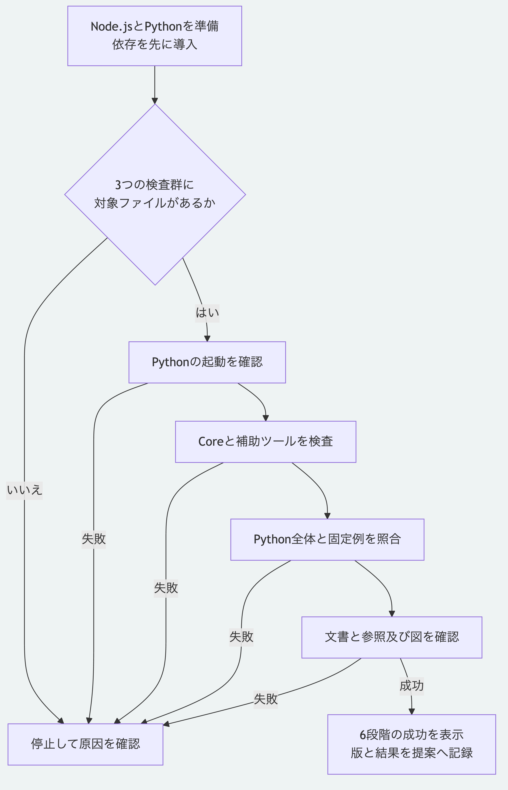

# 変更したSDKをローカルで検査する

変更を提案する前に、標準の保守検査を実行します。
[検査の入口](tools/check-maintenance.mjs)は、選択したPythonを参照照合にも渡し、最初の失敗で停止します。
以下は公開リポジトリの現在の`main`向けの手順です。

## 環境を準備する

Node.js 26.13.0以上とnpm、Python 3.14または3.15を用意します。
Node.jsの選択版は`.nvmrc`と`.node-version`の26.13.0です。
ソース取得と依存の導入は、[最初の手順](docs/tutorials/getting-started.md)も参照できます。
導入には通常通信が必要です。

リポジトリ直下で実行します。

```sh
node --version
python3 --version
npm ci --prefix packages/kernel --ignore-scripts --no-audit --no-fund
```

検査の入口は、導入済みの作業環境を使います。
Coreの配布監査には、一時領域へ配布物を導入して公開APIを確認する既存の検査が含まれます。

## 標準の6段階を実行する

```sh
node tools/check-maintenance.mjs --python python3
```

`--python`を省略すると、`MORIVYX_REFERENCE_PYTHON`に設定した実行ファイルを使い、未設定なら`python3`を使います。
複数のPythonを用意した場合は、それぞれの実行ファイルを指定して検査します。
空白を含むパスは、シェルで一つの引数として引用します。
次の仮のパスは、実在するPythonの実行ファイルへ置き換えます。

```sh
node tools/check-maintenance.mjs --python "/path with spaces/python3"
node tools/check-maintenance.mjs --help
```

| 段階 | 確認する内容 |
|---|---|
| 1 | 選択したPythonが起動すること |
| 2 | `npm test --prefix packages/kernel`によるCoreの全検査と、契約、固定例、配布及び実例の監査 |
| 3 | `tools/*.test.mjs`にある補助ツールの全検査。参照照合にも選択したPythonを使う |
| 4 | `packages/portable-core`の`test_*.py`にあるPythonの全検査 |
| 5 | `tools/check-portable-vectors.py`による固定した入力と期待結果の照合 |
| 6 | `tools/check-documentation.mjs`による文書の形式、相対参照と図の検査 |

各段階で`[1/6]`のように番号と名前を表示し、子コマンドの出力をそのまま表示します。
すべて成功すると、最後に次の行が出て終了コードが`0`になります。

```text
Maintenance checks passed: 6 stages.
```

検査数は版によって変わるため、入口で件数を固定しません。
3つの検査群には対象の通常ファイルがあることを事前確認します。
個別チュートリアルの実行確認は、[各手順](docs/tutorials/README.md)にあるコマンドで行います。

## 失敗した段階を確認する

最初に失敗した段階で停止し、後続の段階は実行しません。
その段階の番号、名前、子コマンドの診断と終了値を確認します。
子コマンドの数値の終了値は引き継ぎ、起動失敗や信号による終了では`1`、引数の不備では`2`を返します。
終了コードだけで理由を決めず、標準エラーに出る段階名も確認します。

| 状況 | 次に確認すること |
|---|---|
| `Python runtime`で停止 | 指定した実行ファイルが存在し、そのPythonが起動するか |
| `No test files found`か`Cannot enumerate test files` | ソース取得が途中でないか、対象の検査フォルダーを削除していないか |
| Coreか補助ツールで停止 | 表示された検査名と診断を確認し、その対象を単独で実行する |
| Pythonで停止 | 選択したPythonと、表示された失敗の入力を確認する |
| 文書で停止 | [文書の検査手順](docs/documentation-check.md)で形式、参照と図を確認する |

修正したら入口を再実行し、すべての段階が成功した版をPull Requestへ記録します。
提案には、解決した問題、変更した動作、対象コミット、実行コマンド、結果と未実行の範囲を記載してください。
この入口は、GitHub Actionsの起動、リリースの公開とサイト配備を行いません。



[図の生成元](docs/diagrams/local-maintenance.mmd)

[プロジェクトの入口](README.md)へ戻れます。
