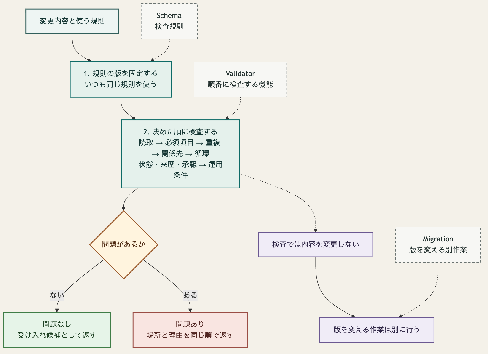

# ADR-0008: Schema の登録簿と Validator の契約

## 文脈

Stage 0 では、参照 Graph と serialization 検査値によって、Core Meta Model、Relation、lifecycle、approval、canonical form の判断を固定しました。
Stage 1 で Schema の登録簿と Validator を実装するには、Graph Revision が使う Schema の特定方法、複数の検査を行う順序、同じ入力に対する検査結果、Migration との責任境界を先に定める必要があります。

これらを定めない場合、実装ごとに未知の項目を無視する範囲、最初の問題で検査を止めるかどうか、複数の問題を返す順序、旧版を暗黙に変換するかどうかが変わります。

## 全体像

この判断の中心は、使う規則を先に固定し、内容を変更せずに決めた順序で検査することです。
問題がある場合は、場所と理由を同じ順序で返します。
版を変える作業は検査から分離します。

図中の用語は、次の意味です。

- 検査規則：Schema
- 順番に検査する機能：Validator
- 版を変える別作業：Migration

[Mermaid の生成元](../diagrams/adr-0008-schema-validator-flow.mmd)

## 決定

### 1. Schema の登録と固定

Schema の登録簿は、Schema ごとに次の情報を保持します。

- 名前空間付き Schema ID
- version
- Schema 内容の digest と digest 算法
- Schema が定義する Entity、Relation、属性、状態、要素数
- Schema を提供する Profile または package
- 読み取れる旧 version と、書き込む version の互換範囲

同じ Schema ID と version に異なる digest を登録しません。
Graph Revision は、解釈に必要なすべての Schema ID、version、digest を Schema 固定情報として保持します。
Validator は、固定情報と完全に一致する Schema だけを使い、登録簿の最新 version へ自動で置き換えません。

固定した Schema が取得できない場合、または登録済み digest と一致しない場合は、その Graph を検証済みとして扱いません。

### 2. Core と Extension の境界

`core` 名前空間の未知の型、属性、Relation、状態値は拒否します。
既知の Core 項目に Schema が許可しない値がある場合も拒否します。

名前空間付きの未知の Extension は、その名前空間、論理値、一覧順序を保持します。
未知の Extension の意味は推定せず、Core の Invariant に適合したものとしても扱いません。
対応する Schema が固定情報に含まれる Extension は未知として扱わず、その Schema で検査します。

### 3. Validator の検証順序

Validator は、固定した入力 Graph Revision と Schema 固定情報を受け取り、次の順序で検査します。

1. serialization と論理値の読取
2. Schema 固定情報の解決
3. GraphElement の必須項目、型、許容値
4. stable ID と Revision ID の形式および重複
5. Relation の接続先、接続型、要素数
6. Graph 全体の循環と重複 Relation
7. lifecycle、review state、Provenance、approval
8. 適用する Policy

入力を論理値として読めない場合は、その入力の読取失敗だけを返し、後続の検査を行いません。
読取後は、一つの問題を見つけても、独立して実行できる同じ段階と後続段階の検査を続けます。
前段の失敗によって判定不能な検査は推測した問題を返しません。

### 4. 検査結果

検査結果は、少なくとも次を持ちます。

| 項目 | 内容 |
|---|---|
| `valid` | 問題が零件かを示す真偽値 |
| `schemaLockDigest` | 使用した Schema 固定情報の digest |
| `graphRevision` | 検査対象の Graph Revision |
| `issues` | 検出した問題の一覧 |

各問題は、問題コード、検証段階、対象の stable ID、対象内の場所、関連する stable ID を持ちます。
問題コードは機械判定に使い、人間向け説明文は判定の同一性に使いません。

問題の順序は、検証段階、対象 stable ID、問題コード、対象内の場所、関連 stable ID の順で比較して固定します。
文字列の比較は NFC 正規化後の Unicode 符号位置順とします。
存在しない項目は空文字列として比較します。

同じ論理入力、同じ Graph Revision、同じ Schema 固定情報、同じ Policy 入力からは、同じ `valid`、問題コード、対象、場所、関連対象、問題順序を返します。
実行時刻、処理時間、実装固有の説明は検査結果の同一性に含めません。

Validator は入力 Graph、Schema 固定情報、Provenance、approval を変更しません。
登録簿の互換範囲は診断に使いますが、固定した Schema の自動置換または暗黙の変換を許可しません。

### 5. ADR-0006 の Schema と Invariant への対応

| ADR-0006 の決定 | Schema または Invariant の規則 | 検証段階 |
|---|---|---:|
| 明示 Relation と派生 Relation | 正規 Relation は Provenance を必須とし、派生物は規則 ID、規則版、入力 Graph Revision を必須とする | 7 |
| Decision の根拠と反証 | accepted Decision は一件以上の `supported_by` と、`challenged_by` または `challengeReview` を持つ | 5、7 |
| Verification と Criterion の要素数 | Verification は一件の `against` と一件以上の `evaluates` を持つ | 5 |
| Artifact Revision と Execution | Artifact Revision は一つの生成責任または取込 Provenance を持つ | 5、7 |
| Criterion と Learning の lifecycle | 許可した状態と状態遷移だけを受け入れる | 7 |
| `stale` の位置 | Artifact の lifecycle では拒否し、比較入力を持つ派生状態として扱う | 3、7 |
| approval の Provenance | Actor、対象 Revision、操作、範囲、時刻を必須とする | 7 |

要素数、接続型、許容状態は Profile の Schema で宣言します。
Graph 全体の到達可能性、循環、生成責任、approval の適用可能性は Invariant として検査します。
Policy によって変わる approval の必要条件は、固定した Policy 入力で検査します。

### 6. Migration との分離

Validator は旧 Schema の入力を新 Schema へ変換しません。
固定した Schema と入力の version が一致しない場合は問題として返します。

Migration は、変換元と変換先の Schema 固定情報を指定し、新しい ChangeSet を生成する別の処理です。
Migration 後の Graph は、変換先 Schema を使う Validator で改めて検査します。
Validator の実行だけでは Graph Revision、Revision ID、Provenance を変更しません。

## 結果

### 利点

- Graph Revision を解釈した Schema を後から再現できます。
- 未知の Core と未知の Extension を一貫して区別できます。
- 複数実装が同じ問題と順序を返せます。
- ADR-0006 の判断と検査規則を追跡できます。
- 検査と意味変更を分離し、暗黙の Migration を防げます。

### 負担

- Graph Revision ごとに Schema 固定情報を保持する必要があります。
- 一つの問題を検出した後も、判定可能な検査を続ける必要があります。
- Profile の Schema と Graph 全体の Invariant を別に管理する必要があります。
- 人間向け説明を変更しても、問題コードとの対応を維持する必要があります。

## 検証

- Schema と Validator の検査値（同梱対象外の参照）で、有効な Graph を問題零件として判定すること。
- Schema 違反、重複 stable ID、接続先がない Relation、禁止する循環を、それぞれ固定した問題コードで検出すること。
- 複数の問題を持つ入力について、問題一覧の順序が実装間で一致すること。
- 未知の Extension を保持し、未知の Core を拒否すること。
- Validator の前後で入力 Graph と Schema 固定情報が変わらないこと。
- 旧 Schema の入力を暗黙に Migration しないこと。

## 再検討条件

- 一つの問題が後続検査へ広く影響し、独立した問題だけを選別する費用が実装可能な範囲を超える場合。
- Unicode 符号位置順では複数実装の問題順序を一致させられない場合。
- Profile ごとの Schema 固定情報が大きく、Graph Revision ごとの再現性と運用費用を両立できない場合。
- Policy の結果を Validator の検査結果と分離しなければ、権限または機密の境界を守れない場合。
