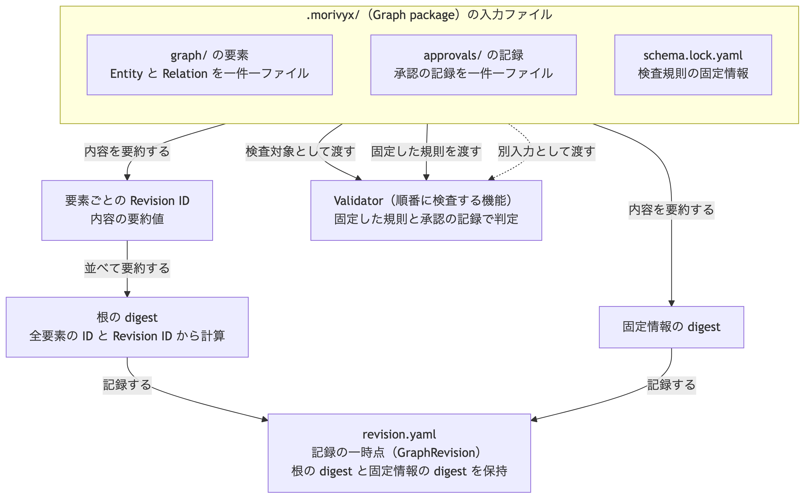

# ADR-0009: Graph package の配置と GraphRevision の記録

## 文脈

ADR-0007 と ADR-0008 で、GraphElement の保存形式、canonical form、Revision ID、Validator の契約を固定しました。
一方、シリアライズ戦略の Git 配置は案のままで、Schema 固定情報のファイル内容、approval の ProvenanceRecord の保存場所と形式、GraphRevision の記録、Graph の根の digest の計算方法は決まっていません。

これらを定めない場合、検査値へ完全な入力を追加できず、複数実装が同じ Graph package を読み書きできません。

## 全体像

この判断の中心は、一つの package の中で、要素の内容、使う検査規則、approval の記録を別のファイルとして固定し、内容の同一性を digest の連鎖で判定できるようにすることです。



図中の用語は、次の意味です。

- 検査規則の固定情報：Schema 固定情報
- 承認の記録：approval の ProvenanceRecord
- 記録の一時点：GraphRevision

[Mermaid の生成元](../diagrams/adr-0009-package-digests.mmd)

## 決定

### 1. ファイル配置

Stage 1 の Graph package は、リポジトリ内の `.morivyx/` に次の配置で保存します。

```text
.morivyx/
  schema.lock.yaml
  revision.yaml
  graph/
    entities/
      <uuid>.yaml
    relations/
      <uuid>.yaml
  approvals/
    <uuid>.yaml
  ledger/
    <changeset-id>.yaml
```

- 一つのファイルに一つの記録だけを保存します。
- すべてのファイルに ADR-0007 の Git authoring profile の入力制限を適用します。
- ファイル名の `<uuid>` は、記録の stable ID から `urn:uuid:` を除いた小文字の UUID です。
- ファイルの場所と名前は同一性ではなく、既定の探索場所です。同一性は記録内の stable ID で判定します。
- `project.yaml`、`plugins.lock.yaml`、`policies/`、`recipes/`、`artifact-manifests/` は、必要になった段階の決定で追加します。
- `ledger/` の ChangeSet の保存形式は、別の決定で固定します。

### 2. Schema 固定情報

`schema.lock.yaml` は、次の項目をこの順序で持ちます。

| 項目 | 必須 | 内容 |
|---|---|---|
| `format` | 必須 | `morivyx.schema-lock/0.1` |
| `stableIdScheme` | 必須 | stable ID の方式。Stage 1 は `urn-uuid-v4` |
| `digestAlgorithm` | 必須 | digest 算法 ID。Stage 1 は `sha256` |
| `schemas` | 必須 | 固定した Schema の一覧 |

`schemas` の各要素は `schemaId`、`version`、`digest` をこの順序で持ちます。
一覧は `schemaId`、`version` の順で、NFC 正規化後の Unicode 符号位置の昇順に並べ、重複を拒否します。

Schema 固定情報の digest は、`schema.lock.yaml` の論理値の canonical form から計算し、ADR-0008 の検査結果の `schemaLockDigest` に使います。

#### UUID の版4を継続する理由と十分性

以下は、2026-09-08の人間による確認で求められた、現在の要件に対する採用根拠の補足です。
ADR-0007 の方式を変更するものではなく、採用当時に記録されていない判断経緯を示すものでもありません。

stable ID に必要なのは、内容や保存場所が変わっても同じ対象を指し、中央の発行サービスへの接続なしに生成できることです。
内容の同一性は Revision ID と digest で、記録時刻は Provenance の項目で別に扱います。
Stage 1 の Git 上のファイル保存では、ID 自体から作成順を得ることや、データベースの索引への挿入順を最適化することを要件にしていません。
UUID の版4はこの識別用途を満たすため、時刻順の機能を追加するためだけに既存の方式を変える必要はありません。

[RFC 9562 の第5.4節](https://www.rfc-editor.org/rfc/rfc9562.html#section-5.4)で定める版4は、版と形式を示すビットを除く122ビットを乱数に使います。
衝突しにくさは、生成側が適切な乱数を使うことを前提とし、絶対に重複しないという保証ではありません。
乱数生成には、[同規格の第6.9節](https://www.rfc-editor.org/rfc/rfc9562.html#section-6.9)が推奨する暗号学的に安全な疑似乱数生成器を使うことが前提です。
現在の Decision 作成処理は呼出側から ID を受け取り、版4の形式と、既存 Graph の ID などとの重複を検査します。
この検査は乱数の品質や、まだ取り込んでいない別の Graph における一意性を証明しません。
ID は識別子であり、本人確認や操作の許可の根拠にも使いません。

したがって「版4で事足りる」は、適切な生成と重複検査を前提に、現在の識別要件に不足がないという設計上の判断です。
今回の確認で、大規模運用の衝突率や性能を実測したという意味ではありません。

[同規格の第5.7節](https://www.rfc-editor.org/rfc/rfc9562.html#section-5.7)の版7は、ミリ秒単位の時刻を含み、時刻順に並べられる方式です。
版7も中央の発行サービスなしに生成できるため、その点は版4だけの利点ではありません。
将来、ID 自体の時刻順やデータベースの索引性能が必要になった場合、または版4の生成品質や衝突対策が運用要件を満たさない場合は、版7を含む方式を再検討します。
方式変更は互換性と移行方法を含めた別の ADR で決定し、この補足によって既存 ID を振り直すことはしません。

### 3. approval の記録

approval の ProvenanceRecord は、対象の GraphElement に埋め込まず、`approvals/` の下へ一件ずつ保存します。
各記録は、次の項目をこの順序で持ちます。

| 項目 | 必須 | 内容 |
|---|---|---|
| `format` | 必須 | `morivyx.approval/0.1` |
| `id` | 必須 | 記録自身の stable ID |
| `actor` | 必須 | approval を行った Actor の stable ID |
| `targetId` | 必須 | 対象の stable ID |
| `targetRevision` | 必須 | 対象の Revision ID |
| `operation` | 必須 | 許可した操作または状態遷移 |
| `scope` | 必須 | 適用範囲と条件 |
| `approvedAt` | 必須 | approval を行った時間 |
| `recordedAt` | 必須 | Morivyx に記録した時間 |
| `expiresAt` | 任意 | 有効期限 |
| `revokes` | 任意 | 撤回する approval 記録の stable ID |

記録は変更せず、撤回と失効は `revokes` を持つ新しい記録として追加します。
approval の記録は、ADR-0007 のとおり対象の canonical form に含めず、Validator の検証段階7への別入力とします。

### 4. GraphRevision の記録

`revision.yaml` は、検証済み Graph の一時点を記録し、次の項目をこの順序で持ちます。

| 項目 | 必須 | 内容 |
|---|---|---|
| `format` | 必須 | `morivyx.graph-revision/0.1` |
| `id` | 必須 | `graph:` で始まる不透明な GraphRevision ID |
| `parentRevision` | 必須 | 親の GraphRevision ID。最初の記録は `null` |
| `rootDigest` | 必須 | Graph の根の digest |
| `schemaLockDigest` | 必須 | Schema 固定情報の digest |

GraphRevision ID には場所、型、意味を埋め込みません。
内容の同一性は `rootDigest` で判定し、ID の一致だけを根拠にしません。
`parentRevision` は Schema が `null` を許可する唯一の項目です。

### 5. Graph の根の digest

Graph の根の digest は、次の手順で計算します。

1. package 内のすべての Entity と Relation について、stable ID と Revision ID の二要素一覧 `["<stable ID>", "<Revision ID>"]` を作る。
2. 一覧を、stable ID の NFC 正規化後の Unicode 符号位置の昇順に並べ、一覧の一覧とする。
3. その canonical form の前に、用途の接頭辞と一バイトの `00` を結合し、digest 算法を適用する。

approval の記録と `ledger/` は、根の digest の入力に含めません。
approval の追加は Graph の内容を変えず、検証段階7の判定だけを変えます。

### 6. digest の接頭辞

digest の用途は、`ASCII` の接頭辞と一バイトの `00` で区別し、相互に流用しません。

| 用途 | 接頭辞 |
|---|---|
| Revision ID | `morivyx:revision:v1` |
| Graph の根 | `morivyx:root:v1` |
| Schema 固定情報 | `morivyx:schema-lock:v1` |

いずれも Stage 1 の算法は SHA-256 とし、値は `sha256:` と小文字の64桁16進数で表します。

## 結果

### 利点

- 複数実装が同じ配置から同じ Graph package を読み書きできます。
- 要素、検査規則、approval、一時点の記録の責任がファイル単位で分かれます。
- 根の digest により、Graph の内容の同一性を要素の Revision ID から再現できます。
- approval の追加が要素の Revision と根の digest を変えないため、承認と内容変更を分離できます。
- 検査値へ完全な入力を追加できます。

### 負担

- 記録の種類ごとに `format` と項目順を維持する必要があります。
- 要素数に比例して小さなファイルが増えます。
- 根の digest の再計算には package 内の全要素の Revision ID が必要です。

## 検証

- 同じ package から同じ根の digest と Schema 固定情報の digest を得ること。
- 要素の追加、改訂、削除で根の digest が変わること。
- approval の記録の追加で根の digest が変わらないこと。
- 三つの接頭辞が異なる digest を生成すること。
- 検査値の文書に、この決定に基づく完全な入力と正解を追加すること。

## 再検討条件

- 大量の小ファイルが Git の性能要件を満たさず、bundle codec が必要になった場合。
- 一つの package に複数の GraphRevision の記録を並行して保持する必要が生じた場合。
- approval の外部正本があり、記録の追加だけでは失効状態を追跡できない場合。
- 根の digest の入力に approval を含めなければ、必要な監査要件を満たせない場合。
