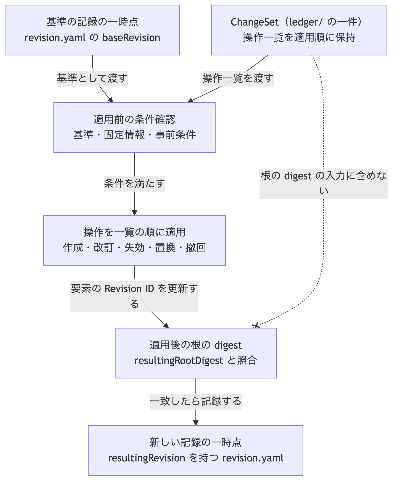

# ADR-0010: ChangeSet の保存形式と適用規則

## 文脈

ADR-0009 で Graph package の配置を固定しましたが、`ledger/` の ChangeSet の保存形式は別の決定へ先送りしました。
用語集では ChangeSet を「一つの基準 Graph Revision に対する、まとめて検証し適用する変更提案」と定義しています。
ADR-0003 は、検証済み操作を一つの原子的な ChangeSet として採択すると定めています。

一方、ファイルの項目、操作の種類、適用前後の GraphRevision との対応、digest の計算方法は決まっていません。
これらを定めない場合、複数実装が同じ変更単位を読み書きできません。

## 全体像

この判断の中心は、基準となる一時点から次の一時点へ移る操作を一件の ChangeSet にまとめ、適用の前後を GraphRevision の記録と digest で検証できるようにすることです。

[Mermaid の生成元](../diagrams/adr-0010-changeset-apply.mmd)

## 決定

### 1. ファイル配置と識別

ChangeSet は `.morivyx/ledger/` の下へ一件一ファイルで保存します。
ファイル名は、ChangeSet の stable ID から `urn:uuid:` を除いた小文字の UUID に `.yaml` を付けたものです。

- 一つのファイルに一つの ChangeSet だけを保存します。
- すべてのファイルに ADR-0007 の Git authoring profile の入力制限を適用します。
- ファイルの場所と名前は同一性ではなく、既定の探索場所です。
- ChangeSet は根の digest の入力に含めません。ADR-0009 の決定を維持します。

### 2. ChangeSet の項目

各 ChangeSet は、次の項目をこの順序で持ちます。

| 項目 | 必須 | 内容 |
|---|---|---|
| `format` | 必須 | `morivyx.changeset/0.1` |
| `id` | 必須 | ChangeSet 自身の stable ID |
| `baseRevision` | 必須 | 基準となる GraphRevision ID |
| `resultingRevision` | 必須 | 適用後の GraphRevision ID |
| `resultingRootDigest` | 必須 | 適用後の Graph の根の digest |
| `schemaLockDigest` | 必須 | 適用時に使う Schema 固定情報の digest |
| `operations` | 必須 | 操作の一覧。一件以上 |
| `provenance` | 必須 | ADR-0006 が定める ProvenanceRecord |
| `recordedAt` | 必須 | Morivyx に記録した時間 |

`operations` の各要素は、次の項目をこの順序で持ちます。

| 項目 | 必須 | 内容 |
|---|---|---|
| `op` | 必須 | 操作の種類 |
| `targetId` | 必須 | 対象の stable ID |
| `beforeRevision` | 条件付き | 適用前の対象 Revision ID |
| `afterRevision` | 条件付き | 適用後の対象 Revision ID |
| `replacementId` | 条件付き | 置換後の対象の stable ID |

一覧の順序は、操作の適用順です。canonical form でもこの順序を保ちます。

### 3. 操作の種類

`op` の値と必須項目は、次のとおりです。

| `op` | 意味 | `beforeRevision` | `afterRevision` | `replacementId` |
|---|---|---|---|---|
| `create` | 対象を新たに追加する | 置かない | 必須 | 置かない |
| `revise` | 既存対象の内容を改訂する | 必須 | 必須 | 置かない |
| `retire` | 既存対象を失効させる | 必須 | 置かない | 置かない |
| `replace` | 既存対象を別の stable ID へ置き換える | 必須 | 必須 | 必須 |
| `revoke` | 未適用の ChangeSet を撤回する | 置かない | 置かない | 置かない |

`revoke` の `targetId` は、撤回する ChangeSet の stable ID です。
`revoke` を含む ChangeSet は、他の操作と混在させません。
`replace` の `afterRevision` は、`replacementId` が指す対象の Revision ID です。

### 4. 適用規則

ChangeSet の適用は、次の条件をすべて満たす場合にだけ成功します。

1. `baseRevision` が、現在の `revision.yaml` の `id` と一致する。
2. `schemaLockDigest` が、現在の Schema 固定情報の digest と一致する。
3. 各操作の事前条件が成立する。
   - `create`: `targetId` が package に存在しない。
   - `revise` と `retire`: `targetId` が存在し、現在の Revision ID が `beforeRevision` と一致する。
   - `replace`: 置き換え元が存在し、`beforeRevision` が一致し、`replacementId` が存在しない。
   - `revoke`: 対象の ChangeSet が未適用である。
4. 操作を一覧の順に適用した結果の根の digest が、`resultingRootDigest` と一致する。
5. 新しい `revision.yaml` の `id` が `resultingRevision` と一致し、`parentRevision` が `baseRevision` と一致する。

適用は原子的です。途中の操作だけを残しません。
適用済みの ChangeSet は変更せず、誤りは新しい ChangeSet で訂正します。

### 5. ChangeSet の digest

ChangeSet の digest は、次の手順で計算します。

1. ChangeSet の論理値から `id` 以外の項目を入力とし、canonical form を作る。
2. その前に、用途の接頭辞 `morivyx:changeset:v1` と一バイトの `00` を結合する。
3. digest 算法を適用し、値を `sha256:` と小文字の64桁16進数で表す。

`id` を入力から除く理由は、記録自身の識別と、ID 以外の内容の照合を分けるためです。
UUID の版4は内容 digest から生成しないため、入力に含めても循環参照にはなりません。
同じ内容へ異なる ChangeSet ID を付けても、内容 digest は変わりません。
ここでいう内容には、操作だけでなく、基準と結果の版、Provenance、記録時刻も含めます。
Stage 1 では、ChangeSet の stable ID は UUID の版4を小文字の `urn:uuid:` 表記にします。
digest は検査値と相互運用の照合に使い、ファイル名には使いません。

| 用途 | 接頭辞 |
|---|---|
| ChangeSet | `morivyx:changeset:v1` |

## 結果

### 利点

- 複数実装が同じ変更単位を読み書きできます。
- 適用前後を GraphRevision と根の digest で検証できます。
- 操作の種類と必須項目が固定されるため、不完全な変更提案を拒否できます。
- ChangeSet を根の digest から分離したまま、変更履歴を追跡できます。

### 負担

- 適用のたびに新しい GraphRevision の記録が必要です。
- 操作一覧の順序を意味として扱うため、同じ集合でも順序が違えば別の ChangeSet になります。
- `revoke` は未適用の ChangeSet だけを対象とし、適用済みの訂正は別操作で行います。

## 検証

- 同じ ChangeSet から同じ digest を得ること。
- 正しい操作一覧の適用で、`resultingRootDigest` と新しい GraphRevision が一致すること。
- `baseRevision` または `schemaLockDigest` の不一致で適用が失敗すること。
- `revise` で `beforeRevision` が現在値と異なる場合に適用が失敗すること。
- `revoke` と他操作の混在を拒否すること。
- 検査値の文書に、この決定に基づく入力と正解を追加すること。

## 再検討条件

- 一つの ChangeSet が扱える操作数が、実務の一括取込を恒常的に超える場合。
- 適用済み ChangeSet の部分撤回が、監査要件として必要になった場合。
- ChangeSet の digest をファイル名または外部参照の主キーにする必要が生じた場合。
