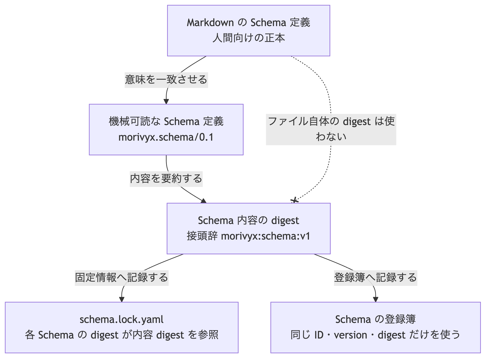

# ADR-0011: Schema 定義の正規 serialization と内容 digest

## 文脈

ADR-0008 は、登録簿が Schema 内容の digest を保持すると定めています。
ADR-0009 の Schema 固定情報も、各 Schema の `digest` を参照します。
Core Schema 0.1 は、内容 digest を「実装が定める正規 serialization」から算出すると書いています。

一方、正規 serialization 自体が決まっていないため、Graph package 検査値では検査用の固定値を使っています。
このままでは、複数実装が同じ Schema 内容から同じ digest を計算できません。

## 全体像

この判断の中心は、人間が読む Markdown の正本とは別に、登録と照合に使う機械可読な Schema 定義を定め、その論理値から内容 digest を計算することです。



[Mermaid の生成元](../diagrams/adr-0011-schema-definition-digest.mmd)

## 決定

### 1. 正本と機械可読表現の役割

- 人間向けの説明と論証の正本は、従来どおり Markdown の Schema 定義文書とします。
- 登録簿と Schema 固定情報が照合する digest の入力は、この決定が定める機械可読な Schema 定義とします。
- Markdown 文書ファイル自体のバイト列の digest は、Schema 内容の digest として使いません。
- 機械可読な Schema 定義は、対応する Markdown 正本と意味上一致しなければなりません。不一致がある場合は、正本を直してから digest を再計算します。

### 2. ファイル配置と保存形式

Stage 1 の機械可読な Schema 定義は、一件一ファイルで保存します。
既定の探索場所は次です。

```text
.morivyx/
  schemas/
    <schemaId>@<version>.yaml
```

`<schemaId>` の `.` はファイル名ではそのまま使います。
すべてのファイルに ADR-0007 の Git authoring profile の入力制限を適用します。

各 Schema 定義は、次の項目をこの順序で持ちます。

| 項目 | 必須 | 内容 |
|---|---|---|
| `format` | 必須 | `morivyx.schema/0.1` |
| `schemaId` | 必須 | 名前空間付き Schema ID |
| `version` | 必須 | Schema の version |
| `stableIdScheme` | 必須 | stable ID の方式。Stage 1 は `urn-uuid-v4` |
| `digestAlgorithm` | 必須 | digest 算法 ID。Stage 1 は `sha256` |
| `reviewStates` | 必須 | 許可する review state の一覧 |
| `entityTypes` | 必須 | Entity 型の一覧。空を許可する |
| `relationTypes` | 必須 | Relation 型の一覧。空を許可する |
| `authoringOrders` | 必須 | 既知の対応表の項目順 |

`reviewStates` は、NFC 正規化後の Unicode 符号位置の昇順に並べ、重複を拒否します。

`entityTypes` の各要素は、次の項目をこの順序で持ちます。

| 項目 | 必須 | 内容 |
|---|---|---|
| `typeId` | 必須 | 名前空間付き型 ID |
| `requiredAttributes` | 必須 | 必須属性名の一覧。空を許可する |
| `optionalAttributes` | 任意 | 任意属性名の一覧。空のときは項目自体を置かない |
| `lifecycle` | 必須 | 許可する lifecycle 値の一覧 |

一覧は `typeId` の昇順に並べ、重複を拒否します。
`requiredAttributes`、`optionalAttributes`、`lifecycle` もそれぞれ昇順に並べ、重複を拒否します。
`optionalAttributes` を省略した論理値は、空の一覧として扱います。

`relationTypes` の各要素は、次の項目をこの順序で持ちます。

| 項目 | 必須 | 内容 |
|---|---|---|
| `predicate` | 必須 | Relation の型名 |
| `sourceTypes` | 必須 | 接続元として許可する型 ID の一覧 |
| `targetTypes` | 必須 | 接続先として許可する型 ID の一覧 |
| `minCount` | 必須 | 許可する最小要素数。0 以上の整数 |
| `maxCount` | 必須 | 許可する最大要素数。整数、または上限なしを示す `null` |
| `cycle` | 必須 | `forbidden`、`allowed`、`not_applicable` |

一覧は `predicate` の昇順に並べ、重複を拒否します。
`sourceTypes` と `targetTypes` もそれぞれ昇順に並べ、重複を拒否します。
`maxCount` は Schema が `null` を許可する項目です。

`authoringOrders` は、次の項目をこの順序で持ちます。

| 項目 | 必須 | 内容 |
|---|---|---|
| `root` | 必須 | GraphElement 根の項目順 |
| `attributes` | 必須 | 型共通の `attributes` 内の既知項目順。空を許可する |
| `provenance` | 必須 | `provenance` 内の項目順 |

各一覧の順序は、Git authoring profile で強制する項目順そのものです。

### 3. 内容 digest

Schema 内容の digest は、次の手順で計算します。

1. Schema 定義の論理値の canonical form を作る。
2. その前に、用途の接頭辞 `morivyx:schema:v1` と一バイトの `00` を結合する。
3. digest 算法を適用し、値を `sha256:` と小文字の64桁16進数で表す。

canonical form は ADR-0007 と同じ規則です。
対応表の項目名は NFC 正規化後の Unicode 符号位置で並べます。
集合として定義した一覧は、各要素の canonical form のバイト順に並べます。

| 用途 | 接頭辞 |
|---|---|
| Schema 内容 | `morivyx:schema:v1` |

この接頭辞は、Revision ID、Graph の根、Schema 固定情報、ChangeSet の接頭辞と区別し、相互に流用しません。

### 4. Schema 固定情報との関係

ADR-0009 の `schemas[].digest` は、この決定が定める Schema 内容の digest を指します。
Schema 固定情報の digest（`morivyx:schema-lock:v1`）は、固定情報ファイル全体の digest であり、個々の Schema 内容の digest ではありません。

同じ `schemaId` と `version` に異なる内容 digest を登録しません。
内容 digest が登録簿または固定情報と一致しない Schema 定義は、検証に使いません。

## 結果

### 利点

- 複数実装が同じ Schema 内容から同じ digest を計算できます。
- Markdown 正本の表記差を、登録 digest の差にしません。
- Schema 固定情報の各 `digest` の意味が固定されます。

### 負担

- Markdown 正本と機械可読な Schema 定義の両方を維持する必要があります。
- Core Schema 0.1 全体の機械可読 serialization は、この決定の後続作業として別途追加します。

## 検証

- 同じ Schema 定義から同じ内容 digest を得ること。
- 属性一覧の順序だけを変えても、canonical form と内容 digest が変わらないこと。
- 属性名または型の追加で内容 digest が変わること。
- Schema 固定情報の digest と Schema 内容の digest が異なる接頭辞で計算されること。
- 検査値の文書に、最小の Schema 定義と正解 digest を記録すること。

## 再検討条件

- Schema 定義に Policy や Migration 規則を埋め込む必要が生じ、項目集合が不足する場合。
- 機械可読表現を Markdown から完全自動生成でき、二重維持が不要になった場合。
- Schema 内容の一部だけを差し替える部分 digest が必要になった場合。
