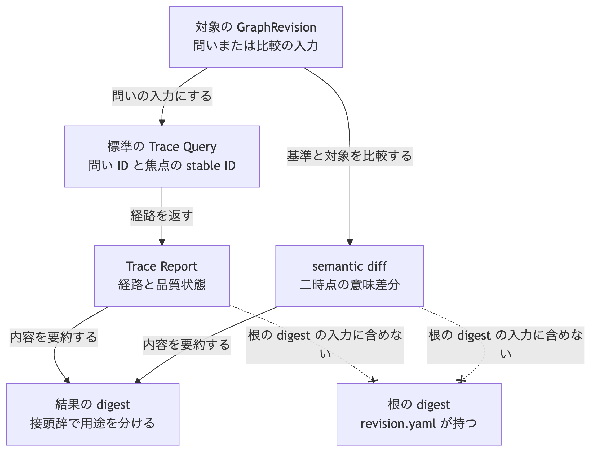

# ADR-0012: Trace Query と semantic diff の結果契約

## 文脈

Stage 1 は Trace Query、semantic diff、決定的な Report を能力として挙げています。
設計文書には標準の問いと、semantic diff として提示すべき変化の種類があります。

一方、問いの識別子、入力条件、結果の項目、一覧の並び順、digest の計算方法は決まっていません。
ChangeSet は操作単位を固定しましたが、操作一覧だけでは Trace の品質変化や Decision の根拠変更を同じ形で比較できません。
これらを定めない場合、複数実装が同じ Graph Revision に対して同じ Trace Report や意味差分を返せません。

## 全体像

この判断の中心は、問いまたは二時点の比較から得た結果を決定的な Report として固定し、根の digest には含めずに digest で照合できるようにすることです。

[Mermaid の生成元](../diagrams/adr-0012-trace-query-semantic-diff.mmd)

## 決定

### 1. 結果の役割と保存

Trace Query の結果と semantic diff の結果は、どちらも Report です。
managed Projection であり、正規 Graph ではありません。

- 結果は Graph を変更しません。
- 結果は根の digest の入力に含めません。ADR-0009 の決定を維持します。
- 結果をファイルへ残す場合の既定の探索場所は `.morivyx/reports/` です。一件一ファイルとします。
- ファイルの場所と名前は同一性ではなく、既定の探索場所です。
- すべてのファイルに ADR-0007 の Git authoring profile の入力制限を適用します。

保存しない計算結果でも、この決定が定める項目と digest の規則に従います。

### 2. 標準の Trace Query

Stage 1 の標準の問い ID は、次の5件に限ります。

| 問い ID | 焦点の型 | 代表的な経路 |
|---|---|---|
| `why-artifact-exists` | Artifact | `Artifact ← produces ← Execution → Plan → Goal` |
| `governing-decision` | Artifact | `Artifact ← governs ← Decision` |
| `decision-evidence` | Decision | `Decision → supported_by / challenged_by` |
| `goal-achievement-evidence` | Goal | `Goal → Criterion ← Verification → Observation` |
| `observation-triggered-change` | Observation | `Observation ← derived_from ← Learning → triggers` |

未知の問い ID は拒否します。
拡張の問いは、この5件の外で別の Schema または Profile が定義します。

各 Trace Query の入力は、次の項目をこの順序で持ちます。

| 項目 | 必須 | 内容 |
|---|---|---|
| `queryId` | 必須 | 上表の問い ID |
| `graphRevision` | 必須 | 問いを評価する GraphRevision ID |
| `schemaLockDigest` | 必須 | 評価時に使う Schema 固定情報の digest |
| `focusId` | 必須 | 経路の起点となる stable ID |
| `evaluatedAt` | 必須 | 評価時刻。`recordedAt` と同じ時刻形式 |

`graphRevision` が指す記録の Schema 固定情報 digest と、入力の `schemaLockDigest` が一致しない場合は評価しません。

### 3. Trace Report の項目

Trace Report は、次の項目をこの順序で持ちます。

| 項目 | 必須 | 内容 |
|---|---|---|
| `format` | 必須 | `morivyx.trace-report/0.1` |
| `id` | 任意 | Report 自身の stable ID。保存する場合に置く |
| `queryId` | 必須 | 評価した問い ID |
| `graphRevision` | 必須 | 評価した GraphRevision ID |
| `schemaLockDigest` | 必須 | 評価時の Schema 固定情報の digest |
| `focusId` | 必須 | 起点の stable ID |
| `evaluatedAt` | 必須 | 評価時刻 |
| `status` | 必須 | 品質状態 |
| `paths` | 必須 | 見つかった経路の一覧。空を許可する |
| `missing` | 必須 | 欠落した要求の識別子一覧。空を許可する |
| `waiverDecisionId` | 条件付き | `status` が `waived` のとき必須 |

`status` の値は次に限ります。

| 値 | 意味 |
|---|---|
| `complete` | 必須の Trace と Provenance がそろっている |
| `partial` | draft として許容される欠落がある |
| `waived` | 免除 Decision によって欠落を期限付きで許容している |
| `stale` | 記録した外部 Artifact の digest または版が、評価時点の比較値と一致しない |
| `broken` | 接続先がない参照、失効した Schema、矛盾する要素数がある |

`stale` は Artifact または参照の lifecycle ではありません。
外部対象の取得手順そのものはこの決定の範囲外とし、記録値と比較値と評価時刻から導出する状態としてだけ定義します。

`paths` の各要素は、次の項目をこの順序で持ちます。

| 項目 | 必須 | 内容 |
|---|---|---|
| `hops` | 必須 | ホップの一覧。一件以上 |

各ホップは、次の項目をこの順序で持ちます。

| 項目 | 必須 | 内容 |
|---|---|---|
| `fromId` | 必須 | 接続元の stable ID |
| `predicate` | 必須 | Relation の型名 |
| `toId` | 必須 | 接続先の stable ID |
| `fromRevision` | 必須 | 接続元の Revision ID |
| `toRevision` | 必須 | 接続先の Revision ID |

一つの経路内の `hops` は、問いがたどる順です。
複数経路がある場合、`paths` は各経路の canonical form のバイト順に並べます。
`missing` は NFC 正規化後の Unicode 符号位置の昇順に並べ、重複を拒否します。

### 4. semantic diff の入力と比較単位

semantic diff の主入力は、同じ Schema 固定情報を使う二つの GraphRevision です。

| 項目 | 必須 | 内容 |
|---|---|---|
| `baseRevision` | 必須 | 比較の基準となる GraphRevision ID |
| `targetRevision` | 必須 | 比較の対象となる GraphRevision ID |
| `schemaLockDigest` | 必須 | 比較時に使う Schema 固定情報の digest |
| `evaluatedAt` | 必須 | 評価時刻 |

基準側と対象側の記録が持つ Schema 固定情報 digest と、入力の `schemaLockDigest` が一致しない場合は比較しません。

代替入力として、一件の ChangeSet の stable ID を渡せます。
その場合の結果は、その ChangeSet の `baseRevision` と `resultingRevision` を主入力とした結果と一致しなければなりません。
ChangeSet の操作一覧そのものを semantic diff の正本とはしません。

### 5. semantic diff の項目

semantic diff の結果は、次の項目をこの順序で持ちます。

| 項目 | 必須 | 内容 |
|---|---|---|
| `format` | 必須 | `morivyx.semantic-diff/0.1` |
| `id` | 任意 | Report 自身の stable ID。保存する場合に置く |
| `baseRevision` | 必須 | 基準の GraphRevision ID |
| `targetRevision` | 必須 | 対象の GraphRevision ID |
| `schemaLockDigest` | 必須 | 比較時の Schema 固定情報の digest |
| `evaluatedAt` | 必須 | 評価時刻 |
| `entries` | 必須 | 差分項目の一覧。空を許可する |

`entries` の各要素は、次の項目をこの順序で持ちます。

| 項目 | 必須 | 内容 |
|---|---|---|
| `kind` | 必須 | 差分の種類 |
| `targetId` | 必須 | 主対象の stable ID |
| `beforeRevision` | 条件付き | 基準側の Revision ID |
| `afterRevision` | 条件付き | 対象側の Revision ID |
| `replacementId` | 条件付き | 置換後の stable ID |
| `aspect` | 条件付き | 同じ対象内の変化側面 |
| `queryId` | 条件付き | Trace 品質の変化で評価した問い ID |
| `beforeStatus` | 条件付き | 基準側の Trace 品質状態 |
| `afterStatus` | 条件付き | 対象側の Trace 品質状態 |

`kind` の値と必須項目は、次のとおりです。

| `kind` | 意味 | 追加の必須項目 |
|---|---|---|
| `entity_added` | Entity の追加 | `afterRevision` |
| `entity_revised` | Entity の改訂 | `beforeRevision`、`afterRevision` |
| `entity_retired` | Entity の失効 | `beforeRevision` |
| `entity_replaced` | Entity の置換 | `beforeRevision`、`afterRevision`、`replacementId` |
| `relation_added` | Relation の追加 | `afterRevision` |
| `relation_revised` | Relation の改訂 | `beforeRevision`、`afterRevision` |
| `relation_retired` | Relation の失効 | `beforeRevision` |
| `decision_changed` | Decision の選択、根拠、影響範囲の変更 | `beforeRevision`、`afterRevision`、`aspect` |
| `goal_changed` | Goal の Criterion または達成評価の変更 | `beforeRevision`、`afterRevision`、`aspect` |
| `trace_quality_changed` | Trace の品質状態の変化 | `queryId`、`beforeStatus`、`afterStatus` |
| `provenance_changed` | Provenance の変更 | `beforeRevision`、`afterRevision` |
| `external_digest_changed` | 外部 digest または版の変更 | `beforeRevision`、`afterRevision` |
| `schema_changed` | Schema の version の変更 | なし。`targetId` は Schema ID |
| `unknown_extension_changed` | 未知 Extension の保持内容の変更 | `beforeRevision`、`afterRevision` |

`decision_changed` の `aspect` は `selection`、`evidence`、`scope` のいずれかに限ります。
`goal_changed` の `aspect` は `criterion`、`achievement` のいずれかに限ります。

同じ属性の競合、削除と編集の競合、Decision の選択競合、Relation の Invariant 違反は、semantic diff では検出対象であり、自動で後勝ちにしません。

`entries` の並びは、次のキーをこの順に比較した昇順です。

1. `kind` を上表の定義順で比較する
2. `targetId`
3. `aspect`。無い場合は空文字として扱う
4. `queryId`。無い場合は空文字として扱う
5. `beforeRevision`。無い場合は空文字として扱う
6. `afterRevision`。無い場合は空文字として扱う
7. `replacementId`。無い場合は空文字として扱う

文字列比較は、NFC 正規化後の Unicode 符号位置順です。

### 6. 結果の digest

Trace Report と semantic diff の digest は、次の手順で計算します。

1. 結果の論理値から `id` 以外の項目を入力とし、canonical form を作る。
2. その前に、用途の接頭辞と一バイトの `00` を結合する。
3. digest 算法を適用し、値を `sha256:` と小文字の64桁16進数で表す。

canonical form は ADR-0007 と同じ規則です。

| 用途 | 接頭辞 |
|---|---|
| Trace Report | `morivyx:trace-report:v1` |
| semantic diff | `morivyx:semantic-diff:v1` |

これらの接頭辞は、Revision ID、Graph の根、Schema 固定情報、ChangeSet、Schema 内容の接頭辞と区別し、相互に流用しません。
`id` を入力から除く理由は、記録自身の識別と、ID 以外の内容の照合を分けるためです。
UUID の版4は内容 digest から生成しないため、入力に含めても循環参照にはなりません。
同じ内容へ異なる Report ID を付けても、内容 digest は変わりません。
評価時刻も入力に含むため、評価時点そのものが異なる結果を同じ内容とは扱いません。

### 7. 他決定との境界

- ChangeSet は適用単位です。semantic diff は比較結果です。一方を他方の代わりにしません。
- Migration は semantic diff を計画表示に使えますが、Migration の保存形式はこの決定の範囲外です。
- Validator の検査結果形式は ADR-0008 の対象であり、この決定の Report 形式へ混ぜません。
- Trace Report と semantic diff は、根の digest と Schema 固定情報の digest を計算する入力に含めません。

## 結果

### 利点

- 複数実装が同じ問いと入力から同じ Trace Report を返せます。
- 二時点の意味差分を同じ項目と並びで照合できます。
- ChangeSet の操作一覧では表しにくい Trace 品質と根拠変化を、共通の結果形で扱えます。
- 結果を根の digest から分離したまま、digest で相互運用できます。

### 負担

- 標準の問い ID と差分種別を増やすたびに、この契約の改訂が必要です。
- Trace Report と semantic diff の両方を実装し、並び規則を守る必要があります。
- `stale` の比較値を得る取得機構は、別の決定が必要です。

## 検証

- 同じ入力から同じ Trace Report と、同じ digest を得ること。
- 同じ二時点から同じ semantic diff と、同じ digest を得ること。
- ChangeSet を代替入力にした結果が、その適用前後の GraphRevision 比較と一致すること。
- 未知の問い ID または未知の `kind` を拒否すること。
- `status` が `waived` のとき `waiverDecisionId` が無い結果を拒否すること。
- 検査値の文書に、この決定に基づく入力と正解を追加すること。

## 再検討条件

- 標準の問いが5件では実務の監査要求を恒常的に満たせない場合。
- semantic diff の `kind` が粗く、競合解消の判断に不足する場合。
- Report を根の digest へ含める必要が生じた場合。
- Migration の計画形式が、この semantic diff 形式では表現できない変換を要求する場合。
