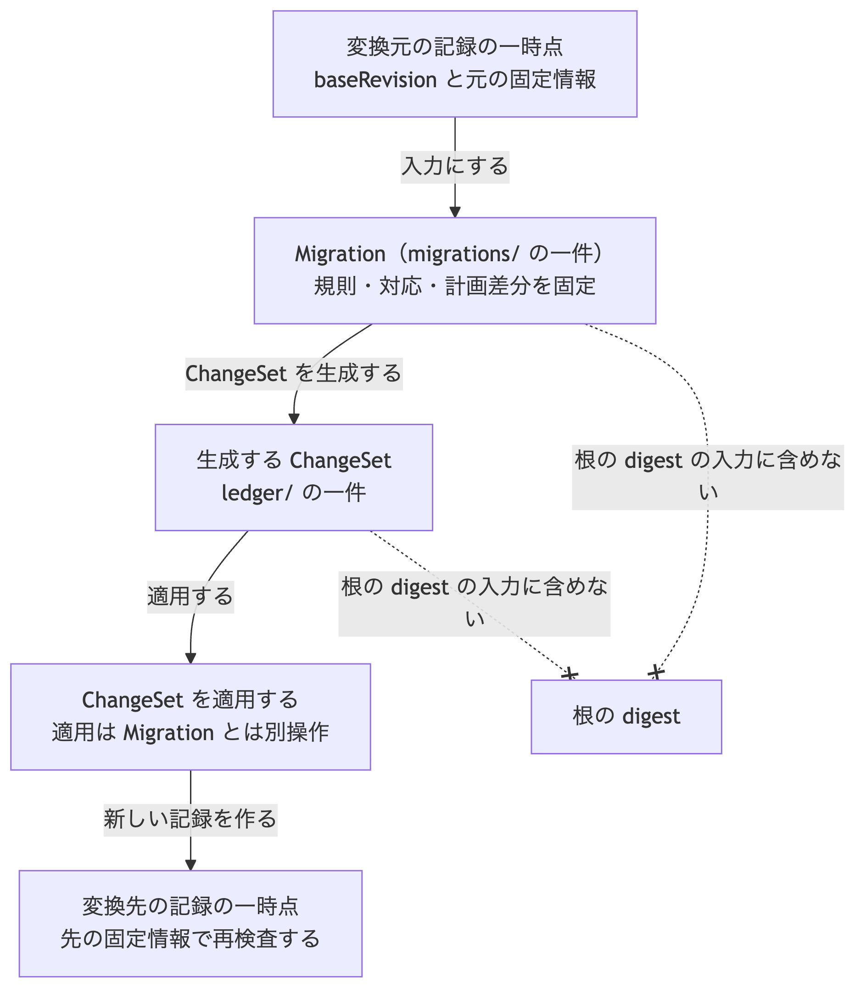

# ADR-0013: Migration の保存形式と適用境界

## 文脈

ADR-0008 は、Validator が旧 Schema の入力を暗黙に変換しないこと、Migration が変換元と変換先の Schema 固定情報を指定して ChangeSet を生成する別処理であることを定めました。
設計文書は、Migration を決定的で副作用のない変換とし、Plan、semantic diff、試行、ChangeSet 生成、事後検証の順を示しています。

一方、Migration 記録のファイル配置、必須項目、digest の計算方法、ChangeSet 適用との境界は決まっていません。
ADR-0010 と ADR-0012 で ChangeSet と semantic diff の契約は固定済みですが、Migration 自体が無いと、複数実装が同じ版変換計画を読み書きできません。

## 全体像

この判断の中心は、版を変える計画を一件の Migration 記録として固定し、生成する ChangeSet の適用と変換先 Schema での再検査を別操作として保つことです。



[Mermaid の生成元](../diagrams/adr-0013-migration-format.mmd)

## 決定

### 1. 役割とファイル配置

Migration は、ある GraphRevision を別の Schema 固定情報へ移すための計画記録です。
正規 Graph ではなく、根の digest の入力に含めません。

Stage 1 の既定の探索場所は次です。

```text
.morivyx/
  migrations/
    <uuid>.yaml
```

- 一つのファイルに一つの Migration だけを保存します。
- ファイル名は、Migration の stable ID から `urn:uuid:` を除いた小文字の UUID に `.yaml` を付けたものです。
- すべてのファイルに ADR-0007 の Git authoring profile の入力制限を適用します。
- ファイルの場所と名前は同一性ではなく、既定の探索場所です。
- ADR-0009 が示した package 配置へ、この決定で `migrations/` を追加します。

### 2. Migration の項目

各 Migration は、次の項目をこの順序で持ちます。

| 項目 | 必須 | 内容 |
|---|---|---|
| `format` | 必須 | `morivyx.migration/0.1` |
| `id` | 必須 | Migration 自身の stable ID |
| `baseRevision` | 必須 | 変換元の GraphRevision ID |
| `sourceSchemaLockDigest` | 必須 | 変換元の Schema 固定情報の digest |
| `targetSchemaLockDigest` | 必須 | 変換先の Schema 固定情報の digest |
| `rulesDigest` | 必須 | 変換規則と実行手段の内容 digest |
| `mappingDigest` | 必須 | 新旧対応表の内容 digest |
| `plannedSemanticDiffDigest` | 必須 | 計画結果の semantic diff の digest |
| `changeSetId` | 必須 | この Migration が生成する ChangeSet の stable ID |
| `resultingRevision` | 必須 | ChangeSet 適用後の GraphRevision ID |
| `resultingRootDigest` | 必須 | 適用後の Graph の根の digest |
| `provenance` | 必須 | ADR-0006 が定める ProvenanceRecord |
| `recordedAt` | 必須 | Morivyx に記録した時間 |

`sourceSchemaLockDigest` と `targetSchemaLockDigest` は異なる値でなければなりません。
同じ Schema 固定情報のままで内容だけを変える操作は、Migration ではなく通常の ChangeSet とします。

`rulesDigest` と `mappingDigest` の入力形式は、この決定では固定しません。
Stage 1 では、内容を開かずに digest として照合し、変換規則言語は後続の決定とします。

`plannedSemanticDiffDigest` は、ADR-0012 の semantic diff 結果の digest です。
比較入力は、`baseRevision` と `resultingRevision` です。
Migration 記録へ semantic diff 本文を埋め込みません。

### 3. 生成と適用の境界

Migration の実行は、次の段階に分けます。

1. 変換元の `baseRevision` と `sourceSchemaLockDigest` が現在の記録と一致することを確認する。
2. 変換規則と対応表から、計画の semantic diff、ChangeSet、`resultingRevision`、`resultingRootDigest` を決定的に計算する。
3. Migration 記録と ChangeSet を保存する。この時点では Graph を変更しない。
4. 人間レビュー後に、生成した ChangeSet を ADR-0010 の規則で適用する。
5. 適用後の Graph を、`targetSchemaLockDigest` が指す Schema 固定情報で Validator により再検査する。

ADR-0010 の通常の適用では、現在の記録と ChangeSet が同じ Schema 固定情報を使います。
Migration ではこの照合を移行元と移行先に分け、現在の記録を `sourceSchemaLockDigest`、生成した ChangeSet と適用後の記録を `targetSchemaLockDigest` と照合します。
Schema 固定情報の切替は、この明示された Migration の適用境界でだけ行い、通常の ChangeSet による不一致は引き続き拒否します。

次を禁止します。

- Validator の実行だけで Graph を Migration すること
- Migration 記録の保存だけで Graph を変更すること
- ChangeSet を経由せずに Migration が Graph を直接書き換えること
- 外部 API や物理作用を発火する変換
- 未知 Extension を破棄する変換
- 適用済み ChangeSet の上書きによる訂正

Extension の Migration 規則は、その Extension を所有する Profile または Plugin が提供します。
Core Schema の Migration 規則は、Core の所有者が提供します。

idempotency は、同じ Migration から同じ ChangeSet 内容と同じ digest 群を再計算できること、および同じ ChangeSet を二度適用できないことで満たします。

### 4. 他記録との整合

生成する ChangeSet は、次を満たさなければなりません。

- `baseRevision` が Migration の `baseRevision` と一致する
- `resultingRevision` と `resultingRootDigest` が Migration の同名項目と一致する
- `schemaLockDigest` が Migration の `targetSchemaLockDigest` と一致する
- `id` が Migration の `changeSetId` と一致する

適用後の `revision.yaml` は、変換先の Schema 固定情報を使います。
変換元の Schema 固定情報だけで適用後 Graph を合格扱いにしません。

### 5. Migration の digest

Migration の digest は、次の手順で計算します。

1. Migration の論理値から `id` 以外の項目を入力とし、canonical form を作る。
2. その前に、用途の接頭辞 `morivyx:migration:v1` と一バイトの `00` を結合する。
3. digest 算法を適用し、値を `sha256:` と小文字の64桁16進数で表す。

canonical form は ADR-0007 と同じ規則です。

| 用途 | 接頭辞 |
|---|---|
| Migration | `morivyx:migration:v1` |

この接頭辞は、Revision ID、Graph の根、Schema 固定情報、ChangeSet、Schema 内容、Trace Report、semantic diff の接頭辞と区別し、相互に流用しません。

### 6. 責任境界のまとめ

| 対象 | 役割 |
|---|---|
| Validator | 固定した Schema に対する検査。変換しない |
| Migration | 版変換の計画記録。ChangeSet を生成する |
| ChangeSet | 適用単位。Graph を次の記録へ進める |
| semantic diff | 計画と結果の意味差分。digest で参照する |

## 結果

### 利点

- 複数実装が同じ Migration 計画を読み書きできます。
- Validator と版変換を分離したまま、計画を監査できます。
- ChangeSet、semantic diff、Schema 固定情報の既存契約を再利用できます。
- 根の digest を変えずに、版変換の履歴を追跡できます。

### 負担

- Migration、ChangeSet、semantic diff の三記録を整合させる必要があります。
- 変換規則言語と対応表の形式は、別の決定が必要です。
- 適用前後で Schema 固定情報を切り替える運用が必要です。

## 検証

- 同じ Migration から同じ digest を得ること。
- `sourceSchemaLockDigest` と `targetSchemaLockDigest` が同じ値の Migration を拒否すること。
- 生成 ChangeSet の基準、結果、Schema 固定情報が Migration と一致すること。
- Migration 保存だけでは Graph と根の digest が変わらないこと。
- 適用後に変換先 Schema 固定情報での Validator 再検査を必須とすること。
- 検査値の文書に、この決定に基づく入力と正解を追加すること。

## 再検討条件

- 変換規則言語を Schema 定義へ埋め込む必要が生じた場合。
- 一つの Migration が複数の ChangeSet を必要とする一括移行が恒常化した場合。
- `mappingDigest` だけでは新旧対応の監査要求を満たせない場合。
- Migration を根の digest へ含める必要が生じた場合。
