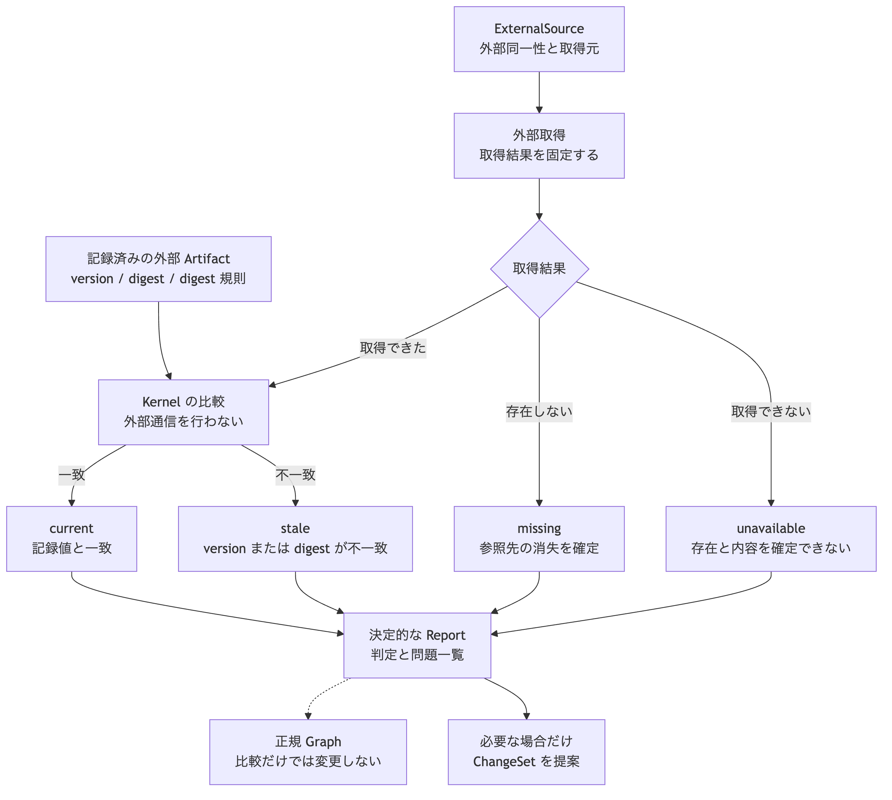

# ADR-0014: external Artifact の参照と stale 検出

## 文脈

ADR-0002 は、外部正本の内容を Graph へ複製せず、外部同一性、version、digest、URI、Provenance を保持すると決定しました。
ADR-0006 は、`stale` を Artifact の lifecycle ではなく、記録値、比較値、検査時点、Verification、Observation から導出する Trace の状態としました。

しかし、外部参照を一意に特定する項目、digest の対象範囲、取得不能と参照先消失の区別、複数の不一致を返す順序は固定されていません。
このまま実装すると、同じ外部対象に対する判定と、正規 Graph を変更する境界が実装ごとに変わります。

## 全体像

外部取得と比較を分離します。
取得機能は、外部対象の取得結果を固定した入力として返します。
Kernel は、その入力と記録済み Artifact Revision を比較し、正規 Graph を変更せずに結果を返します。

[Mermaid の生成元](../diagrams/adr-0014-external-artifact-stale-detection.mmd)

## 決定

### 1. 外部参照の構造

外部正本を指す一つの Artifact Revision は、次を持ちます。

| 所在 | 項目 | 条件 |
|---|---|---|
| `core.artifact` | `artifactKind`、`uri`、`digest` | 必須 |
| `core.artifact` | `externalVersion`、`mediaType` | 外部対象が値を提供する場合に記録 |
| `core.external-source` | `system`、`externalId` | 必須 |
| `core.external-source` | `snapshotAt` | 一時点の記録を外部対象として扱う場合に記録 |
| Relation | Artifact から ExternalSource Revision への `derived_from` | 一件だけ必須 |
| Provenance | 取得方法、取得 Actor、取得時刻、記録時刻、digest 規則 | 必須 |

`uri` は取得場所であり、同一性ではありません。
外部同一性は、ExternalSource の `system` と `externalId` の組で判定します。
場所が変わっても同じ外部対象である場合は、同じ Artifact の stable ID に新しい Revision を作ります。

一つの Artifact が複数の外部対象から生成される場合は、単一の外部参照として扱いません。
生成責任を持つ Execution または Verification と、その入力を個別に記録します。

### 2. 取得時の Provenance

外部から取得した Artifact Revision の Provenance は、次を固定します。

- `method` は `imported` とする。
- `actor` に取得の責任主体を記録する。
- `retrievedAt` に外部対象を取得した時刻を記録する。
- `recordedAt` に Graph へ記録した時刻を記録する。
- `digestRule` に、digest の対象範囲、正規化の有無、算法、規則版を識別する値を記録する。
- 取得に使った ExternalSource Revision を固定する。
- 外部対象が変更されない version を提供する場合は、`externalVersion` を記録する。

認証情報、取得用の秘密値、期限付きの接続情報は Provenance に保存しません。
外部対象を後から取得できない場合も、過去の Artifact Revision、Relation、判断、Provenance は読める状態を保ちます。

### 3. digest の境界

MVP の外部 Artifact reference は、`sha256:` を先頭に持つ digest を必須とします。
digest は、`digestRule` が選んだ外部対象のバイト列へ SHA-256 を適用した値です。

改行、文字の正規化、対応表の項目順、圧縮、除外項目などを暗黙に変更しません。
変換が必要な場合は、`digestRule` の規則として版を固定します。
異なる `digestRule` で作成した digest は比較しません。

`externalVersion` は外部対象が提供する補助的な固定情報です。
MVP では `externalVersion` があっても digest を省略しません。

### 4. 取得結果と比較入力

外部取得は Kernel の外で行います。
取得機能は、認証、通信、外部製品固有の API を扱い、次のいずれかを固定した取得結果として返します。

| 取得結果 | 意味 | 必須値 |
|---|---|---|
| `resolved` | 対象を取得できた | 比較時刻、digest、`digestRule`。記録側に `externalVersion` がある場合は比較する値 |
| `missing` | 外部正本が対象の不存在を確定した | 比較時刻、不存在を判定した方法 |
| `unavailable` | 権限、通信、制限、一時障害により存在と内容を確定できない | 比較時刻、取得不能の理由区分 |

取得機能は、`unavailable` を `missing` と推定しません。
Kernel は外部通信を行わず、次の固定入力だけを比較します。

- 基準の Graph Revision
- Artifact Revision と ExternalSource Revision
- 記録済みの `externalVersion`、digest、`digestRule`
- 固定した取得結果
- 比較時刻

### 5. 判定と問題コード

比較結果は、次のいずれか一件です。

| 結果 | 条件 | Trace への扱い |
|---|---|---|
| `current` | `resolved` であり、digest と、記録済みの場合は `externalVersion` が一致する | 外部参照による `stale` はない |
| `stale` | `resolved` であり、digest または記録済みの `externalVersion` が一致しない | Trace を `stale` として導出する |
| `missing` | 取得結果が `missing` | 外部参照が解決できないため Trace を `broken` として導出する |
| `unavailable` | 取得結果が `unavailable` | `stale` または `current` を新たに断定しない |
| `invalid` | 記録済み参照または比較入力が契約を満たさない | 比較を行わない |

問題コードは次の優先順で返します。
同じ入力からは、問題を検出した処理順にかかわらず同じ順序を返します。

| 優先順 | 問題コード | 条件 |
|---:|---|---|
| 1 | `EXTERNAL_REFERENCE_INCOMPLETE` | 必須の外部同一性、digest、`digestRule`、Provenance がない |
| 2 | `EXTERNAL_DIGEST_RULE_UNSUPPORTED` | 記録側と取得側の `digestRule` が一致しないか、実装が規則を解釈できない |
| 3 | `EXTERNAL_SOURCE_UNAVAILABLE` | 取得結果が `unavailable` |
| 4 | `EXTERNAL_TARGET_MISSING` | 取得結果が `missing` |
| 5 | `EXTERNAL_VERSION_CHANGED` | 記録済みの `externalVersion` と取得値が一致しない |
| 6 | `EXTERNAL_DIGEST_CHANGED` | 記録済み digest と取得値が一致しない |

不完全または未対応の入力がある場合は `invalid` とし、外部対象の状態を推定しません。
`missing` と `unavailable` は、それぞれ一件の問題を返して比較を終えます。
`resolved` では、version の問題を digest の問題より先に返します。

### 6. 結果の記録と正規 Graph の境界

比較は、入力 Graph Revision、入力した各 Revision、取得結果、比較時刻、判定、問題一覧を持つ決定的な Report を返します。
同じ入力からは、実行時刻や処理環境に依存せず同じ判定と問題一覧を返します。

比較だけでは、Artifact の lifecycle、Artifact Revision、Graph Revision、Provenance を変更しません。
`stale`、`missing`、`unavailable` は Artifact の lifecycle 値ではありません。

比較結果を正規 Graph に記録する場合は、Verification と Observation を作成する ChangeSet として提案します。
外部参照を更新する場合は、同じ Artifact の stable ID に新しい Revision を作り、過去の Revision と比較結果を保持します。

### 7. 保持と情報保護

digest は外部内容そのものを保存しませんが、既知内容との照合や対象の存在推定に使われる可能性があります。
保持の可否と期間は Policy で決めます。

Policy により digest を保持できない外部対象は、MVP の stale 検出対象として適合しません。
その場合は digest を省略して適合済みとみなさず、対象外である理由を記録します。

## Invariant

| 対象 | 条件 | 反例 |
|---|---|---|
| 外部 Artifact Revision | 一件の固定した ExternalSource Revision、digest、`digestRule`、取込 Provenance を持つ | `uri` だけを保存する |
| 外部同一性 | `system` と `externalId` の組で判定する | 変更可能な `uri` を同一性にする |
| digest | 固定した規則が選んだバイト列へ適用する | 実装ごとに改行や除外項目を変える |
| 取得不能 | `missing` と `unavailable` を区別する | 通信失敗を対象の消失とみなす |
| `stale` | `resolved` の比較値が記録値と一致しない場合だけ導出する | 取得できないだけで `stale` とする |
| 比較 | 固定入力から決定的な Report を返す | 比較処理が外部通信または現在時刻を読む |
| 正規 Graph | 比較だけでは変更しない | digest の不一致で Artifact の lifecycle を書き換える |
| 更新 | 新しい Artifact Revision と ChangeSet で提案する | 過去の Revision の digest を上書きする |

## 結果

### 利点

- 内容の旧化、参照先消失、一時的な取得不能を区別できます。
- 外部製品固有の取得処理と Kernel の決定的な比較を分離できます。
- 外部正本を複製せず、過去の判断と Provenance を保持できます。
- Artifact の lifecycle を外部参照の一時的な状態と混同しません。

### 負担

- 外部対象の種類ごとに、digest の対象範囲を定めた `digestRule` が必要です。
- 取得機能は、対象の不存在と取得不能を区別して返す必要があります。
- 外部参照の更新では、新しい Artifact Revision と ChangeSet を作成する必要があります。
- digest の保持自体を情報保護の対象として判断する必要があります。

## 検証

- 同じ digest と version から `current` を返すこと。
- digest が異なる場合に `stale` と `EXTERNAL_DIGEST_CHANGED` を返すこと。
- version と digest がともに異なる場合に、二件の問題を固定順で返すこと。
- `missing` と `unavailable` を異なる判定と問題コードで返すこと。
- digest または `digestRule` がない入力を `invalid` とすること。
- 同じ固定入力から同じ判定と問題一覧を返すこと。
- すべての判定で、入力 Graph Revision と Artifact の lifecycle が変わらないこと。
- 外部対象を取得できなくても、過去の Artifact Revision、Relation、判断、Provenance を読めること。

## 再検討条件

- 外部対象の種類ごとに digest の対象範囲を固定できない場合。
- 一つの Artifact Revision に複数の ExternalSource が必要な実例が見つかった場合。
- 外部正本が不存在と取得不能を区別できず、`missing` の判定を再現できない場合。
- digest の保持が情報保護または利用許諾の条件を満たせない場合。
