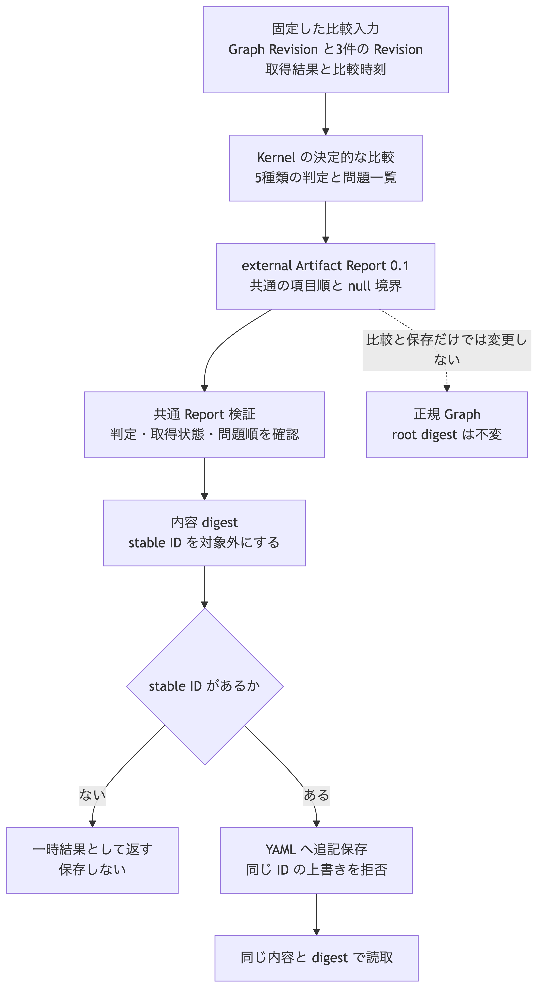

# ADR-0015: external Artifact Report の保存形式と境界

## 文脈

ADR-0014 は、external Artifact の比較が5種類の判定と問題一覧を持つ決定的な Report を返すと定めました。
ADR-0012 は、Trace Report と semantic diff を `.morivyx/reports/` に追記保存し、正規 Graph の root digest から除外すると定めました。

しかし、external Artifact の比較結果には、保存形式、項目順、内容 digest、stable ID、共通 Report 検証との接続がありませんでした。
比較結果をそのまま保存できないため、実装ごとに別の包み方をすると、同じ比較内容の digest と読取結果が一致しません。

## 全体像

Kernel は固定した比較入力から external Artifact Report を作ります。
Report は stable ID の有無にかかわらず同じ内容 digest を持ち、stable ID がある場合だけ既存の Report 保存経路へ追記できます。

[Mermaid の生成元](../diagrams/adr-0015-external-artifact-report-persistence.mmd)

## 決定

### 1. 保存形式

external Artifact の比較結果は、`morivyx.external-artifact-report/0.1` 形式を使います。
この形式は次の項目を持ちます。

| 項目 | 条件 | 内容 |
|---|---|---|
| `format` | 必須 | `morivyx.external-artifact-report/0.1` |
| `id` | 保存時に必須 | Report の stable ID |
| `graphRevision` | 必須 | 比較に使った Graph Revision。`invalid` では不正値または `null` を保持できる |
| `artifact` | 必須 | Artifact の stable ID、Revision、lifecycle |
| `externalSource` | 必須 | ExternalSource の stable ID と Revision |
| `relation` | 必須 | `derived_from` Relation の stable ID と Revision |
| `retrieval` | 必須 | 固定した取得結果。`invalid` では `null` を許可する |
| `comparedAt` | 必須 | 取得結果と同じ比較時刻。`invalid` では不正値または `null` を保持できる |
| `status` | 必須 | `current`、`stale`、`missing`、`unavailable`、`invalid` のいずれか |
| `issues` | 必須 | ADR-0014 の優先順に並べた問題コード |

`artifact`、`externalSource`、`relation` は、比較入力全体を複製せず、比較した Revision の識別に必要な値だけを保持します。
認証情報、外部内容、取得用の秘密値は保存しません。

### 2. 判定と取得結果の対応

`status` と `retrieval.status` は次の組だけを受け入れます。

| `status` | `retrieval.status` | 追加の必須項目 | 問題一覧 |
|---|---|---|---|
| `current` | `resolved` | digest、`digestRule` | 空 |
| `stale` | `resolved` | digest、`digestRule` | version または digest の変更を一件以上 |
| `missing` | `missing` | 不存在を判定した方法 | `EXTERNAL_TARGET_MISSING` |
| `unavailable` | `unavailable` | 取得不能の理由 | `EXTERNAL_SOURCE_UNAVAILABLE` |
| `invalid` | 不正値または `null` | なし | 参照不完全または digest 規則未対応を一件以上 |

記録側に `externalVersion` がある `resolved` の結果は、取得側にも値を持ちます。
取得結果の比較時刻と Report の `comparedAt` は一致しなければなりません。

`invalid` は、不正入力を正常な識別子へ書き換えません。
不正値を監査できるよう、既知の項目に限って文字列または `null` を保持します。

### 3. 内容 digest と stable ID

内容 digest は、接頭辞 `morivyx:external-artifact-report:v1` と、`id` を除いた Report の canonical form から計算します。
同じ比較内容へ異なる Report ID を付けても、内容 digest は変わりません。

対応表の挿入順、Unicode の等価表現、同じ時点を表す時間帯表記は canonical form で正規化します。
問題一覧は ADR-0014 の優先順を保存し、並べ替えまたは重複を拒否します。

### 4. YAML の項目順と null

YAML は、最上位、各 Revision の識別、取得結果、問題コードの順を固定します。
未知の項目と、固定順に反する既知項目を拒否します。

`null` は、`status` が `invalid` の場合に限り、不完全な Graph Revision、Revision の識別、取得結果、比較時刻へ使用できます。
他の4判定では、同じ位置の `null` を拒否します。

### 5. 検証と保存

stable ID を持たない比較結果も、`validateReport` と `serializeReportYaml` で検証できます。
保存する場合は、妥当な Report ID を追加して `writeReport` を使います。

保存先は `.morivyx/reports/<uuid>.yaml` とし、同じ stable ID の上書きを拒否します。
`readReport` は保存した形式を `external-artifact-report` として読み、保存前と同じ内容 digest を返します。

### 6. 正規 Graph との境界

external Artifact Report は GraphElement ではありません。
Report の作成、検証、保存、読取は、Artifact Revision、Graph Revision、Provenance、正規 Graph の root digest を変更しません。

比較結果を正規 Graph の意味として採択する場合は、ADR-0014 に従い、Verification と Observation を作成する ChangeSet を別に提案します。

## Invariant

| 対象 | 条件 | 反例 |
|---|---|---|
| 保存形式 | 5判定を一つの Report 形式で表す | 判定ごとに別形式を作る |
| 内容 digest | stable ID を除いた比較内容から計算する | 保存用 ID により digest が変わる |
| 取得結果 | 判定と取得状態の組を固定する | `missing` に `resolved` を記録する |
| 問題一覧 | ADR-0014 の優先順で重複しない | 検出した処理順で保存する |
| `null` | `invalid` の既知項目だけに許可する | `current` の比較時刻を `null` にする |
| 追記保存 | 同じ stable ID を上書きしない | 過去の比較結果を置き換える |
| 正規 Graph | 比較と保存だけでは変更しない | Report 保存で Graph Revision を更新する |

## 結果

### 利点

- 比較 API の出力を別形式へ変換せず、共通 Report 経路で検証できます。
- 一時的な比較結果と追記保存した結果で、同じ内容 digest を使えます。
- 不完全な入力の結果も、正常な値と混同せずに監査できます。
- 既存の Report ID 衝突検査と追記保存の安全策を再利用できます。

### 負担

- Report 検証は、5判定と取得結果と問題一覧の組合せを検査する必要があります。
- YAML reader と writer は、新しい形式の項目順と `null` 境界を扱う必要があります。
- 保存する呼出側は、比較後に妥当な Report ID を付与する必要があります。

## 検証

- `packages/kernel/test/fixtures/external-artifact-comparison-vectors.json` の5判定が、固定した Report と内容 digest に一致すること。
- 製品実装から独立した検査用実装が、同じ固定 JSON の Report に一致すること。
- stable ID の有無または値が異なっても、内容 digest が一致すること。
- 対応表の挿入順と時間帯表記が異なっても、YAML と内容 digest が一致すること。
- stable ID を付与した Report を追記保存し、同じ内容と digest で読み戻せること。
- 判定と取得状態の不一致、未知の項目、問題コードの逆順、許可されない `null` を拒否すること。
- Report の保存前後で、Graph package の root digest が変わらないこと。

## 再検討条件

- 比較結果へ外部内容そのものを保持する必要が生じた場合。
- 問題コードに追加情報が必要となり、`code` だけでは再現できない場合。
- 一つの Report が複数の Graph Revision を比較する必要が生じた場合。
