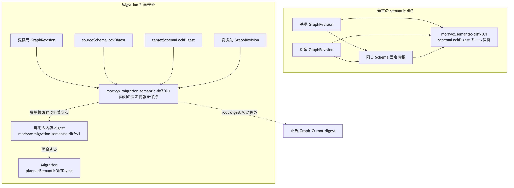

# ADR-0016: Migration 計画差分の両側固定情報と境界

## 文脈

ADR-0012 の semantic diff は、同じ Schema 固定情報を使う二つの GraphRevision を比較し、一つの `schemaLockDigest` を保持します。
ADR-0013 の Migration は、異なる Schema 固定情報の間を移す計画であり、`sourceSchemaLockDigest` と `targetSchemaLockDigest` を持ちます。

しかし、Migration の `plannedSemanticDiffDigest` が従来の semantic diff を参照すると、計画差分自身には変換先の固定情報しか残りません。
変換元の固定情報を別の値へ差し替えても、計画差分だけでは不整合を判定できず、通常の同一 Schema 比較と版変換の境界も曖昧になります。

## 全体像

Migration 計画差分は、変換元と変換先の GraphRevision、および両側の Schema 固定情報を一つの Report に固定します。
Report の内容 digest を Migration が参照し、適用時に両側の値を照合します。

[Mermaid の生成元](../diagrams/adr-0016-migration-semantic-diff-boundary.mmd)

## 決定

### 1. 通常の semantic diff を維持する

`morivyx.semantic-diff/0.1` は ADR-0012 のままとします。
比較する二つの GraphRevision は同じ Schema 固定情報を使い、Report は一つの `schemaLockDigest` を保持します。

異なる Schema 固定情報を使う二つの記録を、この形式で比較しません。

### 2. Migration 計画専用の形式を使う

Migration の計画差分は、`morivyx.migration-semantic-diff/0.1` 形式を使います。
この決定は、ADR-0013 の `plannedSemanticDiffDigest` が ADR-0012 の semantic diff を参照する扱いを置き換えます。
この形式は、次の項目をこの順序で持ちます。

| 項目 | 条件 | 内容 |
|---|---|---|
| `format` | 必須 | `morivyx.migration-semantic-diff/0.1` |
| `id` | 保存時に必須 | Report 自身の stable ID |
| `baseRevision` | 必須 | 変換元の GraphRevision ID |
| `targetRevision` | 必須 | 変換先の GraphRevision ID |
| `sourceSchemaLockDigest` | 必須 | 変換元の Schema 固定情報の digest |
| `targetSchemaLockDigest` | 必須 | 変換先の Schema 固定情報の digest |
| `evaluatedAt` | 必須 | 評価時刻 |
| `entries` | 必須 | 計画した差分項目の一覧 |

`entries` の形式と決定的な並び順は、ADR-0012 の semantic diff と同じです。
Migration では Schema 固定情報が変わるため、`entries` は一件以上の `schema_changed` を持ちます。

### 3. 両側の固定情報を照合する

計画差分の生成時に、次をすべて確認します。

- `sourceSchemaLockDigest` が、入力した変換元の Schema 固定情報の内容 digest と一致する。
- `targetSchemaLockDigest` が、入力した変換先の Schema 固定情報の内容 digest と一致する。
- 変換元と変換先の digest が異なる。
- `schema_changed` の項目が、両側の Schema 固定情報から計算した変更と一致する。

Migration の適用時に、Report の `baseRevision`、`targetRevision`、`sourceSchemaLockDigest`、`targetSchemaLockDigest` を Migration 記録と照合します。
片側だけが一致する場合も拒否します。

### 4. 内容 digest を分離する

Migration 計画差分の内容 digest は、接頭辞 `morivyx:migration-semantic-diff:v1`、一バイトの `00`、`id` 以外の項目の canonical form の順に連結したバイト列から計算します。

通常の semantic diff が使う `morivyx:semantic-diff:v1` は流用しません。
同じ内容へ異なる Report ID を付けても、内容 digest は変わりません。

### 5. 保存と正規 Graph の境界を維持する

Migration 計画差分は Report であり、stable ID を付けた場合は `.morivyx/reports/<uuid>.yaml` へ追記保存できます。
既存の共通 Report 検証、YAML 読取、YAML 書込、stable ID の衝突拒否を使います。

Report の生成、保存、読取だけでは、GraphElement、GraphRevision、Schema 固定情報、正規 Graph の root digest を変更しません。
Migration の `plannedSemanticDiffDigest` は内容 digest だけを参照し、Report 本文を埋め込みません。

## Invariant

| 対象 | 条件 | 反例 |
|---|---|---|
| 通常の semantic diff | 同じ Schema 固定情報を使う二つの記録を比較する | Schema の版をまたぐ計画へ流用する |
| Migration 計画差分 | 変換元と変換先の固定情報を別々に保持する | 変換先だけを保持する |
| 固定情報の照合 | 両側の内容 digest と宣言値が一致する | 片側だけを確認する |
| 形式 | `morivyx.migration-semantic-diff/0.1` を使う | `morivyx.semantic-diff/0.1` を受け入れる |
| 内容 digest | 専用接頭辞を使い、stable ID を除く | 通常の semantic diff の接頭辞を流用する |
| Schema の変更 | `schema_changed` を一件以上持つ | 要素変更だけを Migration として記録する |
| 正規 Graph | Report の操作だけでは変更しない | Report 保存で root digest を更新する |

## 結果

### 利点

- 計画差分だけで、変換元と変換先の固定情報を監査できます。
- 片側の固定情報、Migration 記録、または計画差分の差し替えを適用前に検出できます。
- 通常の同一 Schema 比較と、Schema の版をまたぐ計画を形式と digest の両方で区別できます。
- 共通 Report の保存経路を維持できます。

### 負担

- semantic diff に用途別の二形式と二つの digest 接頭辞が存在します。
- Migration の生成と適用は、計画差分の両側の固定情報を追加で照合する必要があります。
- 旧形式で作成した Migration 計画差分は、新形式へ再生成する必要があります。

## 検証

- 同じ入力から、決定的な Migration 計画差分と内容 digest を得ること。
- 変換元と変換先の固定情報が Report に保持され、Migration 記録と一致すること。
- stable ID の有無または値が異なっても、内容 digest が一致すること。
- Report を追記保存し、同じ内容と digest で読み戻せること。
- 変換元または変換先の固定情報の片側だけを変えた入力を拒否すること。
- 両側の digest が同じ入力、通常の semantic diff 形式、`schema_changed` と固定情報の不一致を拒否すること。
- Report の保存前後で、Graph package の root digest が変わらないこと。

## 再検討条件

- Schema の版をまたぐ比較でも、両側の型を一つの共通 Schema へ正規化できる契約を導入する場合。
- 一件の Migration が三つ以上の Schema 固定情報を段階的に使う必要が生じた場合。
- 計画差分が `entries` 以外の変換規則や対応表の詳細を保持する必要が生じた場合。
