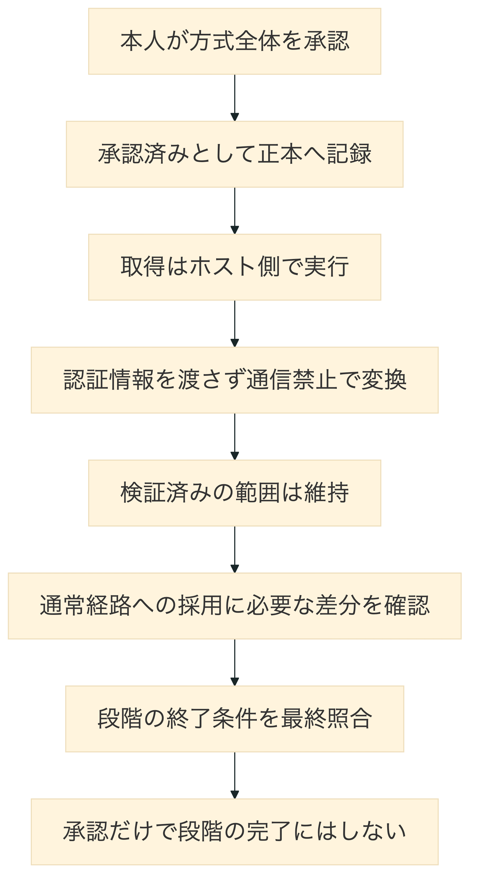
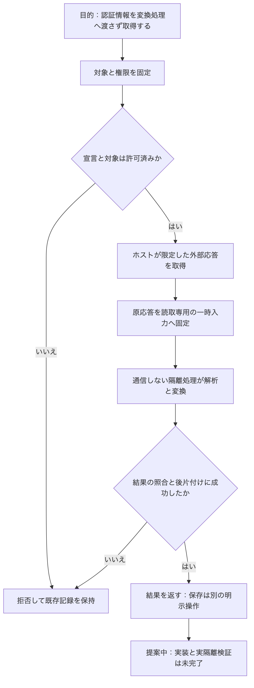

# ADR-0017: 外部取得と隔離変換を分ける

## 承認の状態と目的

この文書は、Stage 2で外部取得と最小権限の隔離実行を組み合わせるための決定です。
2026-09-09に利用者本人が処理の分離、固定対象、通信制限、一時データの扱い、資源上限を順に確認し、それぞれ「はい」と回答しました。
続いて、残る項目を含めて「全て、はいで」と明示し、このADR全体を承認しました。
承認前の提案本文は維持し、状態と承認後の残作業だけを更新しています。
この承認を通常経路への組込み完了、実サービスでの検証完了、Stage 2の終了やStage 3への移行として扱いません。
対応する作業は Issue #687（同梱対象外の参照）、親は Issue #686（同梱対象外の参照） です。

前進させる目的は、GitHubとFigmaの指定対象を読み取り、認証情報やCoreへの接続を変換処理へ渡さずに取得結果を返すことです。
[ADR-0003](0003-plugins-propose-kernel-commits.md) の「Pluginが提案し、Kernelが検証して採択する」という決定は維持します。
追加する判断は、通信をいつ、どの処理で行い、隔離処理へ何を渡すかです。
Coreの直接変更禁止、既定の権限拒否、来歴の保持を変更しません。

## 提案時の不足

現行の `runPluginContainer` は、`network` または `secrets` を要求する実行を開始前に拒否します。
GitHubとFigmaの既存の取得処理には、接続先、固定版、応答量、期限を検査する実装があります。
提案時点では、取得処理と隔離変換を結ぶ実装はありませんでした。
既存の実証記録（同梱対象外の参照） の成功を、この組み合わせの成功へ広げません。

その後、Pull Request #691（同梱対象外の参照）で検証用実装、Pull Request #692（同梱対象外の参照）で実隔離検証を追加しました。
対象の履歴と確認環境は追加検証の記録（同梱対象外の参照）を参照してください。
これらの実装と検証は承認前に完了しており、今回の承認を根拠に検証範囲を広げません。

[Mermaidの生成元](../diagrams/adr-0017-acceptance.mmd)

## 比較した方式

| 方式 | 利点 | 負担と問題 | 今回の扱い |
|---|---|---|---|
| 隔離処理から要求を受け、ホストが都度通信する | 応答に応じた探索を変換処理で行える | 要求ごとの権限検査、双方向通信、中断の伝播、要求に機密内容を載せる行為への対策が必要 | 今回は採用しない |
| ホストが対象を固定して取得し、応答を隔離処理へ渡す | 変換処理へ通信経路と認証情報を渡さずに済む | 応答を一時保持し、取得対象と変換結果の照合が必要 | 今回の提案 |
| 隔離処理へ認証情報と接続先の許可だけを渡す | 既存の取得処理を移しやすい | 認証情報を読む処理と、許可した接続先への情報送信を増やす | 採用しない |

今回の対象は、固定した一つのファイルまたは一つの設計要素です。
任意の探索は不要なため、都度通信する方式の追加経路を設けません。
大量取込や対話的な探索が必要になった場合は、別の判断として再検討します。

## 提案する責務と順序

[Mermaidの生成元](../diagrams/network-isolation-contract.mmd)

1. ホストは要求、権限、認証情報の論理名、実行対象の配布物を検査し、変更されない入力を確保します。
2. ホストの組込み取得処理が、許可済みの対象だけを読み取ります。
3. ホストは応答本文と照合に必要な最小限の情報を一時領域へ固定します。
4. 隔離したImporterが応答本文を解析し、既存の取得結果形式へ変換します。
5. ホストが要求、固定入力、取得結果の一致を検査し、隔離処理と一時領域を片付けます。
6. すべて成功した場合だけ結果を返します。Coreへの保存は、既存の明示的な準備と適用に分けます。

取得処理は、ホストが選んだ検査済みの実装に限定します。
Pluginが指定した関数、実行ファイル、任意の通信先をホストで動かしません。
この取得処理自体は信頼する範囲に残り、その不具合まで隔離できるとは主張しません。

隔離処理は、あらかじめ完成した取得結果を返すだけの処理にしません。
応答本文の解析、対象の照合、内容の識別値の計算を実際に行います。
ホスト側でも結果を再計算して比較しますが、ホストの結果を隔離出力として置き換えません。

## 許可する通信と拒否条件

通信許可は、宣言とPolicyの共通部分に加え、次の対象制約をすべて満たす場合だけ有効です。
未知の項目、不正な値、変更可能な共有入力、期限切れは、最初の通信より前に拒否します。
実行中に利用者側の入力が変更されても、対象や権限を変更しません。

| 項目 | GitHub | Figma |
|---|---|---|
| 接続先 | `https://api.github.com` のみ | `https://api.figma.com` のみ |
| 操作 | `GET` のみ、本文なし | `GET` のみ、本文なし |
| 固定対象 | `owner`、`repository`、数値の `repositoryId`、40桁の `commit`、単一の `locator` | `fileKey`、単一の `nodeId`、明示した `version` |
| 最初の要求 | `/repos/{owner}/{repository}` | `/v1/files/{fileKey}/nodes?ids={nodeId}&version={version}` |
| 後続の要求 | 同じ所有者とリポジトリの `/git/commits/{commit}`、選択経路の `/git/trees/{sha}`、最後の `/git/blobs/{sha}` だけ | なし |
| 対象照合 | リポジトリの数値IDと名前、指定した変更履歴、各階層の選択要素、通常ファイル、内容の識別値 | 応答の版、指定した要素、対象内の構造と内容の識別値 |
| 対象外 | 分岐名による最新追跡、一覧探索、再帰取得、別リポジトリ、参照先の転送、記号的なリンク、下位リポジトリ | 最新版の省略指定、別ファイル、別要素、画像取得、応答中の参照先への追加接続 |

後続要求の識別値は、検証済みの直前の応答からホストが取り出します。
応答中のURLは接続先として使用せず、固定した接続先と経路から要求を組み立てます。
任意の問い合わせ項目、認証ヘッダー、代理接続設定をPluginから受け取りません。
転送は同じ接続先であっても拒否し、認証情報を転送先へ送信しません。
認証に失敗しても、別の認証情報や接続先を自動で試しません。

認証情報は、ホストで解決したGitHub用の任意の読取認証、またはFigma用の読取認証だけを使います。
認証情報の本体、要求ヘッダー、環境変数、利用者の設定ファイルを隔離入力へ含めません。
外部応答自体が機密情報を含む可能性は残るため、本文を一般の診断、実行記録、文書閲覧サイトへ出力しません。

## 回数、量、時間の上限

次は提案する合成経路の上限です。
既存の取得処理の上限を広げず、呼出側は小さくする場合だけ指定できます。
許可された通信先であっても、上限へ達したら終了します。

| 対象 | 上限 |
|---|---|
| GitHubの要求数 | 19回、途中失敗を含む。自動再試行なし |
| Figmaの要求数 | 1回。自動再試行なし |
| 応答本文 | 1応答2,097,152バイト、合計8,388,608バイト。Figmaは1応答分だけ |
| GitHubの復号後のファイル | 1,048,576バイト |
| Figmaの構造の深さ | 64階層 |
| 取得段階 | 最大30,000ミリ秒 |
| 取得開始から結果照合まで | 最大30,000ミリ秒。隔離段階へ新しい30秒を加えない |
| 隔離処理の出力 | 最大1,048,576バイト。標準出力と標準エラーの合計 |
| 隔離処理の資源 | 記憶量は既定134,217,728バイト、最大268,435,456バイト。処理数32、演算量は1処理器分 |
| 後片付け | 本処理の期限と別に、各制御操作5,000ミリ秒。失敗を成功へ変換しない |

`Content-Length` だけでなく、実際に読み取ったバイト数を検査します。
上限を超える部分を切り捨てて成功させません。
不正なUTF-8、不正なJSON、途中で切れた応答、重複する対象、欠けた階層、欠けた本文は拒否します。

## 隔離入力と実行対象の固定

受渡し形式は `morivyx.network-import-input/0.1` を提案します。
ホストが生成し、隔離処理から変更できない入力として渡します。
項目は `format`、`requestDigest`、`retrievedAt`、`responses` に限定します。
`requestDigest` は元の `RunRequest` の正規JSONに対するSHA-256、`retrievedAt` は最後の応答を受け終えた時刻です。

各 `responses` 要素は、要求順の `ordinal`、固定接続先内の `path`、`bodyBytes`、`bodyDigest`、`chunks` に限定します。
`path` は本文から取り出したURLではなく、ホストが実際に要求した相対経路です。
`bodyDigest` は応答本文の生バイトに対するSHA-256、`chunks` は連結順の入力ファイル名です。
状態200とJSON形式をホストが確認した本文だけを含め、要求と応答のヘッダーは含めません。

本文は1ファイル1,048,576バイト以下へ分割し、順序、合計長、識別値を双方で検査します。
入力ファイル数は索引を含め256以下、索引は65,536バイト以下とします。
索引を含む隔離入力の合計は既存上限の8,388,608バイト以下とし、本文だけで上限を使い切った場合も拒否します。
絶対パス、上位への移動、記号的なリンク、重複名、欠落、余分なファイルを許しません。

GitHubの経路確認に使った階層一覧やFigmaの応答には、対象以外の情報が含まれる場合があります。
今回は上限内の原応答を一時保持し、変換処理も読めることを明示します。
対象以外の情報を一切受け取らない保証はせず、継続保存はしません。

実際に変換する配布物を、既存のGitHubまたはFigmaのImporterとして固定します。
元の `RunRequest`、PluginのIDと版、CapabilityのID、出力形式を維持し、別の処理の出力へ既存のIDを付け直しません。
隔離用の宣言は独立した配布物の宣言として用意し、読める入力領域だけを `fileRead` に宣言します。
`network`、`secrets`、`graphRead`、`devices` は空にし、ネットワーク用の既存宣言を実行直前に黙って書き換えません。

ホストは、隔離用宣言の識別値、配布物の `packageDigest`、実行する `imageId`、元の要求、入力索引の識別値を一つの実行設定として固定します。
同じIDと版でも異なる配布物は別の設定として扱い、呼出側やPluginが任意の実行物へ差し替えられないようにします。
配布物と実行物の対応を検査できない場合は、検証済みの配布経路と主張せず実行を拒否します。
検証用の固定値を、実配布物の識別値の代わりに使用しません。

## 既存契約との対応と保存する来歴

| 契約 | 維持する内容と追加する検査 |
|---|---|
| 権限宣言 | ホストの通信許可と、隔離Importerの入力読取許可を別々に検査する。片方の許可で他方を代用しない |
| 実行許可 | `createPluginExecutionGrant` で実際の隔離用宣言と元の要求を照合する。通信可能な実行許可を容器へ渡さない |
| 通信契約 | `RunRequest` と `RunResult` の0.1形式を維持し、`runId`、PluginのIDと版、Capabilityを一致させる |
| 隔離実行 | `--network=none`、読取専用の入力と実行物、非管理者、権限追加禁止を維持する。Core、認証情報、ホストの制御用接続口を共有しない |
| 取得結果 | GitHubとFigmaの既存検査に加え、固定入力から再計算した内容、識別値、対象、取得時刻、情報損失を比較する |
| Coreへの保存 | 既存の準備と適用だけを使う。失敗時は新しいCoreを作らず、既存Coreを変更しない |
| 既存の来歴 | 実際のImporterのID、版、配布物の識別値、実行ID、対象、取得結果を保持する。`executionBinding: not-verified` は変更しない |
| 合成経路の検証記録 | 要求と入力の識別値、宣言と実行物の識別値、通信回数と量、隔離設定、後片付けの成否を別の機械検証記録へ残す。本文、認証情報、任意の診断文は保存しない |

合成経路の検証記録は、Core内の来歴へ新しい保証を追加するものではありません。
過去の記録の読取、再取込の比較、人手編集との競合判定を維持します。
取得結果だけを後から渡す保存操作では、本当にその配布物で実行したことまで証明できないため、既存の `not-verified` を保持します。

## 失敗、中断、再試行

通信、変換、照合のどこで失敗しても、成功した取得結果を返しません。
外部由来の値を含まない固定の理由コードで、権限拒否、対象不一致、上限超過、時間切れ、中断、後片付け失敗を区別します。
Pluginの標準エラーや外部応答を理由文へ転載しません。

中断と時間切れでは、未読の応答も含めて読取を取り消し、隔離処理と子孫処理を停止し、一時領域を削除します。
遅れて到着した応答や終了通知を、別の実行の成功として受け入れません。
後片付けに失敗した場合は、結果が妥当でも失敗として返し、残った資源の識別情報だけをホスト内の回復用記録へ残します。
残存入力を次の実行へ再利用せず、削除失敗の事実を隠しません。

再試行は利用者または呼出側による明示操作に限ります。
再試行ごとに新しい実行ID、権限検査、入力領域、応答取得を必要とし、部分取得を使い回しません。
固定した対象が同じでも、Coreへの重複保存や人手編集の上書きを許しません。

## 実装と実隔離検証への引継ぎ

Issue #688（同梱対象外の参照） では、この提案の受渡し形式と組合せを検証用に実装します。
宣言、取得、受渡し、変換、照合、後片付けを同じ要求へ結び、次の各項目を固定応答で検査します。
既存の通信実装とネットワーク禁止実装の検査も維持します。

Issue #689（同梱対象外の参照） では、実際の隔離環境で同じ経路を検査します。
実サービスの対象や認証情報を自動で選ばず、まず固定応答と実容器を組み合わせます。
この検査は実サービスの認証成功を意味しません。

| 検証項目 | 合格条件 |
|---|---|
| 両サービスの正常な変換 | 隔離処理が原応答から結果を計算し、ホストの計算と一致する |
| 不正な宣言と対象 | 通信も隔離起動も0回で拒否する |
| 許可外通信と転送 | 許可外への要求は0回。隔離処理自身の接続試行も失敗する |
| 認証情報とホスト情報の読取 | 隔離処理から認証情報、環境設定、Core、制御用接続口を読めない |
| 入力と出力の差し替え | 元の要求、応答順、内容、時刻、宣言、実行物、結果の不一致を拒否する |
| 資源の上限 | 要求数、本文量、入力量、出力量、深さ、時間、記憶量の境界と超過を検査する |
| 中断と遅延 | 取得前、読取中、隔離中、結果照合前の中断で成功を返さず、遅延した応答を破棄する |
| 後片付け | 正常終了と各失敗で一時領域と容器が残らない。削除失敗は回復情報を伴う失敗になる |
| Coreの保持 | 初回保存、変更なし、明示再取込、人手編集との競合、取得失敗を通じて、既存記録を暗黙に上書きしない |

2026-09-09時点で、検証用実装、固定応答への実通信と実容器による検証、検証環境の配布物と実行物の内容照合は完了しました。
Issue #688（同梱対象外の参照）とIssue #689（同梱対象外の参照）は完了しています。
このADRの人間による承認は完了し、通常経路への採用判断は残っています。
検査での内容照合は、供給元の真正性やCoreの実行証明を保証しません。
通常経路への採用では必要な差分と検査を照合し、承認だけで組込み済みと記録しません。
正式な人間の時間測定、個別の機密情報方針、Figmaの実サービスでの認証確認、Stage 3への移行は別の確認として残します。

## 再検討条件

- 固定対象の取込でも、一時入力の上限が継続的に不足する。
- 原応答に含まれる対象外情報を、隔離処理へ渡すことも禁止する必要が生じる。
- 都度通信が必要な探索や大量取込を対象にする。
- Coreの来歴に実行の証明を保存する必要が生じる。
- 組込み取得処理を信頼する範囲から外し、認証通信そのものも別の隔離境界へ移す。
