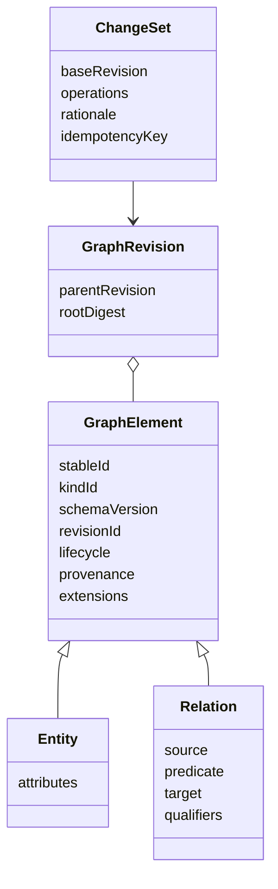
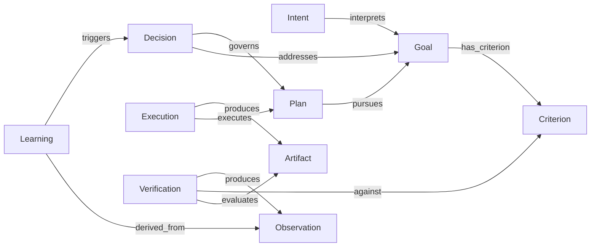

# Core Meta Model

## 層の分離

Morivyx のメタモデルは二層に分離します。

### Kernel

長期的に小さく保つ構造層です。

- `GraphElement`
- `Entity`
- `Relation`
- `GraphRevision`
- `ChangeSet`
- `ProvenanceRecord`
- Schema の登録簿と Invariant の検査機能

### Semantic Profile

交換・追加可能な意味層です。

- Morivyx Core Profile: Goal、Intent、Decision など
- ソフトウェア用 Profile: repository、API、検査、配備など
- 将来の拡張現実、接続機器、ロボティクス、空間用 Profile
- Plugin 固有の名前空間付き型と Relation

Kernel は `core.goal` の業務的意味をハードコードしません。型制約、必須属性、Relation 制約、表示規則はバージョン付き Profile が宣言します。

## Core Meta Model

### GraphElement

すべての Entity と Relation が共有する構造です。

| 項目 | 意味 |
|---|---|
| `id` | 変更されない不透明な論理 ID |
| `kind` | 名前空間付き型 ID |
| `schemaVersion` | 型を解釈するスキーマ版 |
| `revision` | 内容が変わるたびに変わる不変 Revision ID |
| `lifecycle` | draft、active、deprecated、superseded、retracted など |
| `reviewState` | unreviewed、proposed、approved、rejected など |
| `validTime` | 現実または対象領域で有効な時間 |
| `recordedAt` | Morivyx に記録した時間 |
| `provenance` | 主体、方法、入力、外部ソース、ツールの来歴 |
| `extensions` | 名前空間付きの拡張値 |

Domain lifecycle と review state は分離します。たとえば「採択された Decision」と「その記録がレビュー済みであること」は別の状態です。

### Entity

独立した同一性と lifecycle を持つ対象です。属性は Profile のスキーマで検証します。

### Relation

Entity 間の意味を第一級の要素として表します。Relation 自体も ID、Revision、Provenance を持ちます。

基本形は `source predicate target` です。方向は自然な文として読める向きに固定し、逆 Relation は query で導出します。多項関係や関係自体への注釈が必要な場合は、その出来事や主張を Entity として実体化し、二項 Relation で接続します。

### GraphRevision

検証済み Graph の一時点の記録です。親 Revision、根の digest、適用した ChangeSet、Schema の固定情報を特定します。Git の履歴記録と対応できますが、Git のオブジェクト ID そのものを論理仕様にはしません。

### ChangeSet

Graph に対する原子的な変更提案です。

- 基準となる Graph Revision
- `create`、`revise`、`deprecate`、`supersede`、`retract` の操作
- 変更理由と対象 Goal / Decision
- 提案 Actor と生成手段
- idempotency のキー
- 期待する Invariant と検証結果
- 必要な approval

Plugin と AI は正規 Graph を直接変更せず、ChangeSet を提出します。Kernel が Schema、参照整合性、Policy、Traceability を検証してから採択します。

### ProvenanceRecord

少なくとも次を識別します。

- Actor と役割
- `asserted`、`imported`、`inferred`、`generated`、`observed`、`verified` の方法
- ExternalSource の参照、一時点の記録、内容の digest
- Plugin、規則、Model 用 adapter、生成規則の ID と version
- 入力 Graph Revision と参照要素 Revision
- 実行時刻、記録時刻、approval、外部 Receipt

#### approval の Provenance

approval は対象 Revision に適用できる ProvenanceRecord とし、Actor、対象の stable ID と Revision、許可した操作または状態遷移、適用範囲と条件、`approvedAt`、`recordedAt` を必須とします。

review state の `approved` は対象 Revision の内容確認結果です。lifecycle の `accepted` は、Schema と Invariant の検証、および必要な approval を通った正規利用状態です。review、Pull Request の取り込み、沈黙から approval を推定しません。

## Core 候補の Entity

以下は Core Profile の候補であり、Kernel の固定クラスではありません。MVP では単純なスキーマとして扱い、各概念を独立サブシステムとして実装しません。

| 種類 | 必須となる意味 |
|---|---|
| `core.goal` | 望む結果、対象範囲、受益者、lifecycle |
| `core.intent` | 動機、解釈、優先順位、譲れない条件 |
| `core.criterion` | 測定方法、評価規則、必須または任意 |
| `core.decision` | 問い、状態、理由、結果、再検討条件 |
| `core.option` | 説明、利点と負担、選択状態 |
| `core.knowledge` | Claim、認識状態、対象範囲、確信度と根拠 |
| `core.constraint` | 規則、重大度、適用条件 |
| `core.plan` | 予定する行為、依存関係、停止条件 |
| `core.execution` | Actor、入力、実績時刻、結果、再試行の同一性 |
| `core.artifact` | Artifact の種類、URI、外部 version、digest、媒体種別 |
| `core.verification` | 方法、対象 Revision、Criterion、結果 |
| `core.observation` | 対象、値または結果、方法、`observedAt`、`recordedAt` |
| `core.learning` | 統合した理解、確信度、推奨する変更 |
| `core.actor` | 人間、組織、AI、サービス、ツール、機器 |
| `core.context` | 対象範囲、環境、時間、信頼境界 |
| `core.external-source` | 外部同一性、システム、一時点の記録、取得の Provenance |

## Criterion と Learning の lifecycle

Criterion は `draft`、`active`、`deprecated`、`superseded`、`retracted` を使います。意味変更では新しい Criterion が旧 Criterion を `supersedes` し、表記修正は同じ Criterion の新しい Revision とします。

Learning は `draft`、`active`、`superseded`、`retracted` を使います。Learning が `triggers` によって後続作業を開始しても、Learning 自体を完了状態へ移しません。

## Core の Relation

Relation は型ごとに `source` と `target`、要素数、循環 Policy、必要な Provenance、利用する Query を定義します。

| 関係種別 | 接続元 → 接続先 | 意味 |
|---|---|---|
| `refines` | 子 Goal → 親 Goal | Goal の具体化。有向非循環 |
| `interprets` | Intent → Goal | Goal の解釈 |
| `has_criterion` | Goal → Criterion | 成功条件 |
| `constrained_by` | Goal/Intent/Plan/Execution → Constraint/Knowledge | 適用される制約 |
| `addresses` | Decision → Goal/Intent/Knowledge | Decision が閉じる問いの由来 |
| `considers` | Decision → Option | 検討した選択肢 |
| `selects` | Decision → Option | 採用した選択肢 |
| `supported_by` | Decision/Knowledge/Learning → Knowledge/Observation/Artifact | 支持する根拠 |
| `challenged_by` | Decision/Knowledge → Knowledge/Observation | 反証または疑義 |
| `governs` | Decision → Plan/Execution/Artifact/Verification | Decision の影響範囲 |
| `pursues` | Plan → Goal/Intent | 計画が目指すもの |
| `executes` | Execution → Plan | 計画の実行 |
| `produces` | Execution/Verification → Artifact/Observation | 実行が生成したもの |
| `realizes` | Artifact → Intent | Intent の具現化。Goal 達成を直接意味しない |
| `evaluates` | Verification → Artifact/Execution/Goal | 評価対象 |
| `against` | Verification → Criterion | 評価基準 |
| `observes` | Observation → Artifact/Execution/Context | 観測対象 |
| `derived_from` | Learning → Observation/Verification; Artifact → Entity | 導出元 |
| `updates` | Learning → Knowledge | 理解変更の対象 |
| `triggers` | Learning → Goal/Decision/Plan | 次の改善を開始 |
| `supersedes` | 新 Entity → 旧 Entity | 意味上の置換。非循環 |
| `depends_on` | Entity → Entity | 明示的な依存 |

`Artifact satisfies Goal` のような無根拠の直結は Core に置きません。達成は Criterion、Verification、Observation を通して判断します。

### 保存する Relation

正規 Graph には明示的な主張と Provenance を持つ Relation だけを保存します。Trace から導出できる Relation は、入力 Graph Revision、規則 ID、規則版を持つ Projection または Report とし、正規 Relation と区別します。

Artifact の現在の形を決めた Decision は、対象 Artifact Revision へ `governs` で直接接続します。Decision が Plan を `governs` することから、その Plan が生んだ Artifact への `governs` を暗黙に導出しません。

### Relation の要素数

| Relation | 接続元ごとの接続先 | 接続先ごとの接続元 | 追加条件 |
|---|---:|---:|---|
| `supported_by` | accepted Decision は一件以上 | 零件以上 | 対象 Revision を固定する |
| `challenged_by` | 零件以上 | 零件以上 | 零件の場合は `challengeReview` を記録する |
| `governs` | 零件以上 | 零件以上 | Artifact の現在の形には直接 Relation を使う |
| `against` | Verification ごとに一件 | 零件以上 | 複数 Criterion は Verification を分ける |
| `evaluates` | Verification ごとに一件以上 | 零件以上 | 判定対象の Revision を固定する |
| `produces` | Execution または Verification ごとに零件以上 | Artifact Revision ごとに一件 | 取込 Artifact は取込 Provenance を代わりに持つ |

Artifact の改訂では、同じ stable ID の新しい Revision を作ります。`produces` は生成した Artifact Revision を固定し、過去の Revision への Relation を変更しません。複数の実行が寄与した場合は、生成責任を持つ一つの Execution または Verification の入力または `depends_on` として記録します。

## 改善ループの対応

## Invariant

### 構造上の Invariant

- ID と Revision ID は一意である
- Revision の内容は不変である
- Relation の `source` と `target` は存在する
- `predicate` ごとの `source` と `target` の型制約を満たす
- `refines` と `supersedes` は循環しない
- 同じ意味の canonical Relation を重複保存しない
- 正規 Relation は明示的な主張と Provenance を持つ
- Verification は一件の `against` と一件以上の `evaluates` を持つ
- Artifact Revision は一つの生成責任を持つ Execution、Verification、取込 Provenance のいずれかを持つ
- accepted 要素には provenance がある
- accepted Decision、Observation、Verification を破壊的に更新しない
- 未知の Core 型や Core の項目は黙って無視しない
- 未知の名前空間付き Extension は損失なく round-trip する

### Policy 上の Invariant

- draft 中の欠落は許容できるが、accepted には定義済み trace を要求する
- AI または Plugin 由来の変更は ChangeSet と検証結果を持つ
- 予定外の外部作用は、例外理由となる Decision または明示的 approval を持つ
- 派生 Relation は、規則 ID、規則版、入力 Graph Revision から再生成できる
- `stale` は Artifact の lifecycle ではなく、比較入力と検査時点から導出する Trace の状態とする
- review state の `approved` と lifecycle の `accepted` に必要な approval は対象 Revision を固定する
- 個人情報保護、機密保護、安全の Policy は、保持・共有・実行を禁止できる
