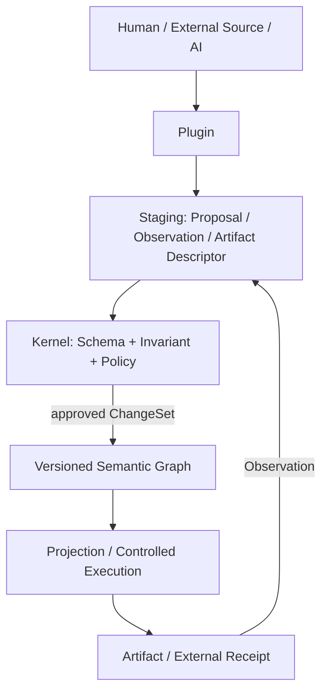

# Plugin 構成

## 目的

Plugin 構成は、既存資産を再利用しながら次を守るための境界です。

- Kernel と外部ツールを疎結合にする
- 特定の AI モデル、言語、ランタイムに依存しない
- 変更と外部作用を最小権限で制御する
- 入力、出力、判断、実行結果の provenance を残す
- Plugin を削除しても Core Graph を読める
- Plugin の失敗で Graph を部分更新しない

## 構成上の面



責務は三つの面に分けます。

1. **Knowledge Plane**: version を持つ Graph、Schema、Provenance、Query
2. **Proposal Plane**: Plan、ChangeSet、review、approval、Policy の評価
3. **Execution Plane**: 成果物生成、外部 API、デバイスなどへの制御された作用

Graph に Relation が存在するだけで、外部作用が実行されてはいけません。

## Kernel の責任

- Core Meta Model と Schema の登録簿
- Graph Revision、処理単位、semantic diff
- Relation、要素数、Traceability の Invariant の検証
- Plugin の検出、通信契約の調整、version の固定
- Capability の許可と Policy の評価
- Run、ChangeSet、approval、Provenance、外部 Receipt の記録
- Artifact の記述と内容の digest の検証
- Migration の計画・検証・適用
- 機密値の論理参照解決

## Plugin の責任

- 外部表現と Graph の間の変換
- Graph からの View / Artifact の投影
- 構造・意味・Policy・安全性の検証
- 実行結果、外部状態、センサー値の Observation 化
- Finding、Plan、Learning、ChangeSet の提案
- 承認済み外部作用の実行
- Domain Profile、表示、query の追加

Plugin は Core の storage、Git の作業領域、外部システムを無制限に直接変更しません。

## Plugin の種類

| 種類 | 役割 | 代表例 |
|---|---|---|
| `Connector` | 外部サービスとの認証・通信 | GitHub、Figma、接続機器の仲介機能 |
| Importer | 外部の一時点の記録から Graph 変更を提案 | repository、OpenAPI |
| Projector / Generator | `approved` の Graph Revision から成果物を生成 | Flutter、ウェブ、ADR、検査 |
| Validator | Schema、意味、Policy、安全性を評価 | Trace の検査機能 |
| `Observer` | 外部状態や実行結果を Observation 化 | 継続的検査の結果、遠隔測定値 |
| Analyzer / agent | Finding、Option、Plan、Learning を提案 | review 用 agent |
| Executor | 承認済み外部作用を反映 | 配備、機器命令 |
| `Exporter` | 外部形式へ、損失を明示して変換 | JSON-LD への変換 |
| View | 人間向けの review または Query 表現 | Trace Report |
| Migration | Schema 間の決定的 Graph 変換 | Profile の更新 |

一つの Plugin は複数 Capability を提供できますが、入出力と権限は Capability ごとに宣言します。

## Manifest の契約

Plugin manifest は少なくとも次を宣言します。

| 項目 | 内容 |
|---|---|
| `Identity` | 安定 Plugin ID、version、package の digest、配布者 |
| `Compatibility` | 通信契約、Core と Profile の Schema の対応範囲 |
| `Capabilities` | Capability ID、入力型、出力型 |
| `Effects` | `pure`、`read-only`、`artifact-write`、`external-effect`、`physical-effect` |
| `Permissions` | Graph の対象範囲、ファイル領域、通信、機密値、機器 |
| `Retry` | `idempotent`、`safe-to-retry`、`reconcile-required`、`manual-recovery` |
| `Resources` | 時間上限、演算量、記憶量、出力量、予算 |
| `Supply chain` | 署名、配布元、SBOM の参照 |
| `Migrations` | Plugin が所有する Extension の Migration 提供機能 |

要求権限と付与権限を分離します。Plugin 自身は権限を拡張できません。

## Capability と権限

既定は拒否です。Run ごとに短命な Capability の許可を発行し、次を限定します。

- 読める Entity と Relation の種類、部分 Graph、属性
- 提案できる ChangeSet 操作
- 出力できる Artifact 領域
- 接続可能な通信先、API、操作
- 参照可能な機密値の論理名
- 操作可能な機器、空間、時間帯
- 有効期限、実行回数、費用、最大作用範囲

Graph の読み取りと外部通信は同時に評価します。読み取り権限だけでも外部送信と組み合わされると情報流出になるためです。

機密値の本体は Graph、Git、Run の記録に保存しません。Graph には論理参照と使用した認証情報の区分だけを記録します。

## Run の契約

### `RunRequest`

- `runId`
- Plugin / Capability ID と version
- 入力 Graph Revision
- 入力 Entity / Relation Revision または query digest
- Policy の許可
- idempotency のキー
- 期限と資源予算
- 設定と生成規則の digest

### `RunResult`

- 提案する Graph 操作
- Observation
- Artifact の記述
- 外部作用の Receipt
- Finding または診断
- provenance
- Verification の結果

出力は一時領域に置き、Kernel が検証後に一つの ChangeSet として採択します。Plugin の異常終了、時間切れ、検証失敗では Graph を部分更新しません。

## idempotency と外部作用

Run の重複判定は、概念的に次の組み合わせで行います。

```text
plugin + version + capability + idempotency-key + request-digest
```

同じ idempotency のキーで異なる要求の digest を受け取った場合は拒否します。

- Importer は外部の名前空間と安定した外部 ID を対応付ける
- Projector は Graph Revision、生成規則の digest、Plugin の digest から一時保存のキーを作る
- `Observer` は ExternalSource の出来事 ID で重複を排除する
- Executor は ActionIntent を先に記録し、実行後に Receipt と Observation を返す

外部システムを含む一回限りの実行は仮定しません。`prepare → execute → observe → reconcile` と補償作用によって、不明状態と部分成功を扱います。

### 物理作用

拡張現実、接続機器、ロボティクスなどの物理作用は、通常の `external-effect` と別の区分にします。

```text
ActionIntent → Simulation / Safety Check → Approval
             → Execute → Observe → Reconcile
```

安全領域、停止条件、有効期限、人間による安全遮断、機器の Receipt、緊急停止を契約に含めます。

## 処理の分離と通信契約

Plugin は原則として別の処理で動作します。MVP では、転送方式に依存しない version 付きの通信契約を、標準入出力上の JSON 通信で検証します。

将来は同じ論理契約を次の実行形態へ適用できます。

- WASI の隔離実行環境
- OCI の隔離容器
- ローカルサービス
- HTTPS または RPC のサービス
- 機器または端部の中継機能

Plugin の開発用部品は利便性のための実装であり、特定言語の開発用部品が通信契約の正本にはなりません。

## AI と Model への非依存

AI を使う agent は特権的な存在ではなく、Analyzer または Proposal の生成機能の一種です。

- 大規模言語モデルの提供元は Model 用 adapter の背後に置く
- 指示文や通信形式ではなく、型付き Finding、Option、Plan、ChangeSet を契約にする
- 人間、規則処理部、ローカル Model、クラウド Model の提案を同じ review 手順で扱う
- 提供元、Model ID、主要設定、指示文の digest、入力 Revision、ツール結果を Provenance に残す
- 非公開の思考過程を保存要件にしない
- 標準権限では、AI は承認済み Graph Revision や外部システムへ直接書き込まない

確率的な提案を検証・承認し、Graph Revision として採択した後、可能な限り決定的な Projector が最終成果物を生成します。

## 既存成果との対応

| 既存成果 | Morivyx の機能 |
|---|---|
| repository、Figma、GitHub、OpenAPI の Importer | `Connector` と Importer |
| Flutter、ウェブ、検査、ADR の Generator | Projector と Generator |
| review または改善用 agent | Analyzer と Proposal の生成機能 |

Importer は外部内容を無条件に正規記録へ変換せず、一時点の記録、外部同一性、digest、取得時刻を持つ `imported` の Claim または ChangeSet として提出します。

## 失敗時と削除時の保証

- Plugin がなくても Core Entity、Relation、Revision、provenance を読める
- Plugin 固有 Extension は不透明なデータとして損失なく保持できる
- 未知の Core の意味は拒否する
- Plugin の再実行で承認済みの人間編集を暗黙に上書きしない
- Plugin の出力上限と時間上限を Kernel が強制できる
- Plugin 削除後も過去の package digest と Run provenance を参照できる
