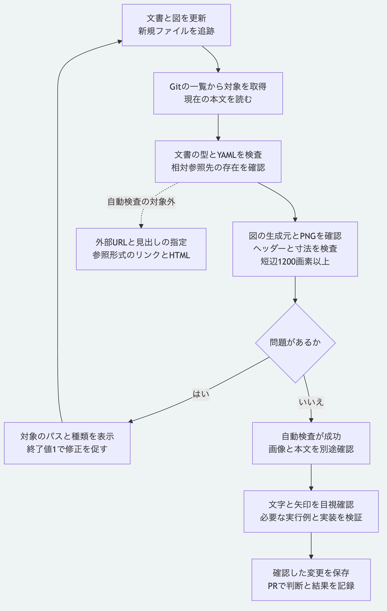

# 文書の形式と参照及び図の寸法を検査する

文書を変更した後、型の記載、参照先と図の同梱をローカルで検査できます。
この検査は現在の`main`に追加したもので、初版のタグ`v0.1.0`には含めません。

## 実行する

Node.js 26.13.0以上とGitを使います。
リポジトリ直下で依存を導入した後、検査を実行します。

```sh
npm ci --prefix packages/kernel --ignore-scripts --no-audit --no-fund
node tools/check-documentation.mjs
node --test tools/check-documentation.test.mjs
```

最初の検査で`valid: true`と空の`findings`を確認します。
失敗時は終了値が1になり、`findings`に対象のパスと問題の種類が出ます。
試験は専用の一時リポジトリで不正な入力を検出し、終了時にその一時フォルダーだけを除去します。
検査も試験も元の文書の本文や元のリポジトリのGit設定を変更せず、検査時に通信を行いません。
依存の初回導入では通信が必要になる場合があります。

検査対象の一覧には`git ls-files`を使います。
新しい文書、参照先や図は`git add`で追跡対象へ加えてから検査します。
既存の追跡対象は、作業ツリーにある現在の本文を読みます。
まだ追跡していない文書そのものは一覧に含まれず、追跡済み文書から未追跡ファイルへの参照は失敗になります。
コミットへ含めた内容を確かめるときは、コミット後に作業ツリーの差分がないことも確認します。

## 検査する内容

| 対象 | 検査すること |
|---|---|
| 追跡対象のMarkdown | 先頭のfrontmatterをYAMLとして解析でき、重複するキーがなく、`type`が空でない文字列であること |
| 本文のインライン形式のリンクと画像 | 相対参照先が追跡対象のファイルまたは追跡対象を含むフォルダーとして存在すること |
| 相対参照の保存範囲 | `..`、絶対パス、符号化したパスやリンクを使ってリポジトリの外へ出ないこと |
| `docs/diagrams`内の生成元 | 同じ名前のPNGが追跡され、生成元も手元に存在すること |
| `docs/diagrams`内のPNG | 同じ名前の`.mmd`または`.puml`が追跡され、PNGヘッダーと短辺1200画素以上を確認できること |

予約された`index.md`と`log.md`には、通常文書の`type`の必須条件を適用しません。
相対参照は`[説明](path)`と``の形式が対象です。
空白のある`<path with spaces>`、括弧を含むファイル名、参照先の後に添える題名にも対応します。
コードブロック、インデントされたコードとバッククォート内の実行例は参照検査から除きます。

## 自動検査に含めない内容

外部URLへは接続せず、`externalReferencesSkipped`に省略した件数を出します。
`#`の後の見出しの指定は、`fragmentsSkipped`に件数を出すだけで、見出しの存在を検証しません。
参照先のファイル部分は、見出しの指定が付いている場合も検査します。
参照形式の`[説明][名前]`とHTMLで書いた参照は対象外です。
この道具は完全なMarkdownの解析器ではありません。

PNGはヘッダーと寸法の検査であり、画像全体の復号や生成元との内容一致は確認しません。
日本語の欠け、文字の重なり、矢印と図の説明は、PNGを開いて別途確認します。
本文の正しさ、用語の承認、実装例の動作、SDKとPythonの適合検査も、それぞれ必要な検査で確認します。



[図の生成元](diagrams/documentation-check.mmd)

[仕様の入口](README.md)へ戻れます。
