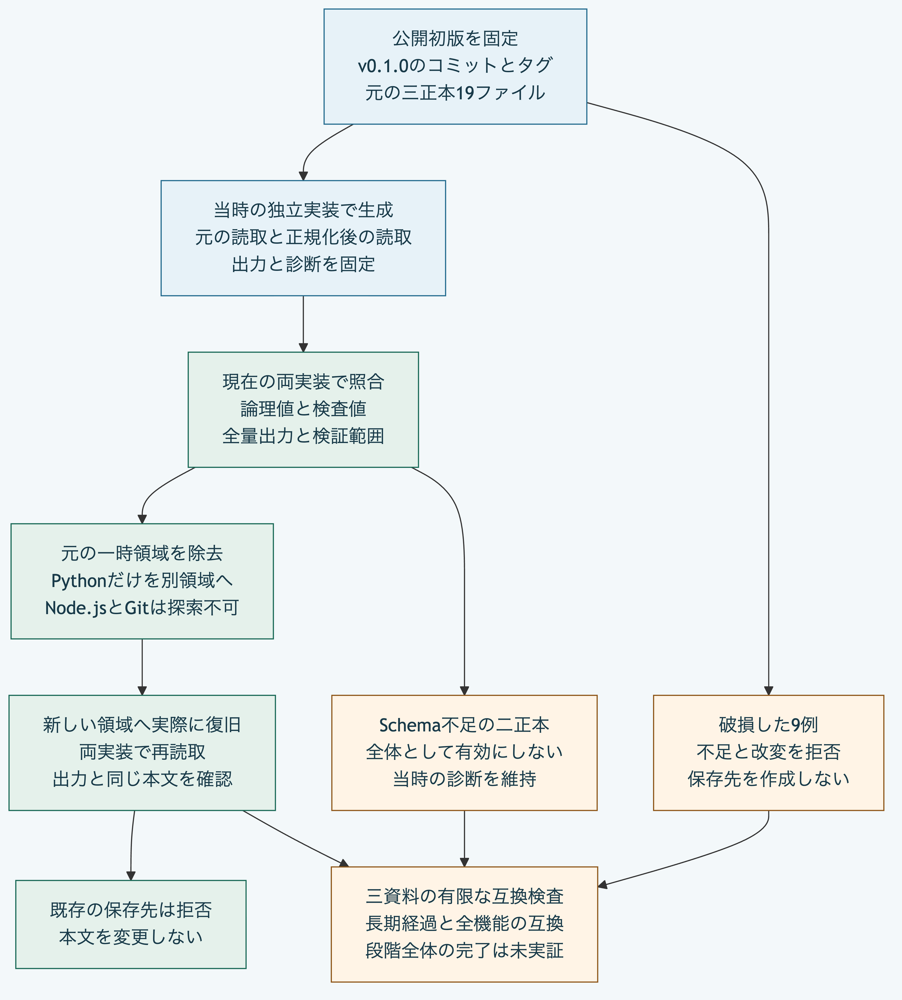

# 公開初版の正本を現行実装で読取と復旧する

公開初版の正本を、現在のNode.jsとPythonで読取、出力及び復旧する互換検査です。
過去の公開版の元ファイルと、当時の独立実装による期待結果を固定しています。
現在の実装の出力から期待値を作り直しません。
この検査は有限な三正本を対象とし、長期経過、全機能の互換性又はStage 6全体の完了を示すものではありません。

## 固定した公開版と資料

- 公開先：`koukemo/morivyx`。
- タグ：`v0.1.0`。
- タグのオブジェクト：`84ec87cb665977f7604505db6ee220b1acece8db`。
- 初版コミット：`306dec450c30c3dd5945ca4f0ffb787b50dc4193`。
- 初版一覧のSHA-256：`3b5509a0b3e289d42122e89bc0ad0f18e08387cf915afc09c22f316fee7b19de`。

| 正本 | 初版での出典 | ファイル数 | SchemaとGraphの検証結果 |
|---|---|---|---|
| `package-v1` | 中核検査の固定資料 | 5 | Schema不足で拒否 |
| `package-v1-roundtrip` | 承認、変更一覧、移行と追跡報告を含む固定資料 | 9 | Schema不足で拒否 |
| `complete-core` | Pythonの固定入力の読取例 | 5 | 同梱SchemaとGraphの制約の検証に成功 |

元資料は[固定した入力と期待結果](../tools/fixtures/first-public-packages.json)に保存しています。
このファイルのSHA-256は`152adc984bc8c1e3ec5fa4e5e410375ef1a7f73b56294af0940a956c04d1cbf7`です。
検査コードにこの値を固定し、各元ファイルの検査値も照合します。
初版のタグと既存の固定入力は変更していません。

期待結果は、初版コミットから取り出した本番用Python 26モジュールで生成しました。
現在の27モジュールとは区別します。
Python 3.14.10で生成し、生成物を再実行による出力とバイト単位で照合しました。
本番用Python、同梱Schema、元の14ファイル及び固定入力の計42ファイルについて、初版のGitオブジェクトと原文の検査値を照合しています。

## 照合する内容

現在の両実装で、次の内容を当時の期待結果と比較します。

- 元の正本の論理値、根とSchema固定情報の検査値。
- 承認、変更一覧、移行と追跡報告を含む各記録。
- 有効な正本の診断と、Schema不足の正本の第2段階の診断。
- 正規化したYAMLの全量出力と再読取した論理値。

元ファイルには時差付きの日時があり、初版の出力は同じ時刻のUTC表記へ正規化します。
元の読取結果と、出力後の読取結果は別の期待値として固定します。
原文と同じバイト列であることは復旧前の元資料に対して確認し、復旧先は当時の全量出力と同じバイト列であることを確認します。
どちらも根とSchema固定情報の検査値が一致します。

SchemaとGraphの制約の検証が成功する正本でも、署名、採用権限及び本人性を確認したものではありません。
Pythonの検証範囲の各項目も当時の結果と比較し、未検証の項目を成功へ変更しません。
Schema不足の二正本は読取可能ですが、Graph全体の有効性は確認できません。

## 元の一時領域を除去して復旧する

三正本を一時領域へ保存し、読取と全量出力の後で元の一時領域を除去します。
復旧には、現在の本番用Pythonファイルだけを別の領域へコピーして使います。
子プロセスの作業フォルダーと実行物の探索先を空にし、Node.jsとGitを解決できないことを確認します。

新しい保存先へPythonで実際に復旧した後、両実装で再読取します。
復旧後も、元資料にSchemaが不足していた場合の診断は残ります。
既存の保存先への復旧は拒否し、本文が変わらないことを確認します。

版の記録がない入力、不正な要素の検査値及び壊れたSchema固定情報は、両実装の読取とPythonの出力で拒否します。
同じ不正入力の復旧も拒否し、保存先が作成されないことを確認します。
三正本に各三種類の破損を与え、計9例の拒否を確認しています。



[図の生成元](diagrams/first-public-package-compatibility.mmd)

## 再実行する

Node.js 26.13.0以上と利用するPythonを使い、リポジトリのルートで実行します。

```sh
MORIVYX_REFERENCE_PYTHON=/path/to/python3 node --test tools/first-public-package-compatibility.test.mjs
```

新しい4試験は、Python 3.14.10と3.15.2で各4件が成功しています。
[標準の保守検査](../CONTRIBUTING.md)からも同じ試験が実行されます。
通常の試験は同梱した固定資料を使い、Git履歴、ネットワークとパッケージの追加導入を必要としません。

期待結果の由来を再生成する場合だけ、初版コミットを含むGit履歴とタグが必要です。
[生成用スクリプト](../tools/generate-first-public-packages.py)は、固定した初版のGitオブジェクトと当時のPython実装を使い、JSONを標準出力へ返します。
Python 3.14.10で実行すると、同梱した固定資料と同じ出力を得られます。

```sh
python3 tools/generate-first-public-packages.py | shasum -a 256
```

別のPython版では、生成時の版を示す項目が変わります。
通常の検査の期待値を更新する操作として、この生成を自動実行しません。
固定した初版の実装以外を実行する入力は受け付けません。

## 残る範囲

同じ初版内の三資料を照合する検査です。
将来の公開版間の長期互換、全機能の独立適合、互換期間と非推奨の方針、正式に採用した移行計画は別の課題です。
Git履歴、外部成果物の本文、認証情報と鍵は、この復旧の対象に含めません。
実際の提供元や実行環境の終了、長期保管媒体の耐久性を実証したものではありません。
