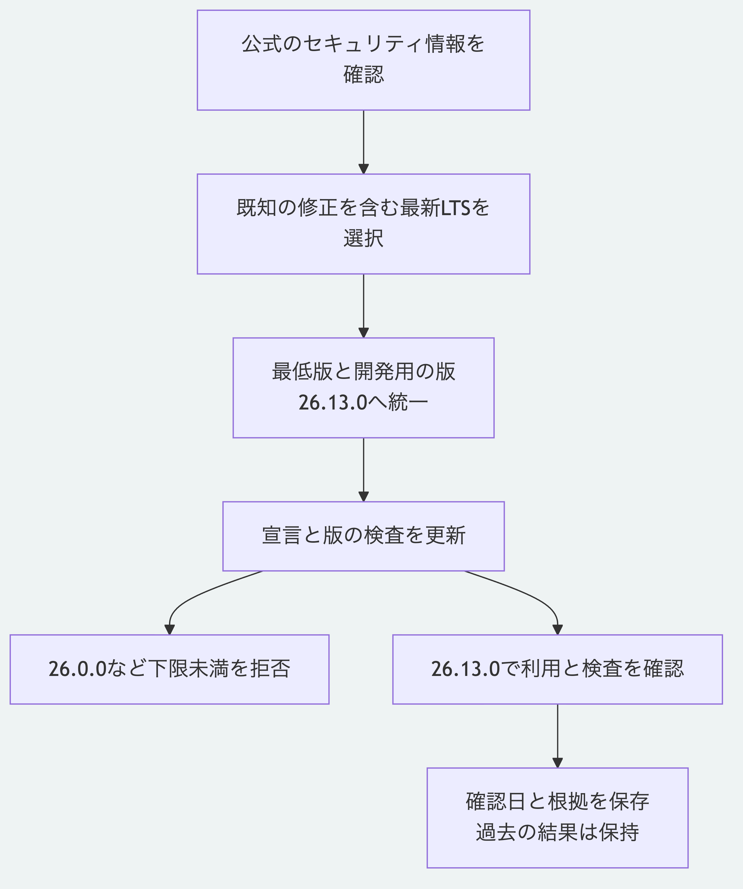
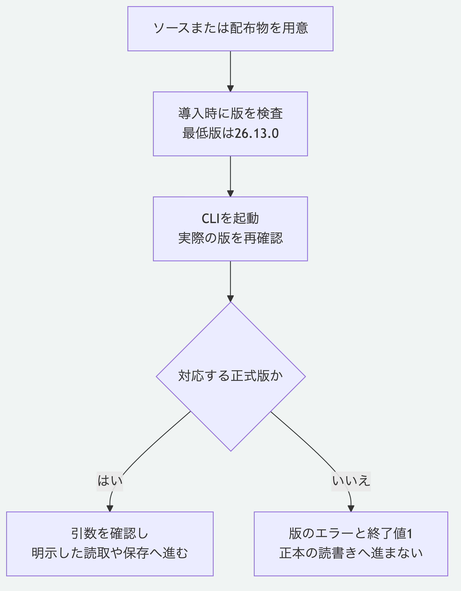

# Node.jsの最低版とセキュリティ情報

確認日は2026-11-02である。
現在の最低要件と開発用の選択版は、ともにNode.js `26.13.0`とする。
最低要件未満の版と先行版は使わない。

## 公式情報による判断

[2026-10-21の公式セキュリティ告知](https://nodejs.org/en/blog/vulnerability/october-2026-security-releases)は、26系の修正版を`26.12.1`としている。
[26.13.0の公式リリース情報](https://nodejs.org/en/blog/release/v26.13.0)は、LTSの表示以外に26.12.1から変更がないと説明している。
[公式のセキュリティ告知一覧](https://nodejs.org/en/blog/vulnerability)も確認した。

この情報を基に、セキュリティ修正を含む最新の26系LTSである26.13.0を下限に選んだ。
26.0.0は、その後の既知の修正を含まないため、現在の下限には使わない。
「既知の修正を反映済み」という判断であり、未発見の脆弱性が存在しないと認定するものではない。

## 適用範囲

Node.js本体の最低版を定める。
依存パッケージの脆弱性は別に検査し、Node.jsの更新だけで解消したとは扱わない。
今後、影響する脆弱性の公表を確認した場合は、修正版を調べてこの下限も更新する。
この記録自体は、新しい告知を自動監視する仕組みではない。

`package.json`の`engines.node`とlockを`>=26.13.0`へ揃える。
導入時は`engine-strict=true`、導入先のアプリでは`--engine-strict`を指定する。
`.nvmrc`と`.node-version`の選択版も26.13.0である。
CLIは、ソースから直接実行する場合も、引数処理と正本の読書きの前に版を検査する。
対応外の版では`NODE_VERSION_UNSUPPORTED`と終了値1を返す。
この実行時検査はCLIの入口に適用し、ライブラリとしての導入には従来の版要件を使う。
境界値、実際の旧版と配布物の[確認結果](validation/cli-runtime-minimum.md)を保存する。
過去のタグと検証結果は、その時点の資料として保持する。

[図の生成元](diagrams/node-security-floor.mmd)

[CLIの図の生成元](diagrams/cli-runtime-minimum.mmd)
