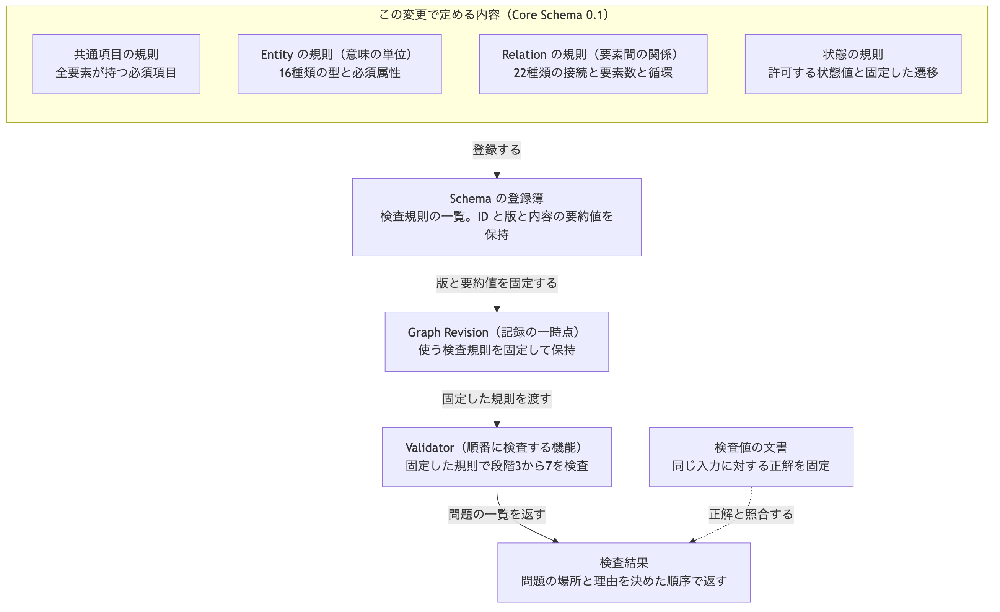
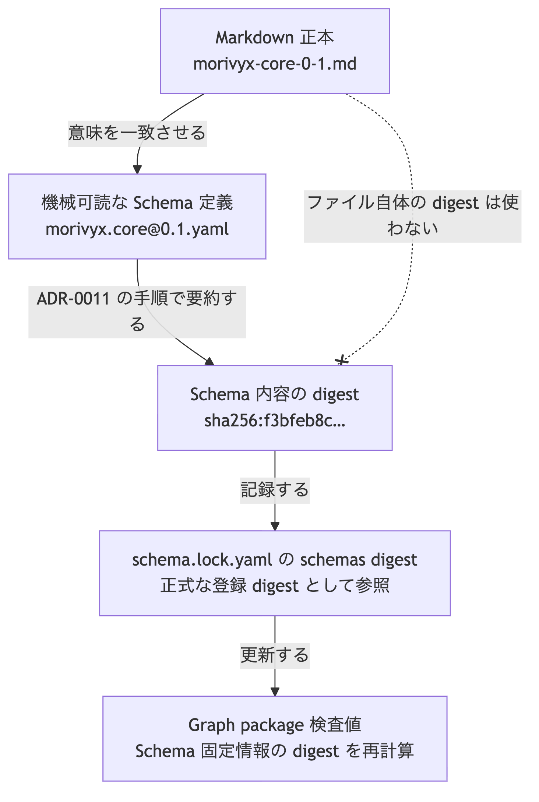
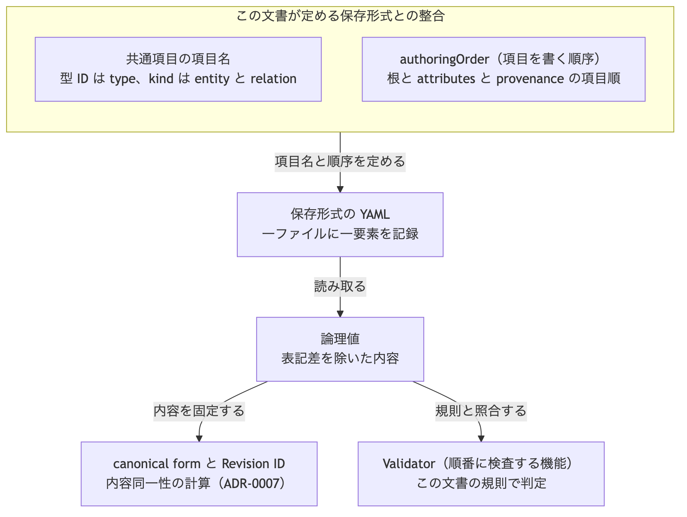
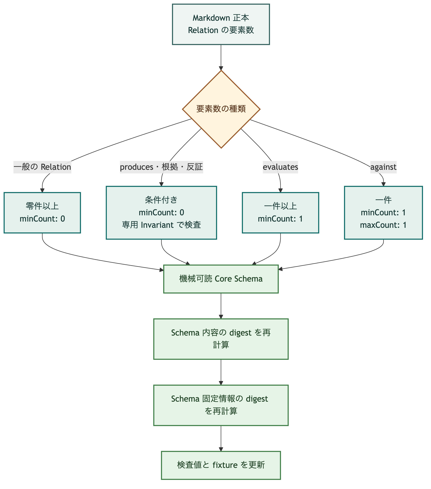

# Core Schema `morivyx.core` 0.1

## 目的

この文書は、Schema の登録簿へ最初に登録する Core Schema `morivyx.core` version `0.1` の内容を定めます。
ADR-0008 が定めた検証段階3から7の検査は、この文書の規則を参照します。
Schema と Validator の検査値（同梱対象外の参照）は、この Schema を固定した入力に対する正解を記録します。

## 全体像

この文書が定める規則と、登録簿、Graph Revision、Validator、検査値の関係を次の図に示します。



[Mermaid の生成元](../diagrams/morivyx-core-0-1-structure.mmd)

機械可読な Schema 定義と内容 digest の関係を次の図に示します。



[Mermaid の生成元](../diagrams/morivyx-core-0-1-machine.mmd)

## 登録簿への登録情報

ADR-0008 の登録簿が要求する情報を次に示します。

| 項目 | 値 |
|---|---|
| Schema ID | `morivyx.core` |
| version | `0.1` |
| digest 算法 | `sha256` |
| Schema 内容の digest | `sha256:f3bfeb8caaaf7ef46c847dd23c16845fedf6cd1c4547e75bd607961c995c90da` |
| 機械可読な Schema 定義 | [`morivyx.core@0.1.yaml`](morivyx.core@0.1.yaml) |
| 提供元 | Morivyx Core Profile |
| 読み取れる旧 version | なし |
| 書き込む version | `0.1` |

Schema 内容の digest は、[ADR-0011](../adr/0011-schema-definition-digest.md) が定める機械可読な Schema 定義 [`morivyx.core@0.1.yaml`](morivyx.core@0.1.yaml) から算出します。
この文書ファイル自体の digest は、Schema 内容の digest として使いません。

機械可読定義へ含める範囲は、ADR-0011 の項目に限ります。
Relation 共通属性の詳細、lifecycle 遷移表、`supported_by` の条件付き要素数は、この Markdown 正本を正とします。

## 名前空間の規則

`core` 名前空間の型、属性、Relation、状態値は、この文書に列挙したものに限ります。
列挙にない `core` の項目は `CORE_UNKNOWN` として拒否します。

`core` 以外の名前空間付き Extension は、意味を推定せず、名前空間、論理値、一覧順序を保持します。
Schema 固定情報に対応する Schema を含む Extension は未知として扱わず、その Schema で検査します。

## GraphElement の共通項目

すべての Entity と Relation は、次の共通項目を持ちます。
項目名は、ADR-0007 の Git authoring profile と serialization 検査値（同梱対象外の参照）の固定条件と同じです。

| 項目 | 必須 | 内容 |
|---|---|---|
| `format` | 必須 | Git authoring profile の識別。`morivyx.git-graph/0.1` |
| `kind` | 必須 | `entity` または `relation` |
| `id` | 必須 | 変更されない不透明な stable ID |
| `type` | 必須 | 名前空間付き型 ID |
| `typeVersion` | 必須 | 型を解釈する Schema の version |
| `revision` | 必須 | 内容が変わるたびに変わる Revision ID |
| `lifecycle` | 必須 | 型ごとに許可する状態値 |
| `reviewState` | 必須 | `unreviewed`、`proposed`、`approved`、`rejected` |
| `attributes` | 型による | 型ごとに定める属性の対応表 |
| `provenance` | 必須 | ADR-0006 が定める ProvenanceRecord |
| `extensions` | 任意 | 名前空間付きの拡張値 |

[中核メタモデル](../architecture/03-core-meta-model.md#graphelement)の `kind` と `schemaVersion` は、この文書の `type` と `typeVersion` に対応します。
`0.1` では、保存形式と同じ項目名を正とします。
記録時刻は `provenance` の `recordedAt` で表し、根の項目には置きません。

必須項目の欠落は `SCHEMA_REQUIRED_FIELD` として検出します。
`typeVersion` が Schema 固定情報の version と一致しない場合は `SCHEMA_VERSION_MISMATCH` として検出します。
`id` と `revision` は Graph Revision 内で一意とし、重複は `ID_DUPLICATE` として検出します。

## 項目を書く順序

ADR-0007 は、既知の対応表の項目順を Schema が定める `authoringOrder` に委ねます。
`0.1` の `authoringOrder` は次です。

| 対応表 | 項目順 |
|---|---|
| 根 | `format`、`kind`、`id`、`type`、`typeVersion`、`revision`、`lifecycle`、`reviewState`、`attributes`、`provenance`、`extensions` |
| `attributes` | NFC 正規化後の項目名を Unicode 符号位置の昇順に並べる |
| `provenance` | `method`、`actor`、`recordedAt` を先頭に置き、その他の項目を NFC 正規化後の項目名の Unicode 符号位置の昇順で後置する |

この項目順は、serialization 検査値（同梱対象外の参照）の固定条件と一致します。

この文書が定める項目名と項目順が、保存形式、内容同一性、検査とどう関係するかを次の図に示します。



[Mermaid の生成元](../diagrams/morivyx-core-0-1-authoring.mmd)

## lifecycle と review state

lifecycle の状態値は、型ごとに次の集合だけを許可します。
集合にない状態値は `CORE_UNKNOWN` として拒否します。

| 型 | 許可する lifecycle |
|---|---|
| `core.decision`、`core.execution`、`core.verification`、`core.observation` | `draft`、`active`、`accepted`、`deprecated`、`superseded`、`retracted` |
| `core.learning` | `draft`、`active`、`superseded`、`retracted` |
| その他の Entity 型と Relation | `draft`、`active`、`deprecated`、`superseded`、`retracted` |

`0.1` で状態遷移を固定する型は、ADR-0006 が定めた Criterion と Learning です。

```text
core.criterion: draft → active、draft → retracted、active → deprecated、active → superseded、active → retracted
core.learning:  draft → active、draft → retracted、active → superseded、active → retracted
```

固定した遷移にない改訂は `LIFECYCLE_TRANSITION` として検出します。
その他の型の遷移制約は、将来の version で定めます。

review state が `approved` の Revision は、その Revision に適用できる approval を必要とします。
lifecycle が `accepted` の要素は、Schema と Invariant の検証成功に加えて、Policy が要求する approval を必要とします。
適用できる approval がない場合は `APPROVAL_REQUIRED` として検出します。

## Entity 型

Entity は `kind` を `entity` とし、次の属性を `attributes` に持ちます。
必須属性の欠落は `SCHEMA_REQUIRED_FIELD` として検出します。

| 型 | 必須属性 | 任意属性 |
|---|---|---|
| `core.goal` | `statement`、`scope`、`beneficiaries` | `horizon` |
| `core.intent` | `motivation`、`priority` | `interpretation`、`nonNegotiables` |
| `core.criterion` | `method`、`evaluationRule`、`necessity` | なし |
| `core.decision` | `question`、`rationale`、`consequences` | `revisitTriggers`、`challengeReview` |
| `core.option` | `description` | `tradeoffs` |
| `core.knowledge` | `claim`、`epistemicState`、`scope` | `confidence` |
| `core.constraint` | `rule`、`severity` | `condition` |
| `core.plan` | `actions` | `dependencies`、`stopConditions` |
| `core.execution` | `actor`、`executedAt`、`outcome` | `inputs`、`idempotencyKey` |
| `core.artifact` | `artifactKind`、`uri` | `externalVersion`、`digest`、`mediaType` |
| `core.verification` | `method`、`result` | なし |
| `core.observation` | `value`、`method`、`observedAt` | なし |
| `core.learning` | `insight` | `confidence`、`recommendedChange` |
| `core.actor` | `actorKind`、`name` | なし |
| `core.context` | `scope` | `environment`、`timeRange`、`trustBoundary` |
| `core.external-source` | `externalId`、`system` | `snapshotAt` |

`core.criterion` の `necessity` は `required` または `optional` だけを許可します。
Option の選択状態は属性ではなく、Decision からの `selects` で表します。

## Relation 型

Relation は `kind` を `relation` とし、`attributes` に次の項目を持ちます。



[Mermaid の生成元](../diagrams/core-relation-cardinality.mmd)

| 項目 | 必須 | 内容 |
|---|---|---|
| `source` | 必須 | 接続元の stable ID |
| `predicate` | 必須 | この文書で定義する Relation の型名 |
| `target` | 必須 | 接続先の stable ID。Revision を固定する Relation では固定する Revision ID も持つ |
| `qualifiers` | 任意 | Relation への注釈 |

`0.1` が定義する Relation 型を次に示します。
表にない `core` の Relation は `CORE_UNKNOWN` として拒否します。

| Relation | 接続元 → 接続先 | 要素数 | 循環 |
|---|---|---|---|
| `refines` | Goal → Goal | 零件以上 | 禁止 |
| `interprets` | Intent → Goal | 零件以上 | 許可しない構造 |
| `has_criterion` | Goal → Criterion | 零件以上 | 許可しない構造 |
| `constrained_by` | Goal/Intent/Plan/Execution → Constraint/Knowledge | 零件以上 | 許可しない構造 |
| `addresses` | Decision → Goal/Intent/Knowledge | 零件以上 | 許可しない構造 |
| `considers` | Decision → Option | 零件以上 | 許可しない構造 |
| `selects` | Decision → Option | 零件以上 | 許可しない構造 |
| `supported_by` | Decision/Knowledge/Learning → Knowledge/Observation/Artifact | accepted Decision は一件以上 | 許可しない構造 |
| `challenged_by` | Decision/Knowledge → Knowledge/Observation | 零件以上 | 許可しない構造 |
| `governs` | Decision → Plan/Execution/Artifact/Verification | 零件以上 | 許可しない構造 |
| `pursues` | Plan → Goal/Intent | 零件以上 | 許可しない構造 |
| `executes` | Execution → Plan | 零件以上 | 許可しない構造 |
| `produces` | Execution/Verification → Artifact/Observation | Artifact Revision ごとに接続元一件 | 許可しない構造 |
| `realizes` | Artifact → Intent | 零件以上 | 許可しない構造 |
| `evaluates` | Verification → Artifact/Execution/Goal | Verification ごとに一件以上 | 許可しない構造 |
| `against` | Verification → Criterion | Verification ごとに一件 | 許可しない構造 |
| `observes` | Observation → Artifact/Execution/Context | 零件以上 | 許可しない構造 |
| `derived_from` | Learning → Observation/Verification、Artifact → Entity | 零件以上 | 許可しない構造 |
| `updates` | Learning → Knowledge | 零件以上 | 許可しない構造 |
| `triggers` | Learning → Goal/Decision/Plan | 零件以上 | 許可しない構造 |
| `supersedes` | 新 Entity → 旧 Entity | 零件以上 | 禁止 |
| `depends_on` | Entity → Entity | 零件以上 | 許可 |

表中の「許可しない構造」は、接続元と接続先の型が異なるため循環を構成できない Relation を指します。
「禁止」の Relation に循環がある場合は `CYCLE_FORBIDDEN` として検出します。

Relation の検査規則は次です。

- 接続先の Revision が入力 Graph Revision に存在しない場合は `RELATION_TARGET_MISSING` として検出します。
- 接続元または接続先の型が表の許可範囲にない場合は `RELATION_TYPE_DISALLOWED` として検出します。
- 要素数が表の許可範囲にない場合は `RELATION_CARDINALITY` として検出します。
- 同じ `source`、`predicate`、同じ対象 Revision の `target` を持つ正規 Relation の重複は `RELATION_DUPLICATE` として検出します。

正規 Relation は明示的な主張と Provenance を持ちます。
Provenance のない正規 Relation は `PROVENANCE_REQUIRED` として検出します。
外部から取得した Artifact Revision は、`produces` の代わりに ExternalSource、version、digest、取得時刻、取得 Actor を含む取込 Provenance を必要とします。

## 問題コードとの対応

Schema と Validator の検査値（同梱対象外の参照）の問題コードと、この文書の規則の対応を次に示します。

| 問題コード | 規則の所在 |
|---|---|
| `SCHEMA_LOCK_MISSING`、`SCHEMA_LOCK_CONFLICT` | ADR-0008 の Schema の登録と固定 |
| `CORE_UNKNOWN` | 名前空間の規則、lifecycle と review state、Entity 型、Relation 型 |
| `SCHEMA_REQUIRED_FIELD` | GraphElement の共通項目、Entity 型 |
| `SCHEMA_VERSION_MISMATCH` | 登録簿への登録情報、GraphElement の共通項目 |
| `ID_DUPLICATE` | GraphElement の共通項目 |
| `RELATION_TARGET_MISSING`、`RELATION_TYPE_DISALLOWED`、`RELATION_CARDINALITY`、`RELATION_DUPLICATE` | Relation 型 |
| `CYCLE_FORBIDDEN` | Relation 型 |
| `LIFECYCLE_TRANSITION` | lifecycle と review state |
| `PROVENANCE_REQUIRED` | Relation 型、GraphElement の共通項目 |
| `APPROVAL_REQUIRED` | lifecycle と review state |

## ADR-0006 の決定との対応

| ADR-0006 の決定 | この文書の規則 |
|---|---|
| 明示 Relation と派生 Relation | Relation 型の正規 Relation と Provenance の規則 |
| Decision の根拠と反証 | Relation 型の `supported_by` と `challenged_by`、Entity 型の `challengeReview` |
| Verification と Criterion の要素数 | Relation 型の `against` と `evaluates` の要素数 |
| Artifact Revision と Execution | Relation 型の `produces` の要素数と取込 Provenance |
| Criterion と Learning の lifecycle | lifecycle と review state の固定した遷移 |
| `stale` の位置 | lifecycle の状態集合に `stale` を含めない |
| approval の Provenance | lifecycle と review state の approval の条件 |
