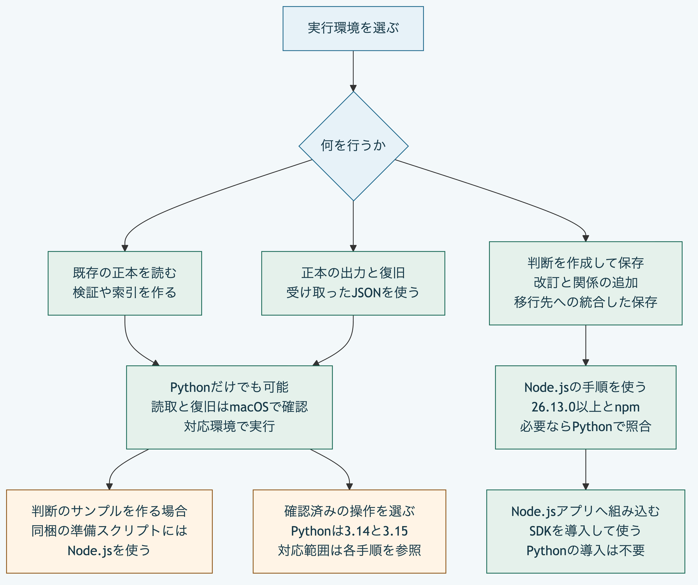

# Morivyxを使い始める

## 実行環境を選ぶ

既存の正本を読む場合は、Pythonだけでも始められます。
判断の作成と更新は、Node.jsの統合した入口と、Pythonで準備と検証と復旧を組み合わせる手順から選べます。
移行先の保存にも、Node.jsの統合した入口とPythonの実行例から選べます。
関係の追加にはNode.jsの手順を使います。

| 行いたい操作 | この公開版で使う環境 |
|---|---|
| YAMLを読む、既存の正本を検証する | [Pythonだけで実行可能](python-only.md)。Node.jsのCLIからも読取と検証を実行できる |
| 既存の正本から索引を作って調べる | [Node.jsとPythonの両方の入口](graph-index.md)がある。手順の最初のサンプル作成にはNode.jsを使う |
| 判断を作成して保存する、改訂する | [Node.jsで判断を保存](getting-started.md)して[改訂](revise-decision.md)するか、[Pythonの実行例](python-decision.md#自分の正本から作成して更新する)へ自分の正本と要求を渡す |
| 関係を加える | [Node.jsで関係を追加](trace-relations.md)する |
| Schemaを変えて別の保存先へ移行する | [Node.jsで準備と保存](schema-migration.md)するか、[Pythonの実行例](python-migration.md)へ自分の正本と明示した要求を渡す |
| 明示した移行と変換先Schemaから新しい正本を保存する | [Pythonの保存入口](python-package-migration-writer.md)で検証と再読取後に確定する。計画の入口と正式な採用は別に扱う |
| 正本を出力する、受け取ったJSONを新しい先へ復旧する | [出力と復旧にはPythonだけ](backup-restore.md)を使える。手順のサンプルを最初から作る場合はNode.jsも使う |
| 自分のNode.jsアプリへ組み込む | [Node.jsとnpm](installed-node.md)を使う。Pythonの導入は不要 |
| 実行情報を生成し、信頼する子を明示して起動する | [Pythonだけでも実行可能](python-plugin-runtime.md)。時間と出力の上限は扱うが、OSの権限の隔離は行わない |
| 入力を複写し、コンテナ実行の条件と後片付けを照合する | [Pythonで実行へ接続する](python-plugin-container.md)。模擬接続で確認し、実際のOS隔離と実基盤の真正性は別に確認する |
| 取得した生の応答を別の許可の変換へ渡す | [Pythonで取得と隔離変換を接続する](python-network-import-container.md)。結果を再計算して照合し、実認証と実際のOS隔離は別に確認する |
| 取得済みの配布物のバイト列を照合する | [Pythonだけで固定値へ比較](python-plugin-supply-chain.md)。署名の有効性と配布元の真正性は未検証 |
| 要求を受けて結果を返す応答側を作る | [Pythonだけでも実装可能](python-plugin-stdio.md)。許可と時間の管理は起動側へ接続する |
| ローカルファイルを取得し再取込の衝突を調べる | [Pythonだけで取込と判定が可能](python-repository-import.md)。取得元の真正性と読取中の差替えの競合は未実証 |
| OpenAPI文書から操作を選び再取込を比較する | [Pythonだけで文書を検査して比較](python-openapi-import.md)。参照先の取得と操作の実行は行わない |
| Figmaの指定した対象を取り込み再取込を比較する | [Pythonの六つの入口](python-figma-import.md)。取得済み本文と明示した取得を区別し、実認証は別に確認する |
| GitHubの固定した版のファイルを取り込み再取込を評価する | [Pythonの七つの入口](python-github-import.md)。取得済み応答と明示した取得を区別し、ローカル変更の競合も評価する |
| 既存の台帳へ承認、変更一覧と移行記録を加える | [Pythonだけで追記する](python-ledger-store.md)。本人性と採用権限は別に確認する |
| 取込済みの結果を資料として新しい正本へ保存する | [Pythonだけで取込保存と汎用の変更適用を行う](python-import-snapshot-creation.md)。元の正本を保持して再検証後に確定する |
| 以前の取込履歴を照合し、資料を改訂して保存する | [Pythonだけで再取込を改訂保存する](python-import-snapshot-revision.md)。ローカル変更と時刻の逆転を拒否し、元の正本を保持する |
| 資料を保持して取得成功の観測を保存する | [Pythonだけで観測と関係を追加する](python-import-presence.md)。ローカル変更と外部の変化を記録し、資料の版を保持する |
| 資料を保持して取得失敗の観測を保存する | [Pythonだけで対象不在と取得不能を記録する](python-import-availability.md)。以前の基準と時刻を照合し、資料の版を保持する |

Node.jsの最低要件は`26.13.0`です。
Pythonは`3.14`と`3.15`で確認しています。
Pythonによる安全なファイルの読取と復旧にはPOSIXの操作が必要で、同梱の手順はmacOSで確認しています。
Pythonは変更一覧と移行の適用計算も扱いますが、ここで案内する判断や移行の保存手順と同一の統合CLIを提供するものではありません。

例では、Node.jsのCLIには正本を含むプロジェクトのフォルダーを渡します。
Pythonのファイル読取には、その中の`.morivyx`を明示します。
下の`/path/to/project`は、実際の保存先へ置き換えます。

```sh
node packages/kernel/src/cli.js inspect /path/to/project
python3 packages/portable-core/package_records.py /path/to/project/.morivyx
```



[図の生成元](../diagrams/runtime-choice.mmd)

## 目的から手順を選ぶ

| 試したいこと | 手順 | 得られる結果 |
|---|---|---|
| 自分の正本を検査する | [正本を検査して失敗の原因を切り分ける](validate-package.md) | 読取と検証の違い、終了コードと失敗箇所を確認する |
| Schemaを変えて移行する | [Schemaを変えて新しい正本へ移行する](schema-migration.md) | 候補と差分を確認し、元を保持して新しい正本を両実装で検証する |
| 種類と入出関係を調べる | [正本から索引を作って種類と関係を調べる](graph-index.md) | 両実装で索引を再生成し、検索結果と照合範囲を確認する |
| 判断と理由を保存する | [最初の判断を保存して差分を確認する](getting-started.md) | 元を保持したまま判断を加え、差分を確認する |
| 判断の理由を改訂する | [判断を改訂して履歴を比較する](revise-decision.md) | 同じ識別子の新しい版を保存し、改訂前後と変更記録を確認する |
| 資料から判断と根拠をたどる | [資料から判断と根拠をたどる](trace-relations.md) | 関係のある経路と不足する関係を確認する |
| 正本を別の保存先へ戻す | [正本をJSONへ出力して復元する](backup-restore.md) | 全体の検査値を照合し、元と既存の保存先を保持して復元する |
| 自分のNode.jsアプリへ組み込む | [別のNode.jsアプリへSDKを導入する](installed-node.md) | 配布アーカイブを導入し、公開APIとCLIで正本を読む |
| Node.jsを導入せずに試す | [Pythonだけで中核の操作を試す](python-only.md) | YAMLの読取と固定例の検証を行う |
| Pythonだけで判断を保存する | [Pythonだけで判断を作成して更新する](python-decision.md) | 候補を準備し、適用後を検証して新しい保存先へ復旧する |
| Pythonだけで判断を人が読む本文へ出力する | [Pythonだけで判断をMarkdownへ出力する](python-decision-markdown.md) | 本文と検査値を生成し、元を保持して新しいファイルへ保存する |
| Pythonだけで別のSchemaへ移行する | [Pythonだけで正本を新しいSchemaへ移行する](python-migration.md) | 実ファイルと明示した要求を検証し、本文と報告名を保持して新しい保存先へ移す |
| 拡張機能の宣言を検査する | [Pythonだけで拡張機能の宣言を検査する](python-plugin-manifest.md) | 宣言の構造と機能を確認し、実行の許可から分ける |
| 拡張機能の要求を許可情報へ照合する | [Pythonだけで実行側の許可情報へ照合する](python-plugin-host-policy.md) | 権限の包含と資源上限を静的に照合する |
| 拡張機能の要求と結果を検査する | [Pythonだけで要求と結果を検査する](python-plugin-messages.md) | メッセージの形式、宣言と要求への対応を確認する |
| 信頼する子を明示して起動する | [Pythonだけで実行情報を生成して子を起動する](python-plugin-runtime.md) | 不変の実行情報、時間と出力の上限及び結果の照合を使う |
| 本体と付属物のバイト列を照合する | [Pythonだけで配布物を照合する](python-plugin-supply-chain.md) | 独立した固定値と比較し、欠落と不一致を区別する |
| 拡張機能の応答側を作る | [Pythonで標準入出力を扱う](python-plugin-stdio.md) | 検証と処理を接続し、一つの結果又は固定した診断を返す |
| ファイルを取り込み再取込の衝突を調べる | [Pythonだけでローカル取込を行う](python-repository-import.md) | バイト列の検査値、外部の変更とローカルの衝突を区別する |
| OpenAPI文書から操作を選んで比較する | [PythonだけでOpenAPI取込と比較を行う](python-openapi-import.md) | 全文の検査値、情報損失と再計算した欠落を区別する |
| Graphの版を示す記録を検査する | [Pythonだけで記録と診断位置を検査する](python-graph-revision.md) | 元ファイル位置を診断へ結び、記録構造の検査とGraph全体の整合を分ける |

Morivyxは現時点では、アプリケーションへ組み込む中核SDKとCLIのソース配布です。
専用の操作画面、実モデル連携、本人認証を済ませた承認操作は含みません。
手順は現在の`main`向けで、初版のタグ`v0.1.0`には後から追加した文書と実装例を含めません。

[プロジェクトの入口](../../README.md)と[仕様の入口](../README.md)へ戻れます。
