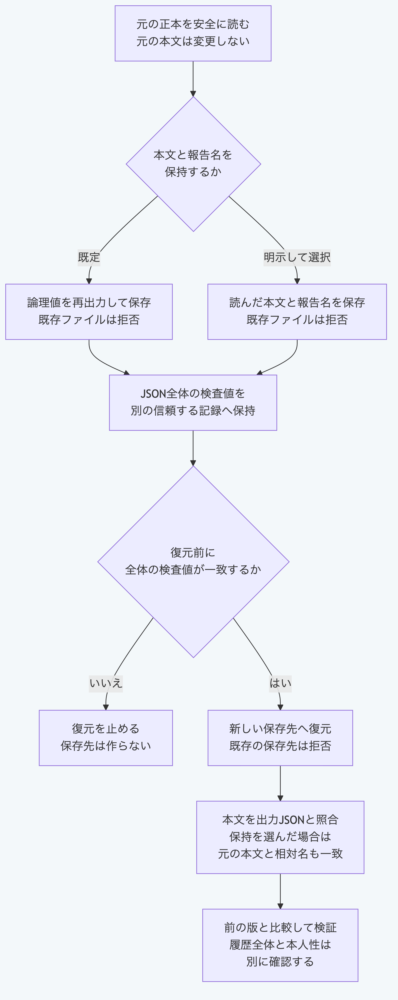

# 正本をJSONへ出力して復元する

正本の記録をJSONへ出力し、別の保存先へ復元します。
復元にはPythonだけを使い、Node.jsとGitの起動は不要です。
既定の論理値の再出力と、元の本文を保持する方法から選べます。
対象は指定した正本のファイルで、履歴と外部成果物の全体を保存する方式ではありません。

| 対象 | この手順で保持するもの |
|---|---|
| 正本の記録 | 要素、承認記録、変更記録、移行記録と報告の論理値、識別子、版と検査値 |
| Schema | 固定情報と同梱した定義の本文 |
| YAMLの表記と報告名 | 既定は再出力する。[本文を保持する方法](#5-元の本文と報告名も保持する)では、元のUTF-8本文と相対ファイル名を引き継ぐ |
| 過去の版 | 別の正本として指定した版を個別に出力する。Git履歴全体は含めない |
| その他 | 索引、保存先の外にある成果物本文、鍵とリポジトリの設定は含めない |
| ファイルの属性 | 所有者、時刻、アクセス権と空のフォルダーは保存しない |

この例のJSONは8 MiBまでです。
大きな正本の分割や、外部本文を含む全体の保管機能ではありません。
Python 3.14と3.15、POSIXのファイル操作を使い、macOSで確認しています。
以下のコマンドはリポジトリ直下で実行します。

## 1. 二つの正本を用意する

[最初の判断の手順](getting-started.md)で`.tutorial/base`と`.tutorial/after`を作成済みなら、次の節へ進みます。
未作成の場合は、Node.jsの依存を導入したうえで次を実行します。
このサンプルの作成だけはNode.jsを使います。
既存の正本を受け取った場合は、以降の入力パスを実際の`.morivyx`へ置き換えます。

```sh
node examples/getting-started/prepare.mjs .tutorial
node packages/kernel/src/cli.js create-decision .tutorial/base .tutorial/decision.yaml .tutorial/after
```

準備のコマンドは既存の`.tutorial`を再利用しません。
別の試行で作成したフォルダーがある場合は、上書きせず別の名前を使います。

## 2. 新しいJSONファイルへ出力する

```sh
python3 -B examples/backup-restore/export.py .tutorial/base/.morivyx .tutorial/base-backup.json
python3 -B examples/backup-restore/export.py .tutorial/after/.morivyx .tutorial/decision-backup.json
```

成功時は`backupCreated: true`と、`backupSha256`、`backupBytes`、`files`、`graphRevision`、`rootDigest`、`schemaLockDigest`を返します。
出力先が既にある場合は`BACKUP_OUTPUT_EXISTS`で停止し、上書きしません。
元の`.morivyx`の中を出力先にする場合も、`BACKUP_OUTPUT_IN_SOURCE`で拒否します。
新しいファイルは所有者だけが読書きできる権限で作ります。

二つの`backupSha256`を、JSONとは別の信頼できる記録へ保存します。
これは末尾改行を含むJSONファイル全体のSHA-256で、正本の`rootDigest`とは別の値です。
受け取ったファイルと同じ場所の値だけを、提供者の本人性の証明には使えません。

## 3. 全体の検査値を照合して新しい先へ復元する

次の二つの値を、それぞれ前の節で記録した64桁の小文字の値へ置き換えます。
`sha256:`という接頭辞は付けません。
別のPCへ移す場合は、JSONに加え、`examples/backup-restore`と`packages/portable-core`の相対配置を保ってコピーします。
下の例では、JSONを移動先の作業フォルダーの`.tutorial`へ置きます。

```sh
MORIVYX_BASE_BACKUP_SHA256='baseのbackupSha256へ置換'
MORIVYX_DECISION_BACKUP_SHA256='afterのbackupSha256へ置換'
mkdir .tutorial/restored-base .tutorial/restored-decision
python3 -B examples/backup-restore/restore.py .tutorial/base-backup.json .tutorial/restored-base/.morivyx --sha256 "$MORIVYX_BASE_BACKUP_SHA256"
python3 -B examples/backup-restore/restore.py .tutorial/decision-backup.json .tutorial/restored-decision/.morivyx --sha256 "$MORIVYX_DECISION_BACKUP_SHA256"
```

保存先の親は先に用意し、`.morivyx`自体は未作成の場所を指定します。
親フォルダーは、処理中に他から変更されない場所を選びます。
検査値が違う場合は`BACKUP_DIGEST_MISMATCH`で止まり、保存先は作りません。
既存の保存先は`PACKAGE_RESTORE_TARGET_UNAVAILABLE`で拒否します。

成功時の`restored: true`、`revision`、`rootDigest`と`schemaLockDigest`を、出力時の値へ照合します。
`filesWritten`はJSONの対応表の件数です。
復元したファイルはJSONに含まれる本文のバイト列へ一致します。
元の正本の表記を保持するには、第5節の選択肢を出力時に指定します。
いずれも電源断を含む原子的な保存を保証する意味ではありません。

途中の失敗で`PACKAGE_RESTORE_INCOMPLETE`が返った場合は、残った保存先を成功と扱いません。
途中保存の印を外して再利用せず、原因を確認して新しい保存先を用意します。
出力の失敗時も、未確認のJSONを成功した出力として扱いません。

## 4. 読み直して検証範囲を確認する

```sh
python3 -B packages/portable-core/package_records.py .tutorial/restored-decision/.morivyx
python3 -B packages/portable-core/package_validation.py .tutorial/restored-decision/.morivyx --previous .tutorial/restored-base/.morivyx
```

読取結果の`calculatedRootDigest`と`calculatedSchemaLockDigest`が出力時と一致することを確認します。
サンプルでは検証結果が`valid: true`、`validation.graphConstraintsValidated: true`になります。
前の正本を指定した比較でも、`historyAncestryValidated`は`false`で、Gitの祖先関係全体の検証ではありません。
`signaturesValidated`も`false`のままで、復元の成功を本人性や承認権限の確認に数えません。

## 5. 元の本文と報告名も保持する

出力時に`--preserve-source`を付けると、既存の安全な読取を使って、記録構造と検査値を確認した実ファイルの本文を保存します。
引用方法、許可された空行と項目順、報告の別名を再出力せずに保持します。
同じJSON形式を使い、復元の入口と全体の検査値の照合方法は変わりません。

```sh
python3 -B examples/backup-restore/export.py .tutorial/base/.morivyx .tutorial/base-source-backup.json --preserve-source
mkdir .tutorial/restored-source
MORIVYX_SOURCE_BACKUP_SHA256='上のbackupSha256へ置換'
python3 -B examples/backup-restore/restore.py .tutorial/base-source-backup.json .tutorial/restored-source/.morivyx --sha256 "$MORIVYX_SOURCE_BACKUP_SHA256"
python3 -B packages/portable-core/package_validation.py .tutorial/restored-source/.morivyx
```

出力結果の`sourceBytesPreserved`は`true`です。
既定の出力では`false`で、論理値からYAML本文を従来どおり再出力してJSONへ保存します。
`backupSha256`は信頼できる出力操作の結果から別に保持し、受け取ったJSONだけを根拠に正しい検査値だと判断しません。

この方法は、出力した時点で読み取れたUTF-8本文を同じ相対名で復旧するものです。
元の保存先がなくなった後でも、正しいJSON、信頼する全体の検査値、Pythonの中核と復元例があれば復旧できます。
対応する実行環境と権利表示を含むソース一式も別に保管します。
同時変更の全面的な排除、本人性、署名、Git履歴全体と長期保管の実証ではありません。
読取は記録構造と検査値までで、実SchemaとGraph制約は復旧後の検証へ明示して接続します。

## 手順の自動確認

```sh
node tools/check-backup-restore-tutorial.mjs python3
```

検査用の一時サンプルだけを作り、元の本文が変わらないことを確認した後、そのサンプルを除去して復元します。
コピーしたPython実装と例だけを使い、子プロセスのPATHにはNode.jsとGitを置きません。
二つの正本、出力の本文バイト列、根とSchemaの検査値、既存ファイルと保存先の保持、誤った検査値と不正な入力の拒否を確認します。
OSによる完全な隔離や、実際の提供元の終了を実証する検査ではありません。

[本文を保持する検査](../../tools/backup-source-preservation.test.mjs)は、日本語の報告名と空行を含む正本を出力し、元を除去してから中核だけの環境で復元します。
相対名と全本文の一致、従来の出力の固定した検査値、既存先、リンク、出力上限及び検査値の不一致の拒否を確認します。



[図の生成元](../diagrams/backup-restore-tutorial.mmd)

[Python単独の手順](python-only.md)と[利用手順の入口](README.md)へ戻れます。
