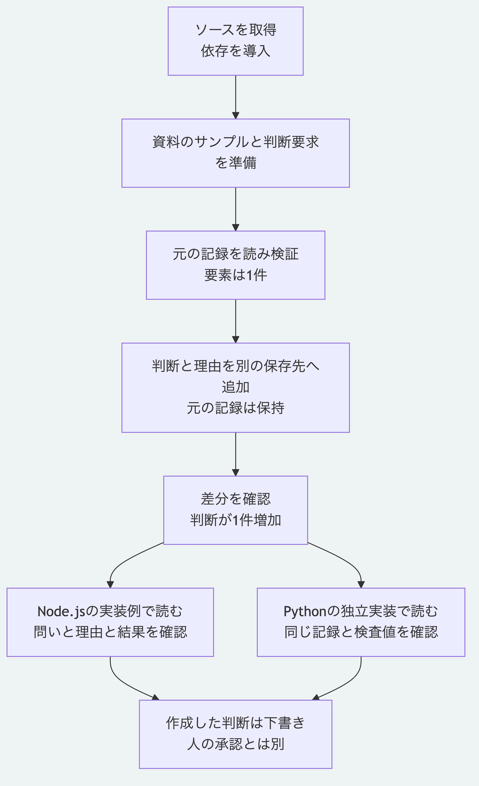

# 最初の判断を保存して差分を確認する

この手順では、「設定の保存形式にYAMLを選ぶ」という判断と、その理由を保存します。
既存の資料の記録を読み、判断を加えた別の保存先を作り、何が増えたか確認します。
操作はローカルで完結し、モデルの契約や認証情報は必要ありません。
対象は公開リポジトリの現在の`main`です。
初版のタグ`v0.1.0`には、この追加チュートリアルは含まれません。

## 1. ソースと実行環境を準備する

Node.js `26.13.0`以上と`npm`、ソース取得用の`Git`を用意します。
開発用の選択版は`26.13.0`です。
Pythonの節も試す場合は、検査済みの`3.14`または`3.15`を用意します。
以下はシェルで実行し、特に断りのないコマンドはリポジトリ直下で実行します。
ソース取得と依存ライブラリの導入には通信が必要です。

```sh
git clone --depth 1 https://github.com/koukemo/morivyx.git
cd morivyx
node --version
python3 --version
npm ci --prefix packages/kernel --ignore-scripts --no-audit --no-fund
node packages/kernel/src/cli.js --version
```

Pythonを使わない場合は、`python3 --version`を省略できます。
`nvm`を導入済みの場合は、リポジトリ直下で`nvm install`と`nvm use`を実行すると、`.nvmrc`の版を選べます。
`.node-version`にも同じ版を記録しています。
これらのファイル自体が、実行中のNode.jsを自動で切り替えるものではありません。
導入時に`EBADENGINE`が出た場合は、`node --version`を確認して26.13.0以上へ切り替えます。
CLIの版として`0.1.0`が表示されます。
現時点ではソース配布です。
`npm install @morivyx/kernel`によるレジストリからの導入は案内していません。

## 2. サンプルを準備する

```sh
node examples/getting-started/prepare.mjs .tutorial
```

`valid: true`が表示され、次のファイルを作ります。
この道具はチュートリアル用のデータ生成例であり、一般用途の初期化コマンドではありません。

```text
.tutorial/
  base/.morivyx/
    graph/entities/00000000-0000-4000-8000-000000000001.yaml
    schemas/morivyx.core@0.1.yaml
    schema.lock.yaml
    revision.yaml
  decision.yaml
```

`base`には資料を表す`core.artifact`が1件あります。
`decision.yaml`は追加したい判断の要求で、まだ`base`へ反映していません。
要求には問い、理由、結果、識別子、記録主体と記録時刻を含めます。
今回の識別子と時刻は、結果を再現するためのサンプル値です。
主体の識別子を記載しても、本人認証を行ったことにはなりません。

## 3. 読み取って検証する

```sh
node packages/kernel/src/cli.js inspect .tutorial/base
node packages/kernel/src/cli.js validate .tutorial/base
```

`inspect`では`graphRevision: "graph:tutorial-base"`と`elementCount: 1`が表示されます。
`validate`では`valid: true`と`issues: []`を確認します。
保存した内容の検査値、Schemaの対応とGraphの制約を調べます。

## 4. 判断を加えた別の保存先を作る

```sh
node packages/kernel/src/cli.js create-decision .tutorial/base .tutorial/decision.yaml .tutorial/after
node packages/kernel/src/cli.js inspect .tutorial/after
node packages/kernel/src/cli.js validate .tutorial/after
```

作成結果は`valid: true`、`graphRevision: "graph:tutorial-decision"`、`elementCount: 2`になります。
`.tutorial/base`は入力として保持され、変更後の正本と変更記録は`.tutorial/after/.morivyx`に保存されます。
保存先は、まだ存在しないフォルダーを指定します。

追加した判断は`core.decision`で、状態は`lifecycle: "draft"`と`reviewState: "unreviewed"`です。
作成と検証が成功しても、判断の承認や本人認証を意味しません。

## 5. 差分と理由を確認する

```sh
node packages/kernel/src/cli.js diff .tutorial/base .tutorial/after --evaluated-at 2026-11-02T00:10:00Z
node examples/getting-started/read.mjs .tutorial/after
```

差分の`report.entries`に`kind: "entity_added"`が1件あります。
対象は末尾が`000000000002`の判断です。
2つ目のコマンドはNode.jsの`readGraphPackage`を呼ぶ[短い実装例](../../examples/getting-started/read.mjs)です。
判断の`attributes`に、次の内容が表示されます。

```json
{
  "question": "設定の保存形式を何にするか？",
  "rationale": "変更理由を差分で読めるよう、YAMLを選ぶ。",
  "consequences": ["構造の検証を行ってから変更を保存する。"]
}
```

この例では資料と判断の関係は追加していません。
理由を保存する操作と、資料への関係を作る操作は別です。

## 6. Pythonで同じ結果を読む

```sh
python3 packages/portable-core/package_records.py .tutorial/after/.morivyx
python3 packages/portable-core/package_validation.py .tutorial/after/.morivyx --previous .tutorial/base/.morivyx
```

Node.jsのCLIには`.tutorial/after`を渡し、Pythonのファイル読取には`.tutorial/after/.morivyx`を渡す点に注意してください。
読取結果は`graphRevision: "graph:tutorial-decision"`、`counts.elements: 2`、`counts.changeSets: 1`です。
検証結果は`valid: true`と`issues: []`になります。
サンプルを準備した後、この2コマンドはNode.jsや通信を使いません。

読取の成功はSchemaとGraphの意味の検証全体を含みません。
2つ目のコマンドがその範囲を追加で検証し、`validation`に検証範囲を出力します。
署名、承認権限と履歴の祖先関係の認証は行いません。
Node.js版とPython版の入力範囲が完全に同じであるという意味ではありません。

## Pythonだけで始める場合

ソース取得後、Node.jsと依存ライブラリを導入せず、まず[Python単独の手順](python-only.md)を試せます。
固定例の全検査は次のコマンドで実行できます。

```sh
python3 tools/check-portable-vectors.py
```

`valid: true`、`cases: 24`、`matched: 24`を確認します。

## 自分のアプリケーションから使う

[別のNode.jsアプリへSDKを導入する手順](installed-node.md)で、このサンプルを自分のアプリから読めます。
配布アーカイブの作成、導入先の設定、公開APIとCLIの利用、固定した依存の再導入まで試せます。
アプリへ置く実行例も同梱しており、npmへの登録は必要ありません。

## うまく動かないとき

[正本の検査と失敗の切り分け](validate-package.md)では、終了コードと出力先、読取と意味の検証の違い及び元を保持した確認方法を説明しています。

| 状況 | 確認すること |
|---|---|
| `ERR_MODULE_NOT_FOUND`で`yaml`が見つからない | リポジトリ直下で導入の`npm ci`を実行する |
| `NODE_VERSION_UNSUPPORTED`になる | CLIを起動したNode.jsを26.13.0以上の正式版へ切り替える。導入後に実行環境を戻していないか確認する |
| サンプル作成が`EEXIST`になる | `.tutorial`が既にあるため、新しいフォルダー名を選び、以降のコマンドのパスも合わせる |
| `create-decision`が既存の保存先を拒否する | `.tutorial/after-2`など未使用の保存先を指定する |
| ファイルやSchemaが見つからない | リポジトリ直下で実行しているか、Node.jsとPythonに渡すフォルダーの違いを確認する |
| 手でYAMLを変えた後に検査値が一致しない | この例では生成済みの正本を直接編集せず、新しいフォルダーでサンプルを作り直す |
| WindowsでPythonの安全なファイル読取が使えない | このファイル操作例はmacOSで確認済み。POSIXのファイル操作を提供する環境を使う |

[利用手順の入口](README.md)と[仕様の入口](../README.md)へ戻れます。



[図の生成元](../diagrams/getting-started.mmd)
