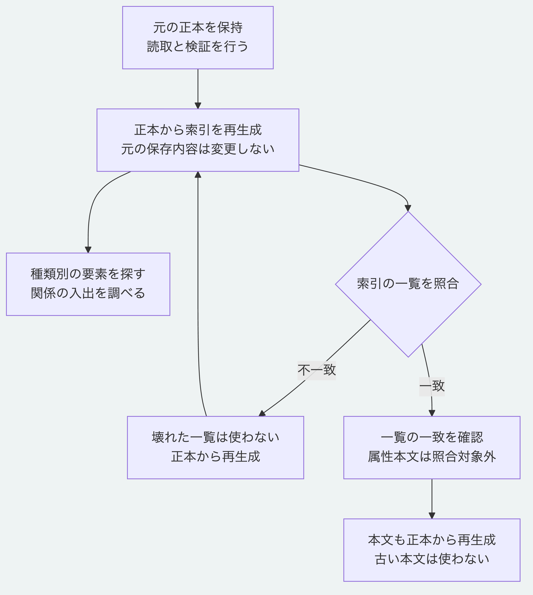

# 正本から索引を作って種類と関係を調べる

索引は、正本から種類別の要素と入出関係を取り出すための派生データです。
この手順では、7要素を含むサンプルから索引を作り、両実装で同じ結果を確認します。
生成元の正本と保存済みの検査値は変更しません。
対象は公開リポジトリの現在の`main`で、Node.js 26.13.0以上、導入済みの依存と、Pythonの節では3.14または3.15を使います。
準備は[最初のチュートリアル](getting-started.md)の手順1を参照し、以下はリポジトリ直下で実行します。

## 1. 関係を含むサンプルを準備する

まだ存在しない`.tutorial-index`を指定します。
既にある場合は別のフォルダー名を選び、後のコマンドも同じ名前へそろえます。

```sh
node examples/getting-started/prepare.mjs .tutorial-index
node packages/kernel/src/cli.js create-decision .tutorial-index/base .tutorial-index/decision.yaml .tutorial-index/after
node examples/getting-started/link.mjs .tutorial-index/after .tutorial-index/linked
node packages/kernel/src/cli.js validate .tutorial-index/linked
```

資料、判断と二つの観測及び三つの関係を含み、検証結果は`valid: true`になります。
資料と観測は説明用のサンプルで、実際の測定結果ではありません。
関係の意味をたどる手順は[判断と根拠の追跡](trace-relations.md)を参照してください。

## 2. CLIで索引を再生成する

```sh
node packages/kernel/src/cli.js reindex .tutorial-index/linked
```

`valid: true`と`index`が標準出力に表示されます。
`index.graphRevision`は`graph:tutorial-linked`で、`index.elements`は7件です。
`rootDigest`は生成元の正本の検査値に対応します。
このコマンドは索引を正本のフォルダーへ保存せず、その場で再生成します。
正本の不一致を修復する操作でも、以降の読取を自動で高速化する設定でもありません。

| 一覧 | 含める内容 |
|---|---|
| `elements` | 要素の識別子、種類と版の検査値。属性本文は含めない |
| `types` | 種類ごとの要素の識別子 |
| `outgoing` | 指定要素を出発点とする関係の識別子 |
| `incoming` | 指定要素を到着点とする関係の識別子 |

## 3. Node.jsで種類と入出関係を調べる

同梱した[Node.jsの実行例](../../examples/graph-index/read.mjs)は、読取に成功した正本から毎回索引を作り直します。
引数は正本のフォルダー、探す種類、入出関係を調べる要素の識別子の順です。

```sh
node examples/graph-index/read.mjs .tutorial-index/linked core.decision urn:uuid:00000000-0000-4000-8000-000000000001
```

`query.elementIds`に末尾が`000000000002`の判断が1件あります。
資料を表す末尾`000000000001`には、末尾`000000000021`の関係が入るため、`query.incomingRelationIds`へ表示されます。
この資料から出る関係はなく、`query.outgoingRelationIds`は空です。

次は判断から出る三つの関係と、二つの観測を確認します。

```sh
node examples/graph-index/read.mjs .tutorial-index/linked core.observation urn:uuid:00000000-0000-4000-8000-000000000002
```

`query.elementIds`は末尾`000000000011`と`000000000012`の観測です。
`query.outgoingRelationIds`は末尾`000000000021`、`000000000022`と`000000000023`です。
これらは関係そのものの識別子であり、到着先の要素の識別子ではありません。
指定した種類がなければ一覧は空になり、指定要素がなければ`query.focusExists`が`false`になります。
実行例の`valid: true`は読取と索引の生成成功を示し、種類や指定要素の存在を意味しません。

## 4. Pythonで同じ索引を作る

Pythonには、シンボリックリンクを経由しない実体の`.morivyx`を渡します。

```sh
python3 -B examples/graph-index/read.py .tutorial-index/linked/.morivyx core.decision urn:uuid:00000000-0000-4000-8000-000000000001
```

[Pythonの実行例](../../examples/graph-index/read.py)も正本を読み、索引を作ってから検索します。
Node.jsの例と同じ`index`及び`query`が返ります。
入力を準備した後は、標準機能と同梱の本番用Pythonモジュールだけで動き、Node.js、Gitと通信を使いません。
別の場所へ持ち運ぶ場合は、実行例と`packages/portable-core`の相対的な配置を保ちます。

## 5. 索引の照合範囲を確認する

`verifyGraphIndex`と`verify_graph_index`は、正本から作り直した索引の一覧と、渡された索引の一覧が一致するかを検査します。
種類別の一覧や入出関係を壊した索引は拒否されます。
一方、一覧に含まれないキャッシュ内の属性本文だけを変えても、この照合は成功します。
照合の成功を、キャッシュ内の本文全体が正本と一致するという意味で使いません。
本文を使う場合も、正本から新たに索引を生成します。
この手順の実行例は保存済みのキャッシュを読みません。
正本自体のSchemaとGraphの制約は[正本の検証](validate-package.md)で確認します。

## 6. 手順全体を確認する

```sh
node tools/check-graph-index-tutorial.mjs python3
```

専用の一時サンプルで三つの検索、両実装の結果とCLIの索引の一致、正本と検査値の保持を確認します。
索引の一覧の損傷を拒否することと、属性本文は照合対象外であること、再生成すると正本の本文へ戻ることも確認します。
その後、本番Pythonだけと実行例及び正本のコピーを別の配置へ移し、最初の一時サンプルを除去します。
NodeとGitを探索できない環境でも同じ結果になることを確認し、最後に作成した専用の一時フォルダーを除去します。
自分の正本を削除する道具ではありません。



[図の生成元](../diagrams/graph-index.mmd)

[利用手順の入口](README.md)と[仕様の入口](../README.md)へ戻れます。
