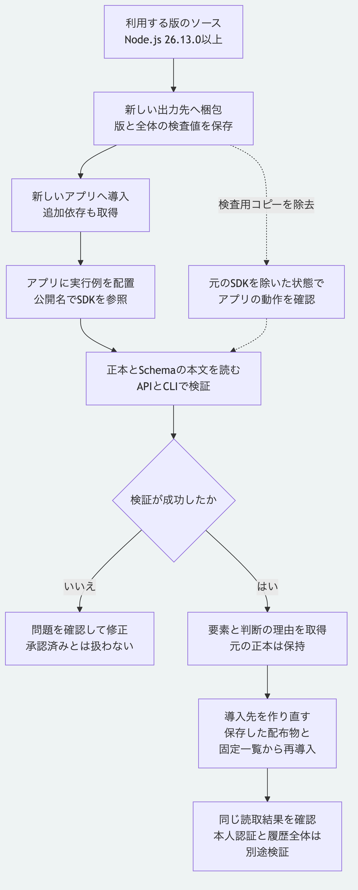

# 別のNode.jsアプリへSDKを導入する

この手順では、Morivyxのソースから配布アーカイブを作り、別のアプリケーションへ導入します。
アプリケーション内の実行例は、`@morivyx/kernel`というパッケージ名で読取と検証を行います。
Node.js 26.13.0以上とnpmを使い、macOSで確認しています。
現在の`main`向けの手順で、初版のタグ`v0.1.0`にはこの文書と実行例を含めません。

## 1. 読み取るデータを準備する

[最初の判断を保存する手順](getting-started.md)の導入を済ませ、Morivyxのリポジトリ直下で実行します。
`.tutorial`がまだない場合は、次の2行で資料と判断のサンプルを用意します。

```sh
node examples/getting-started/prepare.mjs .tutorial
node packages/kernel/src/cli.js create-decision .tutorial/base .tutorial/decision.yaml .tutorial/after
```

既に入門手順を実行して`.tutorial/after`がある場合は、そのデータを使います。
途中で失敗した場合は先へ進まず、[入門手順の対処表](getting-started.md#うまく動かないとき)を確認します。
この後の読取と検証は、サンプルの本文を変更しません。

## 2. 新しいフォルダーへ配布アーカイブを作る

リポジトリ直下で実行します。
`mkdir`が失敗した場合は止め、未使用の出力先を選びます。

```sh
mkdir .tutorial/distribution
npm pack ./packages/kernel --ignore-scripts --pack-destination .tutorial/distribution
git rev-parse HEAD
shasum -a 256 .tutorial/distribution/morivyx-kernel-0.1.0.tgz
```

`morivyx-kernel-0.1.0.tgz`が配布アーカイブです。
取得元のコミットとアーカイブ全体のSHA-256を、使った版の記録として保存します。
現在の`main`と初版のタグでは、同じパッケージ版でも内容が異なるため、名前だけで同一と判断しません。
作成済みのアーカイブを置き換えず、更新時は別の出力先へ作ります。

アーカイブに含まれるのはSDKのコードと配布定義、`LICENSE`、`NOTICE`です。
サンプルの正本、Schemaの本文、Python実装とチュートリアルは別のファイルです。
依存する`yaml`もこのアーカイブへ同梱せず、次の導入時にnpmが取得します。
初回導入には、設定済みの取得先へ接続できる環境か、必要な依存がそろったnpmのキャッシュが必要です。

## 3. 新しいアプリへ導入する

まずリポジトリ直下で、以後に使う絶対パスを変数へ保存します。
`mkdir`が成功した場合だけ、用意した3ファイルを新しいアプリへコピーします。

```sh
MORIVYX_SDK_ARCHIVE="$(pwd)/.tutorial/distribution/morivyx-kernel-0.1.0.tgz"
MORIVYX_SAMPLE="$(pwd)/.tutorial/after"
mkdir .tutorial/app && cp examples/installed-node/package.json examples/installed-node/.npmrc examples/installed-node/read-package.mjs .tutorial/app/
```

コピーが成功したらアプリへ移動し、アーカイブを指定して導入します。

```sh
cd .tutorial/app
npm install "$MORIVYX_SDK_ARCHIVE" --ignore-scripts --engine-strict --no-audit --no-fund
```

アプリの[配布定義](../../examples/installed-node/package.json)は`private: true`とNode.jsの最低要件を持ちます。
[導入設定](../../examples/installed-node/.npmrc)は`engine-strict=true`と`ignore-scripts=true`です。
配布元の設定は導入先へ引き継がれないため、このアプリ自身に置きます。
`engine-strict`は導入時に要件を検査し、APIを呼び出すたびにNode.jsの版を検査する仕組みではありません。
実行時も26.13.0以上を使います。

## 4. アプリから読取と検証を行う

アプリのフォルダー内で実行します。

```sh
node read-package.mjs "$MORIVYX_SAMPLE"
node node_modules/.bin/morivyx inspect "$MORIVYX_SAMPLE"
node node_modules/.bin/morivyx validate "$MORIVYX_SAMPLE"
```

最初のコマンドで`valid: true`、`graphRevision: "graph:tutorial-decision"`と2件の要素を確認します。
`core.decision`の`attributes`には判断の問いと理由が入り、状態は`draft`と`unreviewed`です。
CLIでも記録済みと再計算後の検査値が一致し、検証が成功することを確認します。

[実行例](../../examples/installed-node/read-package.mjs)は次の2つを使います。

```js
import { readGraphPackage } from "@morivyx/kernel";
import { validatePackage } from "@morivyx/kernel/validator";
```

`readGraphPackage`は記録の構造と検査値を確認して読み、`validatePackage`は同梱したSchemaの本文とGraphの制約も確認します。
ここでの成功だけで、本人認証、署名、外部資料の本文や履歴全体の検証を済ませたとは扱いません。
実行ファイルをアプリ内へ置くのは、Node.jsがそのファイルから導入済みパッケージを探すためです。
別の場所のスクリプトを、作業フォルダーだけ変えて実行しても、同じパッケージを探すとは限りません。

データを別のPCへ渡す場合は、`after`フォルダー内の`.morivyx`をSchemaの本文も含めて持ち運びます。
実際の保存先へ`MORIVYX_SAMPLE`を設定し直します。
元のSDKのソースツリーはアプリの実行に使いません。

## 5. 導入した版を再現する

アプリの`package.json`、`package-lock.json`、`.npmrc`、実行例と、指定した相対位置の配布アーカイブを保存します。
生成した`package-lock.json`にはSDKと追加依存の検査値が記録されます。
アーカイブを移動または削除すると、後の再導入が失敗する可能性があります。
この例では`.tutorial/app`と`.tutorial/distribution`の位置関係を保ちます。

アプリのフォルダーで次を実行すると、既存の`node_modules`を作り直して固定した依存を導入できます。
ネットワークが必要になる場合があるため、再導入の成功を確認してから利用します。

```sh
npm ci --ignore-scripts --engine-strict --no-audit --no-fund
node read-package.mjs "$MORIVYX_SAMPLE"
```

## 手順の検査

リポジトリ直下へ戻り、次を実行できます。

```sh
node tools/check-installed-node-tutorial.mjs
```

専用の一時フォルダーにSDKの検査用コピーを作り、梱包後にそのコピーを除去してから、新しいアプリへ導入します。
公開名の参照先がアプリ内にあり、導入先が元のソースへのリンクではないこと、APIとCLIが同じ正本を検証できることを確認します。
Schemaの本文を欠いた検査用コピーではAPIの実行例とCLIが失敗し、成功した結果を返さないことも確認します。
導入先の`node_modules`を除去した後、保存したアーカイブ、固定した依存一覧と取得済みキャッシュから再導入し、読取結果の一致も確認します。
元のリポジトリとサンプルは削除せず、検査専用の一時フォルダーだけを最後に除去します。
この検査は追加依存の初回取得にネットワークを使う場合があります。

操作の詳細はnpm公式の[アーカイブ作成](https://docs.npmjs.com/cli/v11/commands/npm-pack/)、[ファイルからの導入](https://docs.npmjs.com/cli/v11/commands/npm-install/)と[固定した依存の再導入](https://docs.npmjs.com/cli/v11/commands/npm-ci/)を参照してください。



[図の生成元](../diagrams/installed-node-tutorial.mmd)

[利用手順の入口](README.md)へ戻れます。
