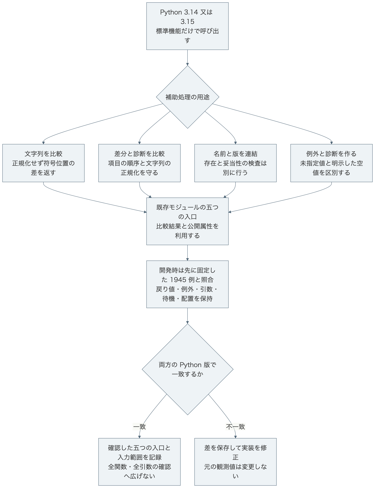

# Pythonで比較と診断の補助入口を使う

既存のPythonモジュールから、比較と診断の補助5入口を直接呼べます。
Python 3.14又は3.15を使い、リポジトリのルートで次の例を実行します。
Python側の処理は標準機能だけで動作し、Node.js、Gitと外部通信を必要としません。

## 文字列と差分を比較する

```sh
PYTHONPATH=packages/portable-core python3.14 -B - <<'PY'
from canonical import compare_unicode
from semantic_diff import compare_semantic_diff_entries
from graph_validation import compare_issues

print(compare_unicode("a", "c"))  # -2
print(compare_unicode("e\u0301", "é"))  # -132
print(compare_semantic_diff_entries(
    {"kind": "entity_added"}, {"kind": "schema_changed"}
))  # -12
print(compare_issues(
    {"phase": 1, "path": "e\u0301"},
    {"phase": 1, "path": "é"}
))  # 0
PY
```

`compare_unicode`は正規化せず、最初に異なる文字の符号位置の差を返します。
共通部分が同じなら文字数の差を返すため、戻り値を`-1`、`0`と`1`だけに限定しません。
一方、差分と診断の文字列項目は、結合文字を含めてNFCへ正規化してから比較します。

| 入口 | 比較する順序 |
|---|---|
| `semantic_diff.compare_semantic_diff_entries` | 種別、対象、側面、問合せ、変更前の版、変更後の版、置換先 |
| `graph_validation.compare_issues` | 段階、要素、診断コード、位置、関連要素 |

差分の種別は既定の順序を使い、不明な種別では`PackageError`を送出します。
比較する文字列項目が文字列以外なら空文字列として扱います。
診断の段階は型の違いも区別してから減算するため、数値`1`と文字列`"1"`を同じ段階として後続項目へ進めません。
段階には通常、数値を渡します。
非数などを含む比較は全順序にならないため、任意の不正値の並べ替えへ使うものではありません。

## キーと例外を使う

```sh
PYTHONPATH=packages/portable-core python3.14 -B - <<'PY'
from canonical import UNDEFINED
from schema_registry import schema_key
from schema_validation import PackageError

print(schema_key("example.core", "1.0"))  # example.core@1.0
error = PackageError("INPUT_INVALID", "/name", "名前を指定してください。")
print(error.name)  # PackageError
print(error.to_issue())
assert error.toIssue() == error.to_issue()
assert PackageError().code is UNDEFINED
assert PackageError("C", None, None).message == "null"
PY
```

`schema_key`は二値を文字列へ変換し、`@`で連結します。
Schemaの存在、名前と版の妥当性を検査する入口ではありません。

`PackageError`は`name`、`message`、`code`と`path`を公開します。
`to_issue()`と`toIssue()`は、`code`、`path`と`message`を持つ新しい対応表を返します。
対応表や配列をコードと位置へ渡した場合、その参照は保持します。
既存の`ValidationError`とは別の例外です。

未指定値を表す`canonical.UNDEFINED`と、明示した`None`を区別します。
省略したメッセージは空文字列になり、明示した`None`は`"null"`になります。
未指定値、循環参照と非数を含む値はそのままJSONへ保存できないため、通常の診断コードと位置には文字列を使います。

## 固定した入力で確認する

```sh
python3.14 -B -m unittest discover -s packages/portable-core -p test_core_helpers.py
npm ci --prefix packages/kernel --ignore-scripts
node tools/python-core-helper-conformance.test.mjs \
  --python "$(command -v python3.14)" --check
```

開発用の比較には、Node.js 26.13.0以上と固定依存の導入が必要です。
上記の`npm ci`で、`packages/kernel`の固定した依存を準備します。
`--python`には実行可能なPythonの絶対パスを指定します。
Python 3.15を確認するときは、上記二箇所の`python3.14`を`python3.15`へ置き換えます。

元の処理で先に記録した1,945例に対し、戻り値と例外、呼出前後の引数、待機可能性、ファイル配置の共通項目を照合します。
1,731例の通常の戻りと214例の例外を両方保持し、例外が出たことだけを不具合や入力の不正と分類しません。
比較ではPythonからNodeとGitを探索できなくし、公開用47モジュールと入力資料だけの別配置でも実行します。
実行器は入力資料だけを読み、期待する観測値をPythonの処理へ渡しません。

今回確認するのは補助5入口と固定した入力の範囲です。
すべての引数、例外のスタック、全関数と全副作用の一致を示すものではなく、本人性や正本の正式採用も判断しません。



[図の生成元](../diagrams/python-core-helper-api.mmd)
