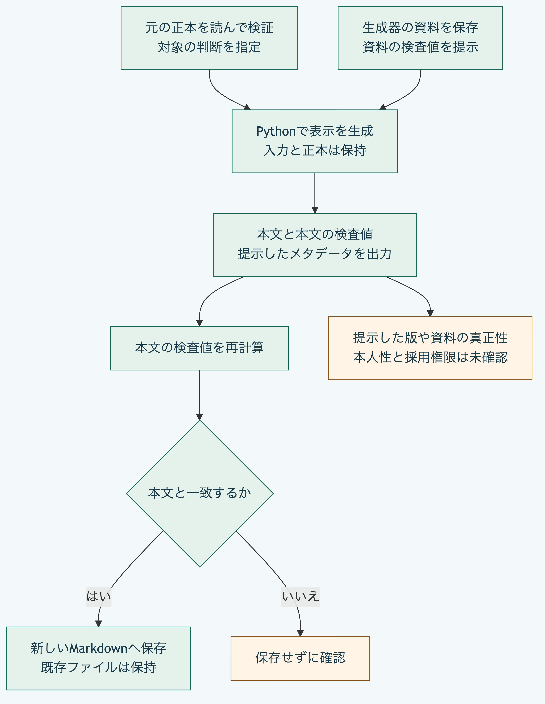

# Pythonだけで判断をMarkdownへ出力する

Python `3.14`または`3.15`と標準機能だけで、判断の問い、理由、結果と関係をMarkdownへ出力できます。
元の正本は変更しません。
以下はリポジトリ直下で実行します。
正本の安全な読取にはPOSIXの操作が必要で、この手順はmacOSで確認しています。

## 生成器の資料を用意する

生成結果には、呼出し側が提示する`projectorPackageDigest`を記録します。
この例では、現在の公開中核のソースと権利表示をローカルのアーカイブへまとめ、その本文のSHA-256を使います。
正式配布物や署名済みの資料を作成する手順ではありません。

```sh
work=$(mktemp -d)
work=$(cd "$work" && pwd -P)
python3 - "$work" <<'PY'
import hashlib
from pathlib import Path
import sys
import tarfile

core = Path("packages/portable-core")
sources = [Path("LICENSE"), Path("THIRD_PARTY_NOTICES.md"), core / "README.md", core / "core-schema.yaml"]
sources += sorted(path for path in core.glob("*.py") if not path.name.startswith("test_"))
archive = Path(sys.argv[1]) / "projector-source.tar"
with tarfile.open(archive, "x") as output:
    for path in sources:
        if path.is_symlink() or not path.is_file():
            raise SystemExit("source must be a regular file")
        output.add(path, arcname=path.as_posix(), recursive=False)
digest = "sha256:" + hashlib.sha256(archive.read_bytes()).hexdigest()
(archive.parent / "projector-digest.txt").write_text(digest + "\n")
print(digest)
PY
```

アーカイブは一時保存先に残り、生成結果の検査値が何の資料を指すか確認できます。
日時なども含むアーカイブなので、別の実行で同じ検査値になることは保証しません。
生成器の関数は、提示した値とこの資料、実行中のコードや依存先の一致を検証しません。
資料の保存と、その資料を信頼する判断は分けます。

## 正本と判断を指定する

`source_package`を実際の正本の`.morivyx`、`decision_id`を対象の判断の識別子へ置き換えます。
元のパスにはリンクを含まない実際の位置を指定します。
[Pythonで作成と更新を行う手順](python-decision.md)の応答にも、対象の`decisionId`があります。

```sh
source_package=/path/to/project/.morivyx
decision_id=urn:uuid:00000000-0000-4000-8000-000000001001
python3 - "$source_package" "$decision_id" "$work/projector-digest.txt" > "$work/projection-input.json" <<'PY'
import json
from pathlib import Path
import sys

sys.path.insert(0, str(Path("packages/portable-core").resolve()))
from package_records import read_package, write_package_files
from package_validation import validate_package_files

contents = read_package(sys.argv[1])
if not validate_package_files(write_package_files(contents))["valid"]:
    raise SystemExit("source Graph is invalid")
request = {"graphRevision": contents["revision"]["id"], "decisionId": sys.argv[2],
           "elements": contents["elements"], "projectorPackageDigest": Path(sys.argv[3]).read_text().strip()}
print(json.dumps(request, ensure_ascii=False))
PY
python3 -B packages/portable-core/decision_markdown.py < "$work/projection-input.json" > "$work/projection.json"
python3 - "$work/projection.json" "$work/decision.md" <<'PY'
import hashlib
import json
from pathlib import Path
import sys

projection = json.loads(Path(sys.argv[1]).read_text())
body = projection["markdown"].encode("utf-8")
if "sha256:" + hashlib.sha256(body).hexdigest() != projection["digest"]:
    raise SystemExit("Markdown digest differs")
with Path(sys.argv[2]).open("xb") as output:
    output.write(body)
print(json.dumps({"digest": projection["digest"], "bytes": len(body), "savedTo": sys.argv[2]}))
PY
```

`projection.json`は本文を含む生成結果、`decision.md`は人が読む本文です。
本文の検査値を再計算して一致することを確かめてから、新しいファイルへ保存します。
`decision.md`が既にある場合は置き換えません。
試し直すときは新しい一時保存先から始めます。



[図の生成元](../diagrams/python-decision-markdown.mmd)

## 生成結果の範囲を確認する

`markdown`と、その本文の`digest`を計算します。
問い、理由、結果、再検討条件、反証確認と、対象、選択肢、根拠などの関係を表示します。
文字の正規化、改行と記法の特殊文字を処理し、関係は既存の規則どおり並べます。
表示しない関係も接続先を確認し、不正な場合は拒否します。

`graphRevision`、`sourceRevision`と`projectorPackageDigest`は提示した値を記録します。
この生成器自体が正本全体、要素の本文の検査値、生成器の実体と資料の一致、本人性、署名や採用権限を確認したとは扱いません。
上の手順では、生成前の正本の読取とSchema及びGraphの制約、生成後の本文の検査値を別に確認しています。
元を編集した場合は、同じ検査値の表示とは扱わず、正本から作り直します。

関数を直接使う場合は、`decision_markdown.py`の`project_decision_markdown(request)`を呼びます。
入力した要素と一覧は変更しません。
CLIは入力と出力をそれぞれ末尾改行を含めて8,388,608バイト以内に制限します。
不正なJSON、重複キー、不正な文字、未知の引数と生成の失敗では、終了コード`1`、空の標準出力と固定した`DECISION_PROJECTION_INPUT_INVALID`を標準エラーへ返します。
関数呼出し自体にこの入出力の上限を適用するものではありません。

[Pythonの範囲](../../packages/portable-core/README.md)と[利用手順の入口](README.md)へ戻れます。
