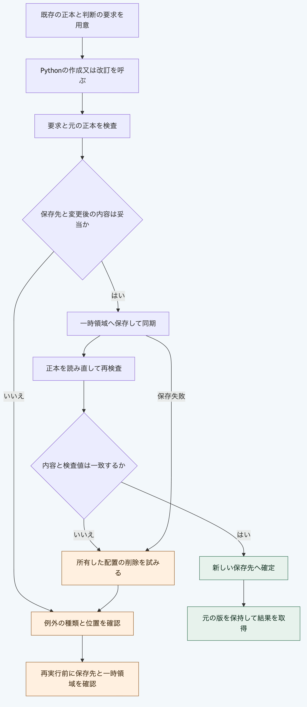

# Pythonで判断を作成又は改訂して保存する

Pythonの標準機能だけで、判断の要求を検査し、新しい正本へ保存できます。
作成には`decision_preparation.write_created_decision_package`、改訂には`decision_preparation.write_revised_decision_package`を使います。
既存の準備関数と、容量を制限した文字列の読取は引き続き使えます。

## 準備する

Python `3.14`又は`3.15`と、検証可能な既存の正本を用意します。
この手順のファイル操作はmacOSで照合しており、他のOSでの動作は未確認です。
以下のコマンドは、取得したリポジトリのルートで実行します。
`./my-package`を、自分の`.morivyx`を含むフォルダーへ置き換えてください。
既存の正本の準備には[Pythonの基本手順](python-only.md)も参照できます。

保存先は元の正本の外にある、未作成のフォルダーを指定します。
既存の保存先には上書きしません。
識別子は例の値をそのまま使わず、既存の全記録と重複しないUUID版4の値を用意します。
判断と変更一覧には異なる識別子を使います。
`actor`は記録する行為者の識別子であり、この処理による本人認証を意味しません。

## 判断を作成する

```sh
PYTHONPATH=packages/portable-core python3.14 -B - <<'PY'
import asyncio
from decision_preparation import write_created_decision_package

result = asyncio.run(write_created_decision_package({
    "basePath": "./my-package",
    "outputPath": "./my-package-with-decision",
    "requestPath": "creation-request.json",
    "request": {
        "format": "morivyx.decision-creation-request/0.1",
        "decisionId": "urn:uuid:00000000-0000-4000-8000-000000001001",
        "attributes": {
            "question": "判断の理由をどこへ残すか？",
            "rationale": "正本へ残す。",
            "consequences": ["後から理由を確認できる。"],
        },
        "changeSetId": "urn:uuid:00000000-0000-4000-8000-000000001002",
        "resultingRevision": "graph:decision-created",
        "actor": "urn:uuid:00000000-0000-4000-8000-000000000001",
        "recordedAt": "2026-11-16T00:00:00Z",
    },
}))
print(result)
PY
```

成功すると`./my-package-with-decision/.morivyx`が作成されます。
元の正本は保持されます。
返り値の`valid`は`True`となり、保存先、Graphの版と検査値、要素数、判断の識別子と版及び変更一覧の識別子を確認できます。
この処理は要求の検査、変更後の検査、一時保存、保存後の読取と再検査を行い、最後に保存先を確定します。

## 同じ判断を改訂する

作成後の正本を基底として、次の処理を実行します。
`attributes`には変更した一項目だけではなく、改訂後の全項目を渡します。
対象の判断は`draft`又は`active`である必要があります。

```sh
PYTHONPATH=packages/portable-core python3.14 -B - <<'PY'
import asyncio
from decision_preparation import write_revised_decision_package

result = asyncio.run(write_revised_decision_package({
    "basePath": "./my-package-with-decision",
    "outputPath": "./my-package-revised",
    "request": {
        "format": "morivyx.decision-revision-request/0.1",
        "decisionId": "urn:uuid:00000000-0000-4000-8000-000000001001",
        "attributes": {
            "question": "判断の理由をどこへ残すか？",
            "rationale": "正本へ残し、変更した理由も追記する。",
            "consequences": ["改訂前後を比較できる。"],
        },
        "changeSetId": "urn:uuid:00000000-0000-4000-8000-000000001003",
        "resultingRevision": "graph:decision-revised",
        "actor": "urn:uuid:00000000-0000-4000-8000-000000000001",
        "recordedAt": "2026-11-16T01:00:00Z",
    },
}))
print(result)
PY
```

判断の識別子は作成時と同じですが、版は変わります。
変更一覧とGraphの版には新しい値を使います。
元の版との比較には[パッケージの検査と差分](python-package-file-api.md)を使えます。

## 失敗を確認する

例外の`code`と`path`で拒否の種類と位置を確認します。
要求が不正なら、元の正本を読む前に拒否します。
`requestPath`を指定すると要求の診断位置に使いますが、そのファイルを自動で読み込む指定ではありません。
両関数は待機可能な処理を返すため、既存の非同期処理では`await`して完了を確認します。
呼出し後も入れ子の要求の参照を保持するので、完了前に入力を変更しないでください。

| 診断の例 | 確認する内容 |
|---|---|
| `DECISION_CREATION_REQUEST_INVALID`又は`DECISION_REVISION_REQUEST_INVALID` | 要求の形式、識別子、属性と時刻 |
| `PACKAGE_OUTPUT_INVALID` | 元の正本の外にある新しい保存先か |
| `PACKAGE_OUTPUT_EXISTS` | 既存の保存先を再利用していないか |
| `CHANGESET_TARGET_VALIDATION_FAILED` | 変更後の内容が固定SchemaとGraphの制約を満たすか |

失敗時は所有した一時領域の後片付けを試みますが、その削除自体が失敗する場合もあります。
失敗を「何も保存されなかった」と解釈せず、保存先と一時領域を確認してから再実行します。
強制終了からの復旧、任意の競合の排除、本人性、署名及び採用権限は、この処理の確認範囲に含みません。

元の実装で事前固定した664入力を使い、結果、診断、入力の保持、全配置と操作の到達順序を別の実装で比較します。
この固定範囲の一致は、全機能又は公開版間の長期互換の証明ではありません。



[図の生成元](../diagrams/python-decision-package-file-api.mmd)
