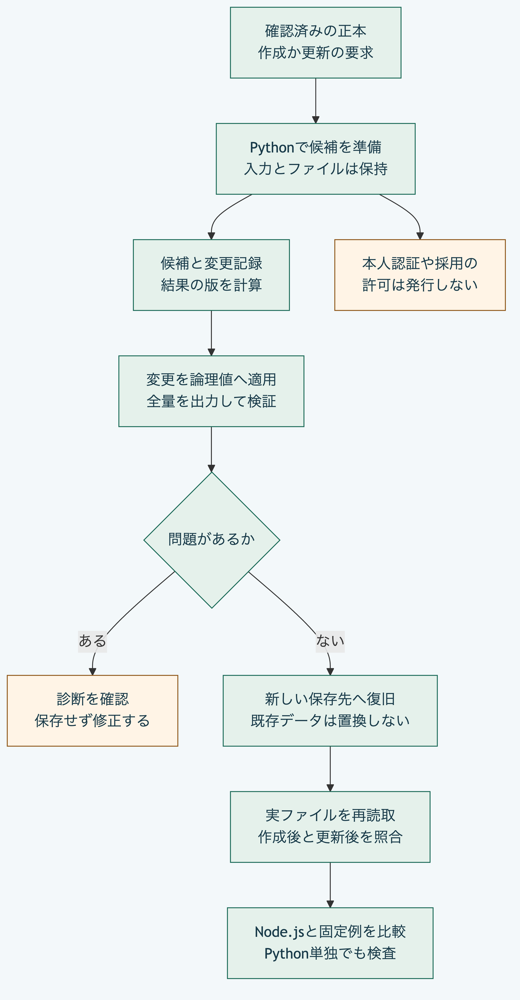
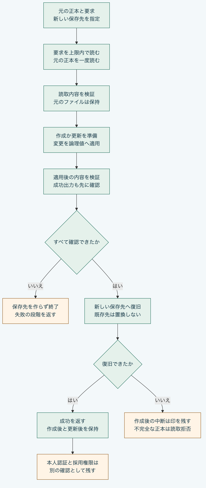

# Pythonだけで判断を作成して更新する

Python `3.14`または`3.15`と標準機能だけで試せます。
Node.js、Gitの起動、通信と追加部品の導入は不要です。
ファイルの読取と復旧にはPOSIXの操作が必要で、この手順はmacOSで確認しています。
以下はリポジトリ直下で実行します。

## 候補の準備と保存を分ける

`decision_preparation.py`は、確認済みの正本の論理値と要求から、候補要素、変更記録と結果の版を返します。
作成は`prepare_decision_creation`、更新は`prepare_decision_revision`を呼び出します。
入力は変更せず、関数の呼出しだけではファイルを保存しません。

作成した判断は`draft`で、確認状態は`unreviewed`です。
更新できる状態は`draft`と`active`で、確認状態を`unreviewed`へ戻します。
本人認証、署名と採用権限の確認は行いません。
準備の成功だけで属性や関係の制約を満たすとは判断せず、適用後の正本を別途検証します。



[図の生成元](../diagrams/python-decision-preparation.mmd)

## 自分の正本から作成して更新する

[実行例](../../examples/python-decisions/workflow.py)は、中核の準備、適用と検証及び復旧を組み合わせます。
既存の正本がある場合は、固定例を組み立てずに利用できます。
`source_package`を、実際の正本の`.morivyx`へ置き換えます。
次の`actor`は記法の例なので、実データでは記録する主体の識別子へ置き換えます。
この指定は本人認証ではありません。

```sh
source_package=/path/to/project/.morivyx
work=$(mktemp -d)
work=$(cd "$work" && pwd -P)
mkdir "$work/created" "$work/revised"
actor=urn:uuid:00000000-0000-4000-8000-000000000001
python3 - "$actor" > "$work/create-request.json" <<'PY'
from datetime import datetime, timezone
import json
import sys
from uuid import uuid4

request = {
    "format": "morivyx.decision-creation-request/0.1",
    "decisionId": "urn:uuid:" + str(uuid4()),
    "attributes": {"question": "保存形式を何にするか？", "rationale": "後で理由を確認できる形式を選ぶ。",
                   "consequences": ["元の判断を保持して変更を追跡する。"]},
    "changeSetId": "urn:uuid:" + str(uuid4()),
    "resultingRevision": "graph:" + str(uuid4()),
    "actor": sys.argv[1],
    "recordedAt": datetime.now(timezone.utc).isoformat(timespec="seconds").replace("+00:00", "Z"),
}
print(json.dumps(request, ensure_ascii=False))
PY
python3 -B examples/python-decisions/workflow.py create "$source_package" "$work/created/.morivyx" < "$work/create-request.json" > "$work/create-result.json"
cat "$work/create-result.json"
```

要求の質問、理由と結果を、自分の内容へ変更して使います。
読取と復旧はリンクを辿らないため、元の正本はリンクを含まない実際のパスで指定します。
一時保存先も`pwd -P`で実際の位置にそろえています。
判断、変更記録と結果の版は毎回新しい識別子を生成します。
成功時は`restored: true`、作成した`decisionId`と`decisionRevision`、`changeSetId`、正本の版と検査値、`graphValidation`を返します。

更新では、作成時の応答から同じ判断の識別子を取り出します。
`attributes`は差分だけでなく、更新後に保持する属性全体を指定します。

```sh
python3 - "$actor" "$work/create-result.json" > "$work/revise-request.json" <<'PY'
from datetime import datetime, timezone
import json
from pathlib import Path
import sys
from uuid import uuid4

created = json.loads(Path(sys.argv[2]).read_text())
request = {
    "format": "morivyx.decision-revision-request/0.1",
    "decisionId": created["decisionId"],
    "attributes": {"question": "保存形式を再検討するか？", "rationale": "利用して分かった条件も理由へ加える。",
                   "consequences": ["更新前と更新後を別々の正本として保持する。"]},
    "changeSetId": "urn:uuid:" + str(uuid4()),
    "resultingRevision": "graph:" + str(uuid4()),
    "actor": sys.argv[1],
    "recordedAt": datetime.now(timezone.utc).isoformat(timespec="seconds").replace("+00:00", "Z"),
}
print(json.dumps(request, ensure_ascii=False))
PY
python3 -B examples/python-decisions/workflow.py revise "$work/created/.morivyx" "$work/revised/.morivyx" < "$work/revise-request.json" > "$work/revise-result.json"
cat "$work/revise-result.json"
python3 packages/portable-core/package_validation.py "$work/revised/.morivyx" --previous "$work/created/.morivyx"
```

元の正本、作成後と更新後は、それぞれ別の保存先に残ります。
保存先そのものが既にある場合は置き換えずに失敗し、親フォルダーがない場合も失敗します。
元の正本の内側も保存先には指定できません。
正本の対応する記録とSchemaを出力し、`.git`や対応外の補助ファイルはコピーしません。
必要な補助ファイルは、元の保存先に保持します。
本文の出力時には、既存の規則に従って文字、時刻とYAMLの表記を正規化します。



[図の生成元](../diagrams/python-decision-workflow.mmd)

### 失敗時の確認

要求の読取から復旧までの処理に失敗した場合は、終了コード`1`、空の標準出力と、標準エラーの`EXAMPLE_DECISION_FAILED`を返します。
`stage`は`input`、`source`、`prepare`、`validation`、`output`、`restore`のいずれかです。
それぞれ要求の読取、元の正本、候補と適用、適用後の検証、成功出力の生成、実ファイルへの復旧を示します。
引数の間違いは通常の使い方を表示して終了コード`2`となります。

要求と成功出力はそれぞれ末尾改行を含めて8,388,608バイト以内です。
成功出力の生成と上限確認は、保存先を作る前に完了します。
`restore`で途中失敗した場合は、新しい保存先に`.morivyx-restore-incomplete`が残ることがあります。
両実装の読取はその保存先を拒否します。
そのまま再実行して上書きせず、元を保持して別の新しい保存先で試します。
既存の保存先の削除や未完了印の解除を、この例は行いません。

`graphValidation.valid`は、この実装が扱う構造、SchemaとGraphの制約の結果です。
本人性、署名、採用権限、履歴全体のつながりと以前のSchemaの意味を確認したとは扱いません。
元の正本は一度読み取った内容を使い、実行中に他の処理が行う変更を固定する仕組みではありません。

## 同梱した例から作成と更新を試す

次の例は、同梱した検査用の正本を使います。
新しい一時フォルダーに、作成後の`create`と更新後の`revise`を別々に保存します。
元の正本と既存の保存先は上書きしません。

```sh
work=$(mktemp -d)
python3 -B - "$work" <<'PY'
import json
from pathlib import Path
import sys

sys.path.insert(0, str(Path("packages/portable-core").resolve()))
from changeset_apply import apply_change_set
from decision_preparation import prepare_decision_creation, prepare_decision_revision
from package_records import read_package, read_package_files, write_package_files
from package_restore import restore_package_files
from package_validation import validate_package_files

destination = Path(sys.argv[1]).resolve()
fixtures = Path("packages/portable-core/fixtures")
base = json.loads((fixtures / "portable-cli-vectors.json").read_text())
files = next(case["input"] for case in base["cases"] if case["name"] == "package-read")
requests = json.loads((fixtures / "decision-preparation-vectors.json").read_text())["cases"]
for case in requests:
    operation, request = case["operation"], case["request"]
    envelope = {"operation": operation, "packageFiles": files, "request": request}
    (destination / (operation + "-request.json")).write_text(json.dumps(envelope, ensure_ascii=False))
    contents = read_package_files(files)
    prepare = prepare_decision_creation if operation == "create" else prepare_decision_revision
    plan = prepare(contents, request)
    applied = apply_change_set({
        "changeSet": plan["changeSet"], "currentRevision": contents["revision"],
        "schemaLockDigest": contents["calculatedSchemaLockDigest"],
        "currentElements": contents["elements"], "candidateElements": [plan["candidateElement"]],
        "resultingRevision": plan["resultingRevision"],
    })
    contents.update(elements=applied["elements"], revision=applied["revision"])
    contents["changeSets"].append(plan["changeSet"])
    previous = files
    files = write_package_files(contents)
    report = validate_package_files(files, previous_files=previous)
    if report["issues"]:
        raise SystemExit(json.dumps(report, ensure_ascii=False))
    target = destination / operation
    target.mkdir()
    receipt = restore_package_files(files, target / ".morivyx")
    reread = read_package(target / ".morivyx")
    decision = next(element for element in reread["elements"] if element["id"] == request["decisionId"])
    print(json.dumps({"operation": operation, "savedTo": str(target), "restored": receipt["restored"],
                      "revision": reread["revision"]["id"], "question": decision["attributes"]["question"]}, ensure_ascii=False))
PY
```

2行のJSONが出力され、どちらも`restored: true`になります。
`create`の版は`graph:decision-create`、`revise`の版は`graph:decision-revise`です。
更新後の質問は「判断の保存方法を再検討するか？」になります。
判断の識別子は同じで、更新前後の検査値と変更記録は別になります。

復旧済みの保存先へもう一度復旧すると、既存データを置き換えずに失敗します。
試し直すときは`mktemp -d`からやり直します。

## 自分の要求へ置き換える

同梱した例の識別子を実データで繰り返し使わず、作成時は新しいUUIDを用意します。
更新時は既存の判断の識別子を指定し、変更記録と結果の版には新しい値を使います。

| 項目 | 指定する値 |
|---|---|
| `format` | 作成は`morivyx.decision-creation-request/0.1`、更新は`morivyx.decision-revision-request/0.1` |
| `decisionId` | 判断の識別子。`urn:uuid:`にUUIDを続ける |
| `attributes` | `question`、`rationale`、`consequences`など、適用するSchemaに従う属性 |
| `changeSetId` | 他の記録と重複しない、新しい変更記録の識別子 |
| `resultingRevision` | 現在と異なる結果の版。例は`graph:decision-create` |
| `actor` | 要求に記録する主体の識別子。指定だけで本人認証を済ませたとは扱わない |
| `recordedAt` | 日付、時刻と時差を含む文字列。例は`2026-11-04T09:00:00+09:00` |

既存の正本を使う場合は、`read_package("/path/to/project/.morivyx")`で読みます。
標準入力用の対応表が必要な場合は、その読取結果を`write_package_files`へ渡します。
出力時には既存規則に従って文字と時刻を正規化します。

## 標準入力から候補だけを得る

上の例が保存した要求を使い、ファイルを更新せずに候補だけを計算できます。

```sh
python3 -B packages/portable-core/decision_preparation.py < "$work/create-request.json" > "$work/create-plan.json"
python3 -B packages/portable-core/decision_preparation.py < "$work/revise-request.json" > "$work/revise-plan.json"
```

入力は`operation`、`packageFiles`、`request`の三項目、出力は`candidateElement`、`changeSet`、`resultingRevision`の三項目です。
標準入力と標準出力はそれぞれ8,388,608バイトが上限で、出力の末尾改行も含みます。
失敗時は終了コード`1`、空の標準出力と、標準エラーの固定コード`DECISION_PREPARATION_INPUT_INVALID`を返します。
既存の16操作の入口とは別で、単独の関数にはこの入出力の上限を適用しません。

## 確認した範囲

固定した作成と更新の期待結果は、既存の公開Node.js APIから採取したものです。
追加の照合では受理8例、拒否63例の結果と診断を比較します。
両段階の適用、出力、実ファイルの復旧と両実装による再読取も確認します。
Node.jsとGitを利用できない別領域では、中核のPythonファイルだけで候補を計算します。
これらは全機能の独立適合、本人認証や長期経過の実証を示すものではありません。

[Pythonだけの読取手順](python-only.md)、[正本の出力と復旧](backup-restore.md)と[利用手順の入口](README.md)も参照できます。
