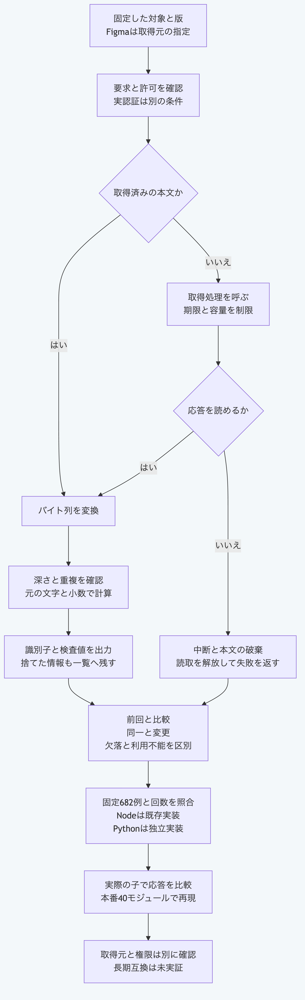

# PythonだけでFigma取込と再取込比較を行う

`figma_import.py`は、固定したファイル、対象の識別子と版を指定するFigma取込を扱います。
Pythonの標準機能だけを使い、Node.js、Gitと追加の依存部品を必要としません。
以下の例は同梱の合成した本文と認証情報だけを使い、実サービスへ接続しません。
リポジトリのルートで、Python `3.14`又は`3.15`を使います。

## 取得済みの本文を変換して比較する

```sh
python3.14 -B - <<'PY'
import json
from pathlib import Path
import sys

core = Path("packages/portable-core").resolve()
sys.path.insert(0, str(core))
from figma_import import validate_figma_import_request, validate_figma_import_result
from figma_import import convert_figma_import_response, compare_figma_import_snapshots

vectors = json.loads((core / "fixtures/figma-import-vectors.json").read_text(encoding="utf-8"))
request = vectors["request"]
assert validate_figma_import_request(request) is request
body = json.dumps(vectors["response"], ensure_ascii=False, separators=(",", ":")).encode("utf-8")
result = convert_figma_import_response(request, body, vectors["retrievedAt"])
assert validate_figma_import_result(result, request) is result
assert result == vectors["result"]
comparison = compare_figma_import_snapshots({
    "previousResult": result, "currentRequest": request, "currentResult": result,
})
print(result["status"], result["output"]["node"])
print(comparison["status"])
assert comparison["status"] == "current"
PY
```

結果は`success {'id': '1:2', 'type': 'FRAME'}`と`current`です。
本文を変換する入口は、バイト列、要求と取得時刻を受け取り、通信を行いません。
検査の入口は元の値を変更せず、その値自体を返します。
結果の検査は記録構造と要求への対応を確認し、取得元の真正性を認証しません。

出力には対象の識別子、種別、版、検査値、取得時刻と情報損失の一覧を含みます。
名前、本文、配置、画像とファイルの付随情報は保持しません。
名前や本文も対象の検査値には反映されますが、結果だけからその内容を復元できません。
文字列をNFC又は日時へ正規化せず、元の文字列と小数を使います。
数値の字面と負のゼロの表記は保持しません。

## 取得処理を差し替えて試す

同梱の検査用応答側を実際の子として起動します。
ここで使う取得処理は合成した応答を返すため、ネットワークへ接続しません。

```sh
python3.14 -B - <<'PY'
import base64
import json
from pathlib import Path
import subprocess
import sys

core = Path("packages/portable-core").resolve()
vectors = json.loads((core / "fixtures/figma-import-vectors.json").read_text(encoding="utf-8"))
spec = {"body": json.dumps(vectors["response"]), "retrievedAt": vectors["retrievedAt"], "options": vectors["options"]}
encoded = base64.b64encode(json.dumps(spec).encode("utf-8")).decode("ascii")
child = subprocess.run([sys.executable, "-B", str(core / "test_figma_import.py"), "--stdio-worker", encoded],
                       input=json.dumps(vectors["request"]) + "\n", text=True, encoding="utf-8", capture_output=True, timeout=10)
assert child.returncode == 0, child.stderr
assert child.stderr == ""
result = json.loads(child.stdout)
assert result == vectors["result"]
print(result["status"], result["output"]["node"]["id"])
PY
```

結果は`success 1:2`です。
この応答側は検査用の駆動部です。
自分の応答側へ組み込む場合は、`serve_figma_importer(options)`を使い、アプリケーションが管理する設定を渡します。
一つの要求を標準入力で受け、結果を標準出力へ返す既存の枠組みを使います。
入力と出力の既定上限は各1MiBで、失敗時の終了値と標準エラーの扱いはその枠組みに従います。

自分の取得処理は`fetchImpl(url, options)`へ渡せます。
直接の応答又は待機可能な応答を返し、`status`、`redirected`、`url`、`headers.get`と`body.get_reader`及び`body.cancel`を持たせます。
読取側は`read`、`cancel`と`release_lock`を持ち、`read`は`done`と`value`を返します。
`read`は直接の値又は待機可能な値を返せます。
`cancel`は待機可能な処理、`release_lock`は同期処理として用意します。
渡した`signal`の`aborted`と中断通知を使い、停止時に取得資源を解放します。

## 実際の取得を組み込む場合

`import_figma_node(request, options)`は待機可能な関数です。
設定の`permission`には`apiOrigin`と`fileKey`、`credential`には`kind`と`token`を明示します。
`kind`は`oauth`又は`personal-access-token`です。
実際に使う値は、利用するアプリケーションが契約、権限と保管方法を確認した上で渡します。
上の合成した値を実認証の証拠として使いません。

取得処理を指定しなければ、標準機能のHTTPS処理を使い、固定したFigmaの取得先だけへ要求します。
リダイレクトを追わず、自動再試行もしません。
既定は30秒、本文2MiBと深さ64段です。
`limits`に`timeoutMs`、`maxResponseBytes`又は`maxDepth`を指定し、上限を小さくできます。
時計を固定する場合は、同期関数の`now`を渡します。
OSの処理とDNSを強制終了する保証はなく、実際の通信環境の確認は別に必要です。

不正な要求を与えた取得は、例外の詳細を出さず、`status: failure`と固定した診断を返します。
本文変換と構造検査の入口は`FigmaImportError`又はバイト列用の検証例外を返します。
再取込比較は`current`、`stale`、`missing`、`unavailable`又は`invalid`で区別し、同じ版の矛盾と取得時刻の逆行も残します。
欠落の結果を、削除の権限又はGraphへの自動反映の許可として使いません。

## 検証範囲

固定682例で、生のJSON、診断、取得要求と後片付けの回数を元のNode.js実装へ照合します。
要求169例、結果261例、変換129例、取得71例と比較52例を含みます。
1024個のビット列から得る有限値の数値表記と、長いキーなどの追加例も照合します。
公開する40本番モジュールと駆動部だけの、NodeとGitがない環境でも全固定例を再現します。
実際の子の枠組み、終了値と出力も両実装で比較します。
元の取込エラーの継承は診断を保持し、外部の属性を実行せず、例外自身が持つ文字列の診断コードだけを読みます。
不正な型と文字を持つコードは一般の失敗へ戻す境界も、七例で元の関数へ照合します。
宣言長は先頭の0を除いてから容量へ照合し、Python全体の整数変換の安全設定は変更しません。
多数の先頭0と容量の前後を含む九例も元の処理へ比較します。

```sh
python3.14 -B -m unittest discover -s packages/portable-core -p test_figma_import.py
python3.15 -B -m unittest discover -s packages/portable-core -p test_figma_import.py
node --test tools/python-figma-import-conformance.test.mjs
```

最後の相互照合だけはNode.js `26.13.0`以上と既存のNode.js側の依存部品を使います。
通常のPython関数には不要です。
実サービスの契約、実認証と通信、本人性、採用権限、長期互換と実際の提供元終了は、この検査だけでは実証しません。



[図の生成元](../diagrams/python-figma-import.mmd)
