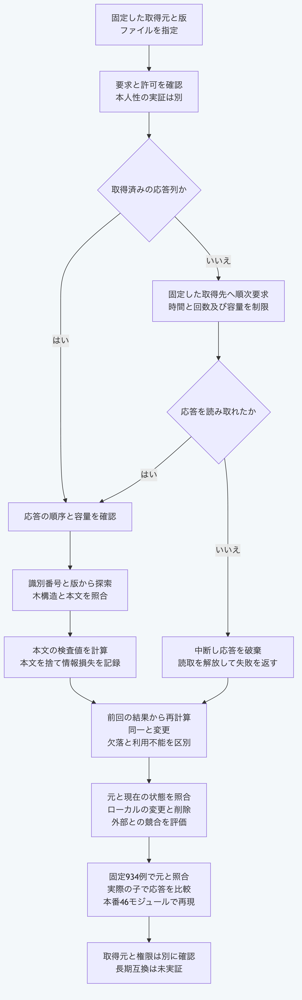

# PythonだけでGitHub取込と再取込評価を行う

`github_import.py`は、リポジトリ識別番号、固定した版とファイル指定に従うGitHub取込を扱います。
Pythonの標準機能だけを使い、Node.js、Gitと追加の依存部品を必要としません。
以下の例は同梱の合成応答だけを使い、実サービスへ接続しません。
リポジトリのルートで、Python `3.14`又は`3.15`を使います。

## 取得済みの応答列を変換して評価する

```sh
python3.14 -B - <<'PY'
import asyncio
import json
from pathlib import Path
import sys

core = Path("packages/portable-core").resolve()
sys.path.insert(0, str(core))
from github_import import github_import_request, validate_github_import_request, validate_github_import_result
from github_import import convert_github_import_responses, compare_github_import_snapshots, assess_github_reimport

vectors = json.loads((core / "fixtures/github-import-vectors.json").read_text(encoding="utf-8"))
request = github_import_request({"runId": vectors["request"]["runId"], **vectors["request"]["input"]})
assert validate_github_import_request(request) is request
responses = [{"path": row["path"], "bytes": row["body"].encode("utf-8")} for row in vectors["responses"]]
result = asyncio.run(convert_github_import_responses(request, responses, vectors["retrievedAt"]))
assert validate_github_import_result(result, request) is result
assert result == vectors["result"]
compared = {"previousResult": result, "currentRequest": request, "currentResult": result}
comparison = compare_github_import_snapshots(compared)
assessment = assess_github_reimport({
    **compared,
    "baselineTarget": {"id": "artifact:owned", "revision": "revision:baseline"},
    "currentTarget": {"id": "artifact:owned", "revision": "revision:baseline"},
})
print(result["status"], result["output"]["byteLength"])
print(comparison["status"], assessment["status"])
assert comparison["status"] == "current" and assessment["status"] == "unchanged"
PY
```

結果は`success 0`と`current unchanged`です。
この例のファイル本文は空で、リポジトリ、固定した版、木構造と本文の4応答を順番に照合します。
本文を変換する入口はバイト列を受け取り、通信と認証情報を使いません。
検証の入口は元の値を変更せず、その値自体を返します。
結果の構造と要求への対応を確認できても、取得元の真正性を認証したことにはなりません。

出力には取得元、ファイル指定、版、本文の検査値、容量、取得時刻と情報損失の一覧を含みます。
本文、ファイル以外の付随情報と名前変更の履歴は保持しません。
Gitの本文検査値を再計算し、復号した本文と応答で申告された内容が一致するか確認します。

## 合成した取得処理を子へ接続する

同梱の検査用応答側を実際の子として起動します。
取得処理は合成した応答を返すため、ネットワークへ接続しません。

```sh
python3.14 -B - <<'PY'
import base64
import json
from pathlib import Path
import subprocess
import sys

core = Path("packages/portable-core").resolve()
vectors = json.loads((core / "fixtures/github-import-vectors.json").read_text(encoding="utf-8"))
spec = {"responses": vectors["responses"], "retrievedAt": vectors["retrievedAt"], "options": vectors["options"]}
encoded = base64.b64encode(json.dumps(spec).encode("utf-8")).decode("ascii")
child = subprocess.run([sys.executable, "-B", str(core / "test_github_import.py"), "--stdio-worker", encoded],
                       input=json.dumps(vectors["request"]) + "\n", text=True, encoding="utf-8", capture_output=True, timeout=10)
assert child.returncode == 0, child.stderr
assert child.stderr == ""
result = json.loads(child.stdout)
assert result == vectors["result"]
print(result["status"], result["output"]["locator"])
PY
```

結果は`success source.txt`です。
この応答側は検査用の駆動部で、製品用CLIではありません。
自分の応答側へ組み込む場合は、既存の`serve_plugin_stdio`へ`handleRequest`、`validateRequest`と`validateResult`を渡します。
処理には`import_github_file`、検証には要求と結果の検証関数を接続します。
一つの要求を受けて結果を返し、入出力の既定上限各1MiBと失敗時の固定診断に従います。

取得処理は`fetchImpl(url, options)`へ差し替えられます。
直接又は待機可能な応答を返し、`status`、`redirected`、`url`、`headers.get`、`body.get_reader`と`body.cancel`を持たせます。
読取側は`read`、`cancel`と`release_lock`を持ち、`read`は`done`と`value`を直接又は待機可能な値で返します。
`cancel`は待機可能な処理、`release_lock`は同期処理として用意します。
渡された`signal`の中断通知を使い、取得資源を解放します。

## 実際の取得を組み込む場合

`import_github_file(request, options)`は待機可能な関数です。
`permission`には`apiOrigin`、`owner`、`repository`と`repositoryId`を明示します。
認証が必要な場合だけ`token`を渡します。
環境変数やファイルから認証情報を自動取得する機能はありません。
実際の値は、呼出側が契約、権限と保管方法を確認して渡します。
上の合成した値の受理を実認証の証拠にはしません。

取得処理を指定しなければ、標準機能のHTTPS処理を使い、固定したGitHubの取得先へ要求します。
リダイレクトと自動再試行は行いません。
既定は30秒、応答ごと2MiB、合計8MiB、ファイル1MiBと19要求です。
`limits`の`timeoutMs`、`maxResponseBytes`、`maxTotalResponseBytes`、`maxFileBytes`と`maxRequests`で上限を小さくできます。
時刻を固定する場合は同期関数の`now`を渡します。
`fetchImpl`と`now`に`null`に相当する`None`を渡した場合も、元のNodeと同じく既定の処理を使います。
認証情報、許可と上限への`None`は、有効な設定として扱いません。
OSの処理とDNSを強制終了する保証はなく、通信環境の確認は別に必要です。

再取込の比較は`current`、`stale`、`missing`、`unavailable`又は`invalid`を返します。
同じ版で本文又は実行属性が変わる矛盾、本文の二つの検査値が食い違う矛盾を残します。
`assess_github_reimport`は比較を再計算し、元の`baselineTarget`と現在の`currentTarget`を照合します。
ローカルの変更と削除、外部の変更と欠落を区別し、競合と利用不能の場合も保存します。
評価結果はGraphの変更、削除又は採用の許可を与えません。

## 検証範囲

元のNodeの7関数から固定した934例を、Python実装の前に保存しています。
要求生成16例、要求検証180例、結果検証244例、変換219例、取得106例、比較58例と評価111例です。
戻り値には失敗と無効な評価も含み、実サービスの成功件数ではありません。
追加の応答パス10例と継承した例外の境界も元の関数へ照合します。
公開する46本番モジュールと駆動部だけの、NodeとGitがない環境でも全固定例を再現します。
実際の子同士で枠組み、終了値と不要な情報の出力も比較します。

```sh
python3.14 -B -m unittest discover -s packages/portable-core -p test_github_import.py
python3.15 -B -m unittest discover -s packages/portable-core -p test_github_import.py
node --test tools/python-github-import-conformance.test.mjs
```

最後の相互照合だけはNode.js `26.13.0`以上と既存のNode.js側の依存部品を使います。
通常のPython関数には不要です。
実サービスの契約、実認証と通信、本人性、採用権限、長期互換と実際の提供元終了は、この検査だけでは実証しません。



[図の生成元](../diagrams/python-github-import.mmd)
