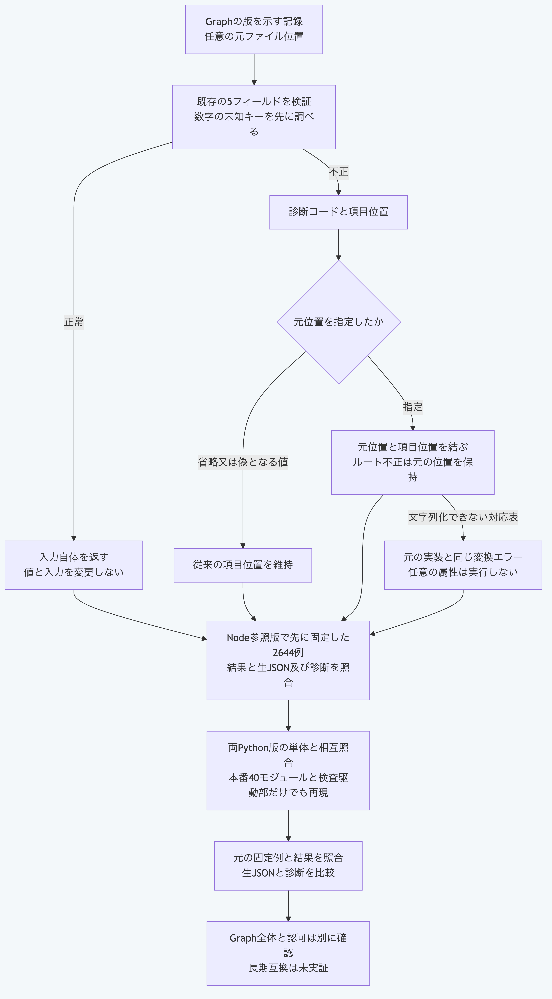

# PythonだけでGraphの版を示す記録を検査する

GraphRevisionは、Graphの版を示す記録です。
この手順は現在の`main`向けで、リポジトリ直下からPython3.14又は3.15を使います。
`python3`を対応する実行物へ置き換えます。
Node.jsと外部サービスへの接続は不要です。

## 1. 記録の構造と入力の保持を確認する

形式、識別値、親、二つの検査値と余分な項目を検査します。
正常なら入力した記録自体を返します。
次の検査値は例示用で、実際のGraphから再計算した値ではありません。

```sh
python3 - <<'PY'
import sys
sys.path.insert(0, "packages/portable-core")
from record_validation import validate_graph_revision
revision = {"format": "morivyx.graph-revision/0.1", "id": "graph:example", "parentRevision": None,
            "rootDigest": "sha256:" + "a" * 64, "schemaLockDigest": "sha256:" + "b" * 64}
assert validate_graph_revision(revision, "source/graph-revision.yaml") is revision
print(revision["id"])
PY
```

この成功は記録の構造が検査条件を満たすという結果です。
Graphの全体的な整合、検査値の再計算、変更の適用と認可を証明するものではありません。

## 2. 元のファイル位置を診断へ結び付ける

元位置を省略すると項目位置だけを返し、文字列を渡すと`元位置#/項目`になります。
ルート自体が不正なら元位置そのものを返します。
識別値と元位置のNFC又は時刻表記の正規化は行いません。

```sh
python3 - <<'PY'
import sys
sys.path.insert(0, "packages/portable-core")
from record_validation import validate_graph_revision
from schema_validation import ValidationError
revision = {"format": "morivyx.graph-revision/0.1", "id": "graph:example", "parentRevision": "graph:example",
            "rootDigest": "sha256:" + "a" * 64, "schemaLockDigest": "sha256:" + "b" * 64}
try:
    validate_graph_revision(revision, "source/graph-revision.yaml")
except ValidationError as error:
    assert error.code == "GRAPH_REVISION_INVALID"
    assert error.path == "source/graph-revision.yaml#/parentRevision"
    print(error.code, error.path)
else:
    raise AssertionError("expected a self-parent diagnostic")
PY
```

項目名の`~`と`/`だけを位置の構文へエスケープし、元位置は保持します。
数字の形の余分なキーを先に調べる順序も、元の公開関数と一致します。
複数の不正がある場合、最初の診断を返すため、一つ直した後に再検査します。

## 3. 固定例をPythonだけで検証する

```sh
python3 -B -m unittest discover -s packages/portable-core -p test_graph_revision.py
```

単体6件には、Node参照版から固定した2644例を含みます。
入力の生JSON、正常な返却値、エラーの種類、診断コードと位置及び出力の生JSONを照合します。
225例が正常、2419例は拒否で、そのうち142例は元位置の変換不能です。
元の公開関数のJSON引数の挙動を保持するため、空の配列と対応表、数値、変換できない`toString`を含む対応表も固定例へ含めています。
通常の呼出し側は文字列の元位置を渡します。
Pythonの任意のオブジェクトの変換処理や属性は呼びません。

公開の本番40モジュールと検査駆動部だけを複写した、NodeとGitがない環境でも全例を再現しています。
検査駆動部のJSON入出力はテスト用で、本番のコマンドライン操作としては公開していません。
この限定した一致を、全機能の独立適合、取得元の真正性又は長期互換の保証へ広げません。



[図の生成元](../diagrams/python-graph-revision.mmd)
