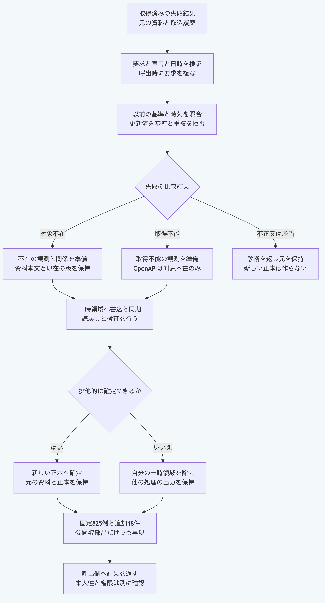

# Pythonだけで資料を保持して取得失敗の観測を保存する

`write_import_availability_package`は、取得できなかった結果を観測と資料への関係として保存します。
対象不在を`missing`、一時的な取得不能を`unavailable`として区別し、既存資料の識別子、本文と現在の版を保持します。
Pythonの標準機能だけで使えます。

| 入口 | 内容 |
|---|---|
| `validate_import_availability_request` | 宣言、失敗結果、要求、識別子と日時の対応を検証する |
| `prepare_import_availability` | 以前の基準を照合し、観測、関係と変更一覧を準備する。保存はしない |
| `write_import_availability_package` | 要求を呼出時に複写し、一時出力の再検証後に新しい保存先へ確定する |

## 失敗を観測して資料を保持する

公開ソースのルートで実行します。
合成した取込履歴とローカル変更のある資料を用意します。
最初は自分の空のフォルダーにあるファイルを読み、不在の失敗結果を実際に取得します。
次は合成した取得不能の結果を使い、二つの状態の保存を別々の出力先で確認します。
外部通信、認証と鍵操作は使わず、一時フォルダーは終了時に削除します。

```sh
python3.14 -B - <<'PY'
import asyncio
import copy
import json
from pathlib import Path
import sys
import tempfile

core = Path.cwd() / "packages/portable-core"
sys.path.insert(0, str(core))
from import_availability import (
    prepare_import_availability,
    validate_import_availability_request,
    write_import_availability_package,
)
from ledger_store import read_ledger_package
from repository_import import import_repository_file
from schema_validation import ValidationError

vectors = json.loads((core / "fixtures/import-availability-vectors.json").read_text())
with tempfile.TemporaryDirectory() as folder:
    root = Path(folder)
    base_path, source = root / "base", root / "source"
    for name, text in vectors["baseSets"]["repository-local"].items():
        path = base_path / name
        path.parent.mkdir(parents=True, exist_ok=True)
        path.write_text(text, encoding="utf-8")
    source.mkdir()
    before = {str(path.relative_to(base_path)): path.read_bytes()
              for path in base_path.rglob("*") if path.is_file()}
    artifact = copy.deepcopy(read_ledger_package(str(base_path))["elements"][0])
    for status, suffix in [("missing", "-local"), ("unavailable", "-local-unavailable")]:
        request = copy.deepcopy(vectors["requests"]["repository" + suffix])
        if status == "missing":
            request["runRequest"]["input"]["repositoryRoot"] = str(source)
            request["runResult"] = import_repository_file(request["runRequest"])
        assert request["runResult"]["status"] == "failure"
        validate_import_availability_request(request)
        prepared = prepare_import_availability(read_ledger_package(str(base_path)), request)
        saved = asyncio.run(write_import_availability_package({
            "basePath": str(base_path), "outputPath": str(root / status), "request": request,
        }))
        observed = read_ledger_package(saved["outputPath"])
        assert next(value for value in observed["elements"] if value["id"] == artifact["id"]) == artifact
        assert before == {str(path.relative_to(base_path)): path.read_bytes()
                          for path in base_path.rglob("*") if path.is_file()}
        record = prepared["candidateElements"][0]["extensions"]["morivyx.import/availability"]
        print(saved["valid"], len(observed["elements"]), saved["status"], record["localStatus"])
        try:
            asyncio.run(write_import_availability_package({
                "basePath": str(base_path), "outputPath": saved["outputPath"], "request": request,
            }))
        except ValidationError as error:
            print(error.code)
PY
```

出力は`True 3 missing changed`、`PACKAGE_OUTPUT_EXISTS`、`True 3 unavailable changed`、`PACKAGE_OUTPUT_EXISTS`の順です。
元の資料に観測と関係の二件を追加し、資料のローカル変更を`changed`として残します。
一時的な取得不能の例は合成結果であり、実際の外部障害を発生させた実証ではありません。

## 自分の正本へ接続する

`basePath`へプロジェクトか、その中の`.morivyx`を指定します。
`outputPath`は元の外にある、存在しないプロジェクトのルートにします。
`baseRevision`と`baseRootDigest`を読取結果の`revision.id`と`revision.rootDigest`へ合わせます。
`artifactId`に既存の資料、`baselineArtifactRevision`に最後に取り込んだ資料の版を指定します。
ローカル変更がある場合は、基準の版と現在の版を観測の中で区別します。

観測、関係、変更一覧と実行者には、資料とも互いに異なる小文字のUUID版4の識別子を使います。
新しい`runId`と元と異なる`graph:`形式の`resultingRevision`を指定します。
実際に取得を試みた宣言、要求と失敗結果を`manifest`、`runRequest`と`runResult`へ渡します。
`observedAt`は基準の取得及び記録日時と以前の観測日時以降、`recordedAt`は観測と以前の記録日時以降にします。
成功結果の保存には[取得成功の観測](python-import-presence.md)を使います。

ローカルファイル、GitHubとFigmaの対応した失敗を扱います。
OpenAPIは対象不在だけを保存し、未対応の失敗コードを拒否します。
GitHubとFigmaで同じ固定版の対象が不在という矛盾も拒否します。
以前の取込情報、試みた取得元と失敗コードを記録しますが、本人性と実行との結付けは証明しません。

## 診断と検証範囲

| 診断 | 確認すること |
|---|---|
| `IMPORT_AVAILABILITY_REQUEST_INVALID` | 宣言、失敗結果、識別子と日時の対応を確認する |
| `IMPORT_AVAILABILITY_BASE_MISMATCH` | 正本の版と根の検査値を読み直す |
| `IMPORT_AVAILABILITY_BASELINE_UNRECORDED` | 基準の版を作った取込履歴が一件だけあるか確認する |
| `IMPORT_AVAILABILITY_BASELINE_INVALID` | 以前の取込情報と宣言の対応を確認する |
| `IMPORT_AVAILABILITY_BASELINE_SUPERSEDED` | 最後に取り込んだ版を基準へ使う |
| `IMPORT_AVAILABILITY_ID_EXISTS` | 観測、関係と変更一覧に新しい識別子を使う |
| `IMPORT_AVAILABILITY_RUN_ALREADY_RECORDED` | 同じ実行を再記録しない |
| `IMPORT_AVAILABILITY_TIME_REGRESSION` | 基準と以前の観測より古い日時を使っていないか確認する |
| `IMPORT_AVAILABILITY_COMPARISON_INVALID` | 失敗コード、同じ版の矛盾と取込元の対応を確認する |
| `PACKAGE_OUTPUT_EXISTS` | 既存の出力を保持して新しい保存先を指定する |

公開47本番モジュールだけで、固定825例と保存前後の状態を再現します。
追加48結果では、不完全な資料と履歴の診断も元の実装へ照合します。
保存後は検査値、SchemaとGraphを読み直して検証し、失敗時は自分が作った領域だけを除去します。
本人性、採用権限、電源断からの全面復旧と悪意ある同時差替えの全面的な排除は未実証です。

```sh
python3.14 -B -m unittest discover -s packages/portable-core -p test_import_availability.py
python3.15 -B -m unittest discover -s packages/portable-core -p test_import_availability.py
node tools/run-node26.mjs node --test tools/python-import-availability-conformance.test.mjs
```

相互照合にはNode.js `26.13.0`以上を使います。
Pythonの利用例と単体検査にはNode.jsとGitを使いません。



[図の生成元](../diagrams/python-import-availability.mmd)

[取得成功の観測](python-import-presence.md)、[再取込改訂](python-import-snapshot-revision.md)と[手順の入口](README.md)へ戻れます。
