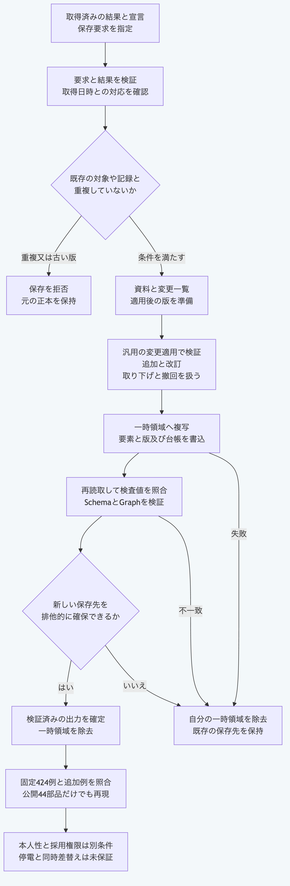

# Pythonだけで取込結果を新しい正本へ保存する

取込済みの結果を資料として保存する場合は、`write_imported_snapshot_package`を使います。
一般の変更一覧を適用して保存する場合は、`write_applied_package`を使います。
どちらも元の正本を上書きせず、存在する保存先を拒否します。
必要な環境はPythonだけで、標準機能以外の導入は不要です。
Python `3.14`と`3.15`で確認しています。

| 入口 | 実行する内容 |
|---|---|
| `validate_import_snapshot_creation_request` | 保存要求、取得済み結果と宣言の対応を検証する |
| `prepare_import_snapshot_creation` | 資料、変更一覧と適用後の版を準備する。保存はしない |
| `write_imported_snapshot_package` | 呼出時に要求を複写し、新しい正本へ保存する |
| `write_applied_package` | 明示した変更一覧を適用し、出力の再検証後に確定する |

## ファイルを取り込んで二つの保存方法を試す

公開ソースのルートで次の例を実行します。
試験用の空の正本を作り、自分で作成したファイルを読み取って、取込保存と汎用の変更適用の両方を試します。
例の時刻は試験用の固定値で、外部通信と認証は行いません。
一時フォルダーは終了時に削除します。

```sh
python3 -B - <<'PY'
import asyncio
import copy
import json
from pathlib import Path
import sys
import tempfile

core = Path.cwd() / "packages/portable-core"
sys.path.insert(0, str(core))
from import_snapshot_creation import (
    prepare_import_snapshot_creation,
    validate_import_snapshot_creation_request,
    write_imported_snapshot_package,
)
from ledger_store import read_ledger_package
from package_apply import write_applied_package
from repository_import import import_repository_file
from schema_validation import ValidationError

vectors = json.loads((core / "fixtures/import-snapshot-creation-vectors.json").read_text())
with tempfile.TemporaryDirectory() as folder:
    root = Path(folder)
    base_path, source = root / "base", root / "source"
    for name, text in vectors["baseFiles"].items():
        path = base_path / name
        path.parent.mkdir(parents=True, exist_ok=True)
        path.write_text(text, encoding="utf-8")
    source.mkdir()
    (source / "source.txt").write_bytes(b"owned local file\n")
    before = {str(path.relative_to(base_path)): path.read_bytes()
              for path in base_path.rglob("*") if path.is_file()}
    request = copy.deepcopy(vectors["requests"]["repository"])
    request["runRequest"]["input"]["repositoryRoot"] = str(source)
    request["runResult"] = import_repository_file(
        request["runRequest"], now=lambda: "2026-09-09T00:00:00Z")
    assert request["runResult"]["status"] == "success"
    validate_import_snapshot_creation_request(request)
    base = read_ledger_package(str(base_path))
    prepared = prepare_import_snapshot_creation(base, request)
    saved = asyncio.run(write_imported_snapshot_package({
        "basePath": str(base_path), "outputPath": str(root / "imported"),
        "request": request,
    }))
    applied = asyncio.run(write_applied_package({
        "basePath": str(base_path), "outputPath": str(root / "applied"),
        "changeSet": prepared["changeSet"],
        "candidateElements": [prepared["candidateElement"]],
        "resultingRevision": prepared["resultingRevision"],
    }))
    imported = read_ledger_package(saved["outputPath"])
    assert imported["elements"] == read_ledger_package(applied["outputPath"])["elements"]
    assert before == {str(path.relative_to(base_path)): path.read_bytes()
                      for path in base_path.rglob("*") if path.is_file()}
    print(saved["valid"], len(imported["elements"]), "base unchanged")
    try:
        asyncio.run(write_imported_snapshot_package({
            "basePath": str(base_path), "outputPath": saved["outputPath"],
            "request": request,
        }))
    except ValidationError as error:
        print(error.code)
PY
```

出力は`True 1 base unchanged`と`PACKAGE_OUTPUT_EXISTS`です。
保存された資料はファイル本文ではなく、取得対象、本文の検査値、取得日時と保持していない情報を含みます。
資料は下書きで、未確認の状態と実行の結付けが未検証であることを記録します。

## 自分の正本へ接続する

`basePath`へ既存のプロジェクトのルートか、その中の`.morivyx`を指定します。
`outputPath`は元のプロジェクトの外にある、存在しない新しい保存先にします。
要求の`baseRevision`と`baseRootDigest`は、`read_ledger_package`が返す`revision.id`と`revision.rootDigest`へ合わせます。
新しい資料、変更一覧と実行者の識別子には、互いに異なる小文字のUUID版4を使います。
`resultingRevision`には元と異なる`graph:`形式の版を指定します。

取得に使った宣言、要求と成功結果を、それぞれ`manifest`、`runRequest`と`runResult`へ渡します。
`recordedAt`には、結果の`output.retrievedAt`以降の実際の記録日時を指定します。
GitHub、FigmaとOpenAPIの検証済み結果も同じ保存入口へ接続できます。
既存の同じ外部対象を更新する再取込の保存は、この入口の対象ではありません。

## 失敗と検証範囲

| 診断 | 確認すること |
|---|---|
| `IMPORT_SNAPSHOT_BASE_MISMATCH` | 元の正本を読み直し、版と全体の検査値を合わせる |
| `IMPORT_SNAPSHOT_TARGET_EXISTS` | 同じ外部対象の資料又は記録が既に存在する。初回取込として追加しない |
| `IMPORT_SNAPSHOT_RESULT_INVALID` | 宣言、取得要求、結果と記録日時の対応を確認する |
| `PACKAGE_OUTPUT_INVALID` | 元の正本の外に新しいプロジェクトのルートを指定する |
| `PACKAGE_OUTPUT_EXISTS` | 既存の保存先を保持し、別の新しい保存先を指定する |
| `CHANGESET_TARGET_VALIDATION_FAILED` | 適用後の要素とSchema及びGraphの制約を確認する |

保存は一時領域で行い、書込の同期、再読取した内容の検査値とGraphの検証を終えてから確定します。
取込保存の入口は、呼出時に要求全体を複写します。
汎用の変更適用は呼出時の項目を保持し、検証が始まるまで候補の配列と記録への参照を使うため、結果を待つ間は候補を変更しないでください。
失敗時は操作が作った一時領域と確保済み出力を片付け、先に他の処理が作成した保存先を保持します。
停電からの復旧、悪意ある同時差替え、本人性と採用権限の保証は含みません。
公開する44本番モジュールだけでも、固定424例と保存時の診断を照合します。

```sh
python3.14 -B -m unittest discover -s packages/portable-core -p test_import_snapshot_creation.py
python3.15 -B -m unittest discover -s packages/portable-core -p test_import_snapshot_creation.py
node tools/run-node26.mjs node --test tools/python-import-snapshot-creation-conformance.test.mjs
```

最後の相互照合コマンドにはNode.js `26.13.0`以上を使います。
上の利用例とPythonの単体検査にはNode.jsとGitを使いません。



[図の生成元](../diagrams/python-import-snapshot-creation.mmd)

[ローカル取込](python-repository-import.md)、[台帳への追記](python-ledger-store.md)と[手順の入口](README.md)へ戻れます。
