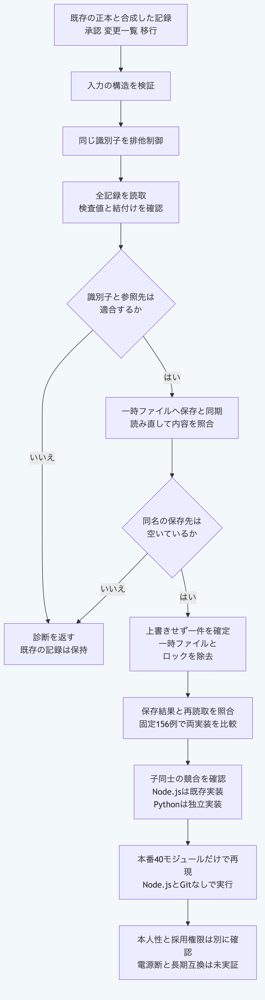

# Pythonだけで既存の台帳へ記録を追記する

`ledger_store.py`は、既存の正本に三種類の記録を追加する関数を提供します。
Pythonの標準機能だけで利用でき、Node.js、Git、通信と追加の依存部品を必要としません。
以下の例は、検証用の合成した記録を一時領域へ保存します。
実際の利用者による承認を作った証拠にはしません。

| 関数 | 保存する内容 |
|---|---|
| `write_approval(path, approval)` | 承認又は既存の承認への撤回 |
| `write_change_set(path, change_set)` | 変更一覧。Graphへの適用は別に行う |
| `write_migration(path, migration)` | 保存済みの変更一覧へ結び付く移行記録 |
| `read_ledger_package(path)` | 記録構造、検査値と台帳の結付けを確認した読取 |

`path`には正本を含むプロジェクト又は`.morivyx`自体を渡します。
`.morivyx`は先に必要であり、存在しない場合は自動で正本を作りません。
記録用の下位フォルダーだけが未作成なら、保存時に作成します。
以下はmacOSのPython `3.14`と`3.15`で確認する手順です。

## 一時領域で三種類を保存する

リポジトリのルートで実行します。
一時領域は最後に自動で削除されます。

```sh
python3.14 -B - <<'PY'
import copy
import json
from pathlib import Path
import sys
import tempfile

core = Path("packages/portable-core").resolve()
sys.path.insert(0, str(core))
from ledger_store import read_ledger_package, write_approval, write_change_set, write_migration
from schema_validation import ValidationError

vectors = json.loads((core / "fixtures/ledger-store-vectors.json").read_text(encoding="utf-8"))
with tempfile.TemporaryDirectory(prefix="morivyx-ledger-example-") as temporary:
    project = Path(temporary)
    for name, source in vectors["baseFiles"].items():
        target = project / ".morivyx" / name
        target.parent.mkdir(parents=True, exist_ok=True)
        target.write_text(source, encoding="utf-8")

    approval = copy.deepcopy(vectors["templates"]["approval"])
    change = copy.deepcopy(vectors["templates"]["change"])
    migration = copy.deepcopy(vectors["templates"]["migration"])
    for function, record in ((write_approval, approval), (write_change_set, change), (write_migration, migration)):
        result = function(str(project), record)
        assert result["valid"] is True
        assert Path(result["path"]).is_file()
        print(Path(result["path"]).parent.name, "saved", "digest" in result)

    package = read_ledger_package(str(project))
    print({key: len(package[key]) for key in ("approvals", "changeSets", "migrations")})
    try:
        write_approval(str(project), approval)
    except ValidationError as error:
        assert error.code == "APPROVAL_ALREADY_EXISTS"
        print(error.code)
    else:
        raise AssertionError("duplicate was not refused")
PY
```

結果は次のとおりです。
移行記録は、元の合成した正本に含まれる変更一覧へ結び付いています。

```text
approvals saved False
ledger saved True
migrations saved True
{'approvals': 2, 'changeSets': 3, 'migrations': 2}
APPROVAL_ALREADY_EXISTS
```

自分の正本では、取得した記録を各関数へ渡します。
成功時は`valid`と保存先を返し、変更一覧と移行には`digest`も返します。
入力を変更せず、既存の記録も上書きしません。

## 拒否時の確認

記録構造と撤回先又は移行先の不整合は`ValidationError`の`code`と`path`で確認できます。
同じ種別の識別子が保存済みなら、種別に応じた`APPROVAL_ALREADY_EXISTS`、`CHANGESET_ALREADY_EXISTS`又は`MIGRATION_ALREADY_EXISTS`です。
別の種別が識別子を使用していれば`ID_DUPLICATE`です。
同じ識別子のロックが約1秒の待機後も残る場合は`PACKAGE_RECORD_BUSY`です。
他の処理のロックを削除して続行する入口はありません。
一般のファイル操作の失敗は`OSError`として返します。

保存は、一時ファイルへの書込と同期、読取結果の照合、上書きしないリンクの作成の順に行います。
同じ識別子で協調するNode.jsとPythonの処理は、同じロックを使います。
同期と確定で失敗した場合も、自分の一時ファイルとロックを除去します。

## 検証範囲

固定156例で、保存結果、診断の位置、保存した全バイトの検査値と別の読取の結果を既存のNode.js実装と比較します。
追加の46例では、制御文字、負のゼロ、文字の正規化と再読取で拒否されるキーも既存の関数へ照合します。
公開する本番40モジュールと検査駆動部だけの環境で、Node.jsとGitを探索できない状態でも全例を再現します。
実際の別プロセスで、同じ識別子の承認同士と異なる種別が一件だけ確定することも検査します。

台帳の読取は、未知の通常ファイルと通常のハードリンクを許し、メタデータ内のシンボリックリンクと特殊ファイルを拒否します。
祖先のシンボリックリンクは許します。
既存の`package_records.read_package`は、ファイル数と容量の上限、リンクと未知の項目をさらに制限する別の読取です。
台帳はNode.jsが扱える大きさと深さを一律に制限しません。
共用のYAML関数の既定上限である8MiBと深さ128は維持します。

保存成功の`valid`は、本人性、署名と採用権限を認証する値ではありません。
Graph全体の検証、変更の適用、電源断への耐久性、無関係な書込を含む一時点の取得、悪意ある置換の全面的な排除は保証しません。
長期互換と実際の提供元終了の実証も別に必要です。

```sh
python3.14 -B -m unittest discover -s packages/portable-core -p test_ledger_store.py
python3.15 -B -m unittest discover -s packages/portable-core -p test_ledger_store.py
node --test tools/python-ledger-store-conformance.test.mjs
```

最後の比較検査だけはNode.js `26.13.0`以上と既存のNode.js側の依存部品を使います。
通常のPython関数の利用には必要ありません。



[図の生成元](../diagrams/python-ledger-store.mmd)
