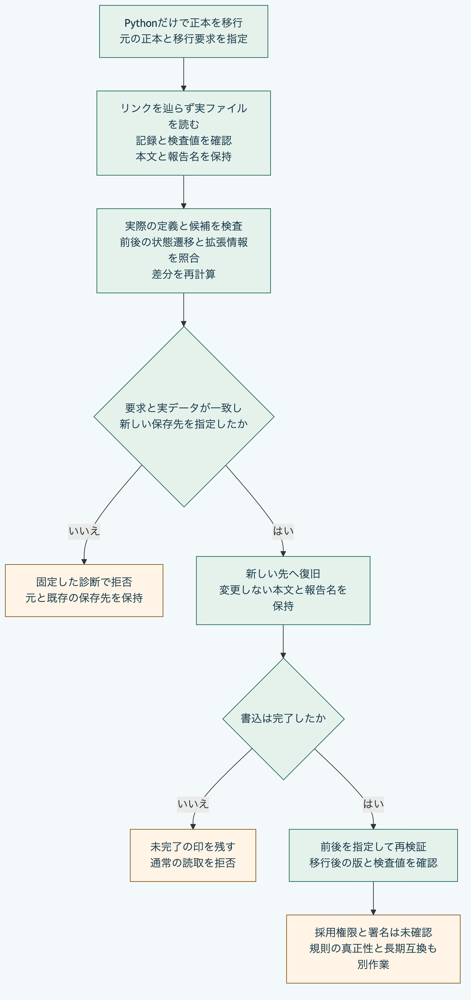

# Pythonだけで正本を新しいSchemaへ移行する

既存の正本と明示した移行要求を[実行例](../../examples/python-migrations/workflow.py)へ渡し、別の保存先へ移行します。
Pythonの標準機能だけを使い、Node.js、Git、外部通信と依存の導入は必要ありません。
Python 3.14と3.15、POSIXの安全なファイル操作を使い、この手順はmacOSで確認しています。
以下は取得済みのリポジトリ直下で実行します。

## 1. 説明用の入力と元の正本を準備する

[固定した入力](../../examples/python-migrations/sample.json)は、説明用の主体1件をSchemaの版`0.1`から`0.2`へ変え、主体を1件加える例です。
Morivyxの新しい正式版や、実在する本人の認証を意味しません。
サンプルの規則と対応表の検査値は説明用の固定値で、対応する規則本文を認証又は実行するものではありません。

```sh
work=$(mktemp -d)
work=$(cd "$work" && pwd -P)
python3 -B - "$work" <<'PY'
import json
from pathlib import Path
import sys
sys.path.insert(0, "packages/portable-core")
from package_restore import restore_package_files
sample = json.loads(Path("examples/python-migrations/sample.json").read_text())
work = Path(sys.argv[1])
restore_package_files(sample["sourceFiles"], work / "source")
(work / "request.json").write_text(json.dumps(sample["request"], ensure_ascii=False) + "\n")
print(work)
PY
```

`source`は`revision.yaml`を直接含む正本です。
Node.jsのCLIへ渡すプロジェクトのフォルダーと、その中の`.morivyx`を区別します。
この例では正本を直接`source`へ置くため、`.morivyx`を付け足しません。

## 2. 計画を確認して新しい保存先へ移行する

```sh
python3 -m json.tool "$work/request.json"
python3 -B examples/python-migrations/workflow.py "$work/source" "$work/migrated" < "$work/request.json" > "$work/result.json"
python3 -m json.tool "$work/result.json"
python3 -B packages/portable-core/package_validation.py "$work/migrated" --previous "$work/source"
```

成功時は`restored: true`です。
元の版は`graph:package-validation`、移行後の版は`graph:apply-next`で、元と移行後の`schemaLockDigest`が異なります。
再検証は`valid: true`で、実際のSchemaとGraph制約及び前後の状態遷移を確認します。

実行例は安全に読み取った実ファイルの本文を計画へ渡します。
元のファイルは変えず、変更しない記録の本文と報告の別名は保存先でも保持します。
変換先のSchema、候補、変更記録、移行記録、差分と版は要求から照合し、差分を再計算します。
同じ名前と版のSchemaを異なる内容へ差し替える要求も拒否します。

結果の`checks`では、`sourceSchemaAndGraphValidated`、`targetSchemaAndGraphValidated`、`lifecycleTransitionsCompared`と`plannedDiffRecalculated`が`true`です。
`historyAncestryValidated`、`rulesAndMappingAuthenticated`、`adoptionAuthorityValidated`と`signaturesValidated`は`false`のままです。
移行の採用、本人性、規則の真正性、署名とGit履歴の祖先関係全体を確認した結果ではありません。

## 3. 自分の正本と要求を使う

```sh
python3 -B examples/python-migrations/workflow.py /path/to/source/.morivyx /path/to/new-project/.morivyx < migration-request.json
```

保存先の親である`new-project`は先に用意し、`.morivyx`自体は存在しない状態にします。
元の正本の内側や、リンクを通る保存先は指定できません。
要求は次の7項目を持つJSONです。
`sourceFiles`を渡して元の実ファイルを差し替えることはできません。

| 項目 | 指定する内容 |
|---|---|
| `targetSchemaLock` | 移行先のSchemaの名前、版と内容を固定する情報 |
| `targetSchemaSources` | 固定したSchemaのファイル名とUTF-8本文の対応表 |
| `migration` | 元と移行先の検査値、変更記録と差分を結び付ける移行記録 |
| `changeSet` | 変更前後の版と操作を明示する変更記録 |
| `plannedSemanticDiff` | 保存用の識別子を持つ、要素とSchemaの変更の計画差分 |
| `candidateElements` | 操作に必要な変更後の要素の完全な本文 |
| `resultingRevision` | 元の版を親とする移行後の版と検査値 |

識別子、時刻、候補と検査値は呼出側が整合させて用意します。
任意のSchemaの差から候補や規則を自動生成する道具ではありません。
未知の拡張情報は同じ要素又は明示した置換先へ保持し、欠落や変更を拒否します。
標準入力は重複のない厳密なUTF-8のJSONで8MiBまでです。

## 失敗を確認する

同じ保存先へもう一度実行すると、終了コード1で拒否し、既存の内容を保持します。

```sh
python3 -B examples/python-migrations/workflow.py "$work/source" "$work/migrated" < "$work/request.json"
```

失敗時は標準出力を空にし、標準エラーへ固定した`EXAMPLE_MIGRATION_FAILED`と`stage`を返します。
利用者のパス、本文や内部例外は診断へ展開しません。
引数の不足は引数解析の終了コード2です。

| `stage` | 確認する内容 |
|---|---|
| `input` | UTF-8、JSONの構文、重複項目と入力上限 |
| `source` | 元の配置、読取可能性、記録構造と検査値 |
| `plan` | 7項目の過不足、実SchemaとGraph制約、候補、差分、状態遷移と検査値の整合 |
| `output` | 結果のJSONを保存前に生成でき、8MiB以内か |
| `restore` | 親の存在、新しい保存先、リンクと元の内側への指定、書込中の失敗 |

書込が中断した保存先は未完了の印が残り、通常の正本としては読み取れません。
その先へ再試行して上書きせず、内容を調べて別の新しい保存先を選びます。
原子的な保存、読取中の同時変更の全面的な排除、長期互換と正式な採用は実証していません。



[図の生成元](../diagrams/python-migration-workflow.mmd)

[利用手順の入口](README.md)へ戻れます。
