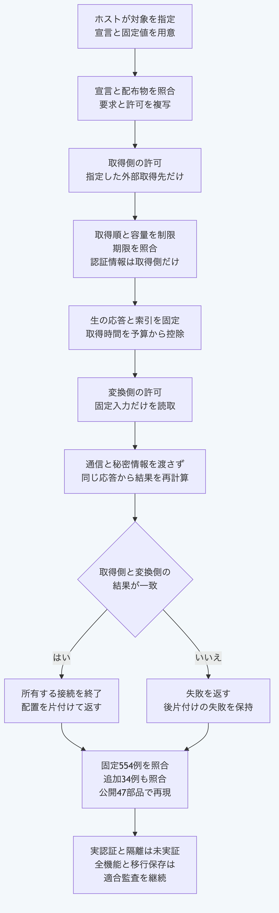

# Pythonで取得結果を隔離変換へ渡す

`run_network_import_container`は、許可した取得先の生の応答を固定し、別の許可で動く変換側の結果と照合します。
宣言と配布物及びイメージの固定値は、呼出側が用意します。
結果が一致しても、`authenticity`と`executionBinding`は`not-verified`です。
Pythonの標準機能だけで使えます。

## 合成データで取得と変換を接続する

公開ソースのルートで実行します。
同梱した合成データを使い、取得と実行の両方をホスト側の模擬接続へ差し替えます。
実認証、実外部取得、実Dockerと実イメージは使いません。
変換側は入力に置かれた生の応答から再計算し、完了済みの結果を返すだけの処理にはしません。

```sh
python3.14 -B - <<'PY'
import asyncio
import copy
import json
from pathlib import Path
import sys
from types import SimpleNamespace

core = Path.cwd() / "packages/portable-core"
sys.path.insert(0, str(core))
from network_import_container import run_network_import_container
from figma_import import convert_figma_import_response
from schema_validation import ValidationError

vectors = json.loads((core / "fixtures/network-import-container-vectors.json").read_text())
source = vectors["providers"]["figma"]
value = copy.deepcopy(source["input"])
value["execution"]["artifacts"]["package"] = bytearray(value["execution"]["artifacts"]["package"])
container_id = vectors["containerId"]
state = {"requests": 0}

class Reader:
    def __init__(self, raw):
        self.raw, self.done = raw, False

    async def read(self):
        if self.done:
            return {"done": True}
        self.done = True
        return {"done": False, "value": self.raw}

    async def cancel(self):
        self.done = True

    def release_lock(self):
        pass

async def fetch(url, settings):
    assert settings["method"] == "GET" and settings["redirect"] == "manual"
    row = source["responses"][0]
    assert url == "https://api.figma.com" + row["path"]
    state["requests"] += 1
    reader = Reader(row["text"].encode())
    return SimpleNamespace(status=200, redirected=False, url=url,
        headers=SimpleNamespace(get=lambda key: "application/json" if key == "content-type" else None),
        body=SimpleNamespace(get_reader=lambda: reader, cancel=reader.cancel))

async def transport(args, settings):
    if args[0] == "info":
        return {"code": 0, "stdout": json.dumps(vectors["server"])}
    if args[0] == "image":
        return {"code": 0, "stdout": value["execution"]["imageId"]}
    if args[1] == "create":
        flag = lambda key: args[args.index(key) + 1]
        root = flag("--mount").split("source=", 1)[1].split(",", 1)[0]
        state["root"] = root
        assert "HOST_ONLY_FIXTURE_CREDENTIAL" not in json.dumps(args)
        state["info"] = {"Id": container_id, "Image": value["execution"]["imageId"],
            "Config": {"Labels": {"morivyx.run": flag("--label").split("=", 1)[1]},
                       "User": "65534:65534", "WorkingDir": "/input"},
            "HostConfig": {"NetworkMode": "none", "ReadonlyRootfs": True, "Privileged": False,
                "CapDrop": ["ALL"], "CapAdd": None, "SecurityOpt": ["no-new-privileges=true"],
                "Memory": int(flag("--memory")), "MemorySwap": int(flag("--memory-swap")),
                "PidsLimit": 32, "NanoCpus": 1000000000, "LogConfig": {"Type": "none"},
                "PidMode": "", "IpcMode": "none", "CgroupnsMode": "private"},
            "Mounts": [{"Type": "bind", "Source": root, "Destination": "/input", "RW": False}]}
        return {"code": 0, "stdout": container_id}
    if args[1] == "inspect":
        return {"code": 0, "stdout": json.dumps([state["info"]])}
    if args[1] == "start":
        request = json.loads(settings["input"])
        root = Path(state["root"])
        index = json.loads((root / "network-input.json").read_bytes())
        chunks = index["responses"][0]["chunks"]
        raw = b"".join((root / name).read_bytes() for name in chunks)
        result = convert_figma_import_response(request, raw, index["retrievedAt"])
        return {"code": 0, "stdout": json.dumps(result)}
    if args[1] == "rm":
        state["removed"] = True
        return {"code": 0, "stdout": container_id}
    raise AssertionError("unexpected operation")

options = {"runtimeBinding": source["runtimeBinding"], "fetchImpl": fetch,
           "transport": transport, "now": lambda: vectors["time"]}
result = asyncio.run(run_network_import_container(value, options))
print(result["result"]["status"], result["acquisition"]["requestCount"])
print(result["binding"]["authenticity"], result["binding"]["executionBinding"])
print(state["removed"], not Path(state["root"]).exists())
invalid = copy.deepcopy(value)
invalid["acquisition"]["permission"]["fileKey"] = "other"
try:
    asyncio.run(run_network_import_container(invalid, options))
except ValidationError as error:
    print(error.code, state["requests"])
PY
```

出力は次のとおりです。

```text
success 1
not-verified not-verified
True True
NETWORK_IMPORT_PERMISSION_DENIED 1
```

最後の行は対象の違う許可を取得前に拒否し、取得回数が増えていないことを表します。
この例の実行側は、合成データの再計算を説明する模擬処理です。
読取時の全境界と実際のOS隔離をこの例だけで確認したとは扱いません。

## 自分の呼出側へ接続する

入力は`request`、`acquisition`と`execution`です。
取得側の`acquisition`は宣言、許可、対象と必要な認証情報を持ちます。
実行側の`execution`は別の宣言と許可、固定イメージの`imageId`、取得済み配布物のバイト列を持つ`artifacts`を指定します。
ホストが保持する`runtimeBinding`には、宣言と配布物の検査値及び同じイメージ識別子を指定します。
これらの固定値を拡張機能自身の申告から無条件に作らず、利用する基盤と配布物の判断へ結び付けます。

取得側は指定したAPIの通信と必要な認証情報だけを許可します。
変換側は`network-import-input`の読取だけを許可し、通信と秘密情報を持ちません。
元の要求はGitHubの固定コミットにある一ファイル、又はFigmaの固定版にある一要素です。
[GitHubの手順](python-github-import.md)、[Figmaの手順](python-figma-import.md)と[コンテナ実行の手順](python-plugin-container.md)も参照してください。

取得処理を省略した場合の標準接続は、自分の接続だけを所有し、共有の接続群、環境変数による中継、再試行と転送の追跡を使いません。
実際に取得する場合は、取得先、契約、認証情報、イメージと実行基盤の利用条件を運用側で用意します。
この手順では実認証、実外部取得、TLS、実Dockerと実際のOS隔離の実証を未完了とします。

応答一件は2 MiB、分割した一ファイルは1 MiB、索引は64 KiB、全体は8 MiBと256ファイルまでです。
取得回数はGitHubが19回、Figmaが一回までで、取得と実行は合計30秒までの予算を共有します。
`acquisition.limits`は既定の上限を狭める場合に使います。
`options`は必須の固定情報と、ホスト側の`fetchImpl`、`transport`、`now`、`signal`及び絶対パスの`dockerPath`を受け付けます。

後片付けの失敗`PLUGIN_ISOLATION_CLEANUP_FAILED`では、対象と作業場所を`details`へ残します。
所有した通信作業の終了を5秒以内に確認できない場合は`NETWORK_IMPORT_NETWORK_CLEANUP_FAILED`を返します。
注入した処理やOSの名前解決が制限を守ることまで、入口の検査で証明するものではありません。

## 照合する

```sh
cd packages/portable-core
python3.14 -B -m unittest -v test_network_import_container
```

元の実装から固定した554例と、時計、バイト列及び待機前の複写の追加34結果を照合します。
公開47本番モジュールだけでも、NodeとGitを探索せずに固定結果を再現します。
所有する局所HTTP接続による短い応答と終了の検査も含みます。
全機能の独立適合、全面的な移行保存、本人性、採用権限、実環境と提供元終了の実証は別に残ります。



[図の生成元](../diagrams/python-network-import-container.mmd)
