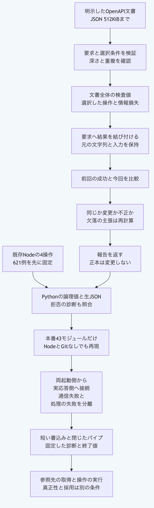

# PythonだけでOpenAPI文書から操作を選び再取込を比較する

この手順は現在の`main`向けです。
リポジトリ直下でPython3.14又は3.15を使い、`python3`を対応する実行物へ置き換えます。
Node.jsと外部サービスへの通信は不要です。
対象はOpenAPIの版が`3.1.x`であるJSON文書で、YAMLの本文と参照先の解決は扱いません。

## 1. 操作と全文の検査値を取得する

要求の組立と検証は別の操作です。
元の文書のUTF-8バイト列を検査値へ結び付け、元の識別値と時刻表記を保持します。
次の時刻は再現用の固定値で、実際の時計の認証を意味しません。

```sh
python3 - <<'PY'
import json, sys
sys.path.insert(0, "packages/portable-core")
from openapi_import import openapi_import_request, validate_openapi_import_request, import_openapi_operation, validate_openapi_import_result
document = {"openapi": "3.1.2", "info": {"title": "Owned example", "version": "1.0.0"},
            "paths": {"/items": {"get": {"operationId": "listItems"}}}}
request = openapi_import_request(run_id="run:openapi", external_id="openapi:owned",
    document_text=json.dumps(document, separators=(",", ":")), path="/items", method="get")
assert validate_openapi_import_request(request) is request
result = import_openapi_operation(request, now=lambda: "2026-11-05T00:00:00Z")
assert result["status"] == "success"
validate_openapi_import_result(result, request)
assert result["output"]["operation"] == {"path": "/items", "method": "get", "operationId": "listItems"}
print(result["output"]["operation"], result["output"]["digest"])
PY
```

文書は512KiB以下、入れ子の容器は64段まで、要求全体のJSONは1MiB以下です。
重複した項目名と選択した操作への参照は拒否します。
本文、他の操作、説明と例、パラメーターとSchema、サーバーと安全性の設定は解釈又は保持せず、その情報損失を結果の7項目へ記録します。

## 2. 変更と欠落を比較する

検査値は文書全体から求めるため、空白の追加でも`stale`になります。
欠落を主張する失敗結果は、その文書で同じ操作が欠落していることを再計算してから`missing`と判定します。
比較は報告だけを返し、正本を更新しません。

```sh
python3 - <<'PY'
import json, sys
sys.path.insert(0, "packages/portable-core")
from openapi_import import openapi_import_request, import_openapi_operation, compare_openapi_import_snapshots
document = {"openapi": "3.1.2", "info": {"title": "Owned example", "version": "1.0.0"}, "paths": {"/items": {"get": {}}}}
request = openapi_import_request(run_id="run:compare", external_id="openapi:owned",
    document_text=json.dumps(document), path="/items", method="get")
previous = import_openapi_operation(request, now=lambda: "2026-11-05T00:00:00Z")
request["input"]["documentText"] += " "
current = import_openapi_operation(request, now=lambda: "2026-11-05T00:00:01Z")
report = compare_openapi_import_snapshots({"previousResult": previous, "currentRequest": request, "currentResult": current})
assert report["status"] == "stale"
document["paths"] = {}
request["input"]["documentText"] = json.dumps(document)
missing = import_openapi_operation(request, now=lambda: "2026-11-05T00:00:02Z")
report = compare_openapi_import_snapshots({"previousResult": previous, "currentRequest": request, "currentResult": missing})
assert report["status"] == "missing"
print(report["status"], report["current"]["documentDigest"])
PY
```

同じ文書と保持属性は`current`、不正な組合せと時刻の後退は`invalid`です。
比較全体の入力は正規形で2MiB以下です。
小数秒を切り捨てず時差を照合しますが、時刻自体の真正性は確認しません。

## 3. 実際の応答側を起動する

[実行側の許可情報と資源上限](python-plugin-runtime.md)へ、信頼するPython実行物と同梱の応答側を明示します。
この例では同梱の宣言を許可情報の照合に使います。
宣言中の配布物の検査値とPython実行ファイルの実際のバイト列を認証した結果にはしません。

```sh
python3 - <<'PY'
from pathlib import Path
import json, sys
sys.path.insert(0, "packages/portable-core")
from plugin_runtime import run_plugin_process
from openapi_import import validate_openapi_import_result
fixture = Path("packages/kernel/test/fixtures/openapi-importer")
manifest = json.loads((fixture / "manifest.json").read_text())
request = json.loads((fixture / "request.json").read_text())
capability = manifest["capabilities"][0]
policy = {"format": "morivyx.plugin-host-policy/0.1",
    "plugin": {key: value for key, value in manifest["identity"].items() if key != "distributor"},
    "capability": {"id": capability["id"], "effect": "pure", "permissions": capability["permissions"], "resources": capability["resources"]}}
result = run_plugin_process(command=sys.executable,
    args=["-B", str(Path("packages/portable-core/openapi_import.py").resolve()), "--stdio"],
    manifest=manifest, request=request, policy=policy)
validate_openapi_import_result(result, request)
assert result["status"] == "success"
print(result["output"]["operation"])
PY
```

`--stdio`は[一要求・一結果の応答側](python-plugin-stdio.md)です。
通信の失敗は終了値2と固定した診断、形式の正しい取込失敗は終了値0の失敗結果です。
Node.jsの既存の起動側から同じ応答側を呼ぶこともできます。
許可情報はOSの権限を隔離する仕組みではありません。

## 4. JSON入口を使う

包みは`operation`と`input`だけで、操作は`validate-request`、`validate-result`、`import`と`compare`です。
検証は`valid`、取込は`result`、比較は`report`へ返します。

```sh
python3 - <<'PY' | python3 packages/portable-core/openapi_import.py
import json, sys
sys.path.insert(0, "packages/portable-core")
from openapi_import import openapi_import_request
document = {"openapi": "3.1.2", "info": {"title": "Owned example", "version": "1.0.0"}, "paths": {"/items": {"get": {}}}}
request = openapi_import_request(run_id="run:json", external_id="openapi:owned", document_text=json.dumps(document), path="/items", method="get")
print(json.dumps({"operation": "import", "input": request}))
PY
```

`validate-result`の入力は`result`と任意の`request`を持ち、それ以外は各関数の入力を直接渡します。
入力と出力は各8MiB以下です。
不正なUTF-8、包み、重複項目と引数は、終了値1と固定した`OPENAPI_IMPORT_INPUT_INVALID`及び位置`/`を標準エラーへ返します。
標準出力と診断を明示的にフラッシュし、失敗したストリームを閉じて終了時の追加例外を防ぎます。
途中までの出力を取り消せないため、終了値1の標準出力を採用しません。
終了値0でも失敗結果と不正な比較報告を返すため、`status`と診断コードを確認します。

## 確認した範囲

固定621例は要求179例、結果238例、取込148例と比較56例です。
戻り値の221例には失敗結果と不正な報告を含み、残り400例は拒否の診断です。
正規形と生のJSON及び診断を照合し、本番43モジュールだけのNodeとGitなしの環境でも再現します。
OpenAPI全仕様の解釈、参照先と実サービスの取得、取得元の真正性、操作の実行と正本への採用は行いません。



[図の生成元](../diagrams/python-openapi-import.mmd)

[手順一覧](README.md)へ戻れます。
