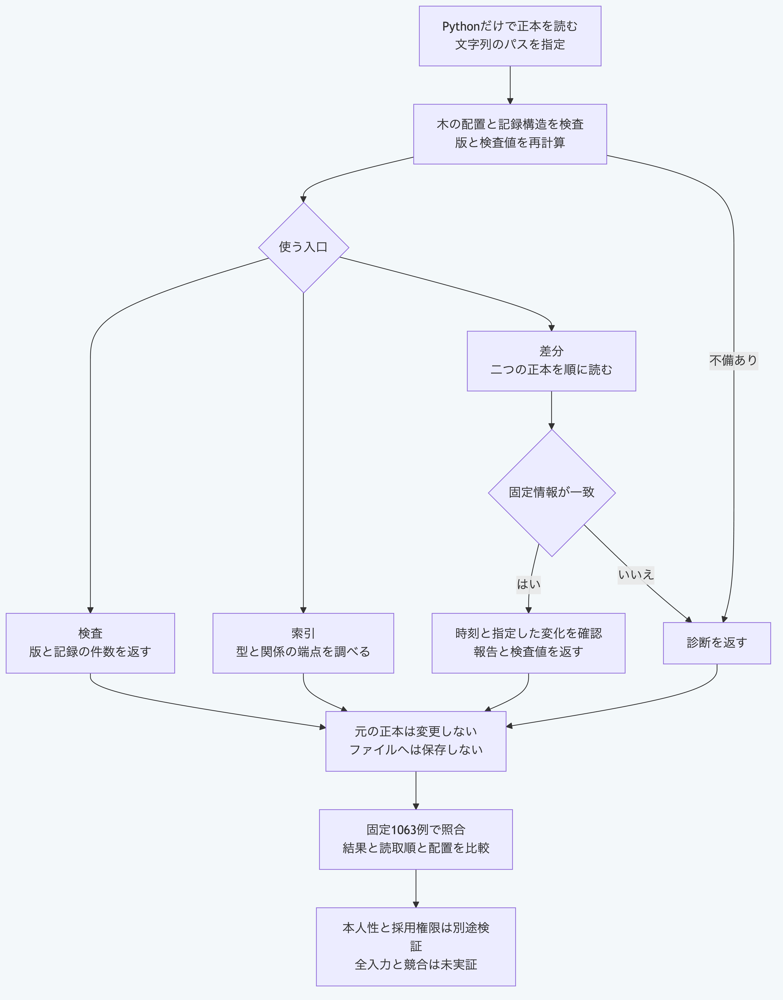

# Pythonで正本を検査して索引と差分を得る

Python 3.14と3.15で、正本から概要、索引と差分を得られます。
NodeとGit及び外部のYAML処理系は呼び出しません。
パスは文字列で渡し、戻された処理の完了を`await`で待ちます。
`Path`を使う場合は`str(path)`へ変換します。
末尾が`.morivyx`ならその場所、それ以外なら直下の`.morivyx`を読みます。
この三つの入口はファイルを保存しません。

## 所有する一時領域で試す

公開リポジトリの直下から実行します。
同梱の固定資料を二つの一時領域へ複写して読み、既存の正本を変更しません。
同じ版を二つ用意するため、差分の一覧は空になります。

```sh
cd packages/portable-core
python3.15 -B - <<'PY'
import asyncio
import json
from pathlib import Path
from tempfile import TemporaryDirectory
from package_records import inspect_package
from graph_index import rebuild_package_index
from semantic_diff import diff_packages

async def main():
    fixtures = Path("../kernel/test/fixtures")
    sample = json.loads((fixtures / "graph-package-roundtrip-vector.json").read_text())
    source = fixtures / sample["inputRoot"]
    with TemporaryDirectory(prefix="morivyx-package-example-") as directory:
        roots = [Path(directory) / name for name in ("left", "right")]
        for root in roots:
            for name in sample["inputFiles"]:
                target = root / ".morivyx" / name
                target.parent.mkdir(parents=True, exist_ok=True)
                target.write_bytes((source / name).read_bytes())
        summary = await inspect_package(str(roots[0]))
        indexed = await rebuild_package_index(str(roots[0]))
        result = await diff_packages(str(roots[0]), str(roots[1]), {
            "evaluatedAt": "2026-11-12T00:00:00Z",
        })
        assert indexed["index"]["graphRevision"] == summary["graphRevision"]
        assert result["report"]["entries"] == []
        print(summary["elementCount"])
        print(len(indexed["index"]["elements"]))
        print(result["report"]["entries"])

asyncio.run(main())
PY
```

出力は次のとおりです。

```text
2
2
[]
```

## 自分の正本と診断を扱う

`package_records.inspect_package(path)`は、版、親の版、各記録の件数、記録した値と再計算した検査値、要素の識別子と種別及び版を返します。
記録構造、ファイル名、識別子の重複、承認の取消参照、移行と変更一覧の結付け、要素の版、Schema固定情報と根の検査値を照合します。
保存済みの報告には識別子を求めます。
木全体のシンボリックリンクと特殊ファイルを拒否し、通常の未知のファイルと入れ子の記録は検査対象の記録へ含めません。

`graph_index.rebuild_package_index(path)`は同じ読取に接続し、関係の端点の識別子と存在を確認します。
`index`には要素の投影、型別の一覧と、関係の始点及び終点別の一覧が入ります。
索引ファイルを作成しません。

`semantic_diff.diff_packages(base_path, target_path, options)`の第三引数は必須です。
`options`へ評価時刻の`evaluatedAt`、必要なら報告の`id`と追跡品質の変化の`traceChanges`を渡します。
両側を順番に読んだ後、Schema固定情報の検査値が異なれば`SCHEMA_LOCK_CONFLICT`として拒否します。
同じ固定情報なら、要素の追加、改訂と除去及び明示した追跡品質の変化から、報告と`digest`を返します。
追跡そのものは実行せず、報告も保存しません。

```python
try:
    summary = await inspect_package("/path/to/project")
except Exception as error:
    print(getattr(error, "code", None), getattr(error, "path", None))
    raise
```

診断は`code`と`path`で確認します。
対象のヘッダーがなければ`PACKAGE_FILE_MISSING`、ファイル名と識別子が違えば`PACKAGE_FILENAME_ID_MISMATCH`になります。
索引の端点が存在しなければ`INDEX_SOURCE_INVALID`です。

## 検証範囲を確認する

返された`valid`は、上記の記録検査と投影の範囲を示します。
実SchemaとGraph全体の意味、真正性、署名、本人性と採用権限の検証完了を示しません。
既存の`read_package`、`read_package_files`と`read_package_file_sources`は、同期する入口と従来の容量、ファイル数及び深さの制限を保持します。
新しい三つの入口へその制限を流用していないため、実行資源は呼出し側で管理します。

リポジトリ直下で実行します。

```sh
python3.15 -B -m unittest discover -s packages/portable-core -p test_package_file_api.py
```

実装前に元の1063例を固定し、最初の実装と専用試験も比較前に保存しています。
結果、診断の種類と位置、読取順序、制御した故障の到達回数、引数と配置を比較します。
四つの報告形式、10001ファイル、8MiBを超える本文と深さ1024も含みます。
65536バイトを超える文字列と大きな配置一覧は、長さとSHA-256で照合します。
公開47本番モジュールだけを複写して、NodeとGitを探索できない条件でも再実行します。
macOSで名前を構成できなかった六例はAPIの呼出し前の失敗として区別し、1063例へ数えません。
全入力、ほかのOS、任意の競合と長期耐障害性の証明ではありません。



[図の生成元](../diagrams/python-package-file-api.mmd)
