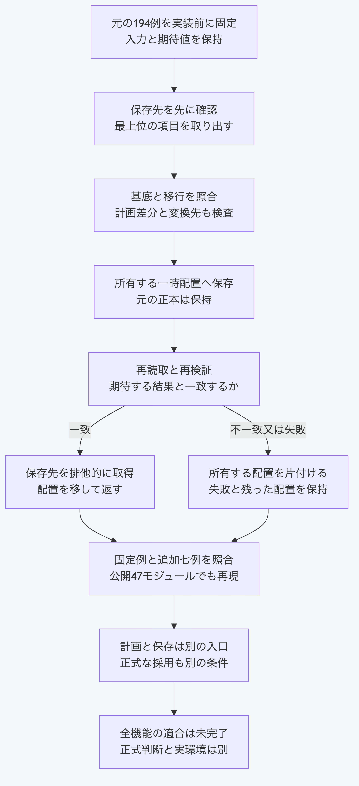

# Pythonで全面的な移行結果を新しい保存先へ書く

`package_migration.write_migrated_package`は、明示した移行、変更一覧、計画した差分、候補と変換先Schemaを照合し、新しい保存先へ書きます。
既存の`plan_package_migration`は、提案するファイル群を返す計画の入口として残ります。
計画と保存は入力も異なるため、計画の返り値をそのまま保存入口へ渡すものではありません。
保存の成功は、本人による正式な採用や、由来と承認の真正性を証明しません。

## 同梱の合成例で保存と拒否を試す

Python 3.14又は3.15を使い、リポジトリのルートから実行します。
Node、Git、追加ライブラリー、実認証と外部通信は不要です。
同梱の固定資料から合成した元の正本と入力を読み、所有する一時フォルダーの中だけで保存と後片付けを行います。

```sh
PYTHONPATH=packages/portable-core python3.14 -B - <<'PY'
import asyncio
import copy
import hashlib
import json
from pathlib import Path
import tempfile

from package_migration import write_migrated_package
from ledger_store import read_ledger_package

data = json.loads(Path("packages/portable-core/fixtures/package-migration-writer-vectors.json").read_text())
with tempfile.TemporaryDirectory(prefix="morivyx-migration-example-") as temporary:
    root = Path(temporary).resolve()
    base, output = root / "base", root / "output"
    for name, source in data["baseFiles"].items():
        path = base / ".morivyx" / name
        path.parent.mkdir(parents=True, exist_ok=True)
        path.write_text(source, encoding="utf-8")
    def source_hashes():
        return {str(path.relative_to(base)): hashlib.sha256(path.read_bytes()).hexdigest()
                for path in base.rglob("*") if path.is_file()}
    before = source_hashes()
    request = {**copy.deepcopy(data["template"]), "basePath": str(base), "outputPath": str(output)}
    result = asyncio.run(write_migrated_package(request))
    reread = read_ledger_package(result["outputPath"])
    print(result["valid"], result["elementCount"], reread["revision"]["id"])
    print(before == source_hashes(), sorted(path.name for path in root.iterdir()))
    try:
        asyncio.run(write_migrated_package(request))
    except Exception as error:
        print(getattr(error, "code", None))
    print(before == source_hashes(), sorted(path.name for path in root.iterdir()))
PY
```

出力は次のとおりです。
一度目は三要素を含む新しい正本を保存し、二度目は既存の保存先を上書きせず拒否します。

```text
True 3 graph:migrated-package-v1
True ['base', 'output']
PACKAGE_OUTPUT_EXISTS
True ['base', 'output']
```

`TemporaryDirectory`を抜けると、この例が所有する合成データと出力を削除します。
自分の正本へ使う場合は、次の項目を明示して、基底の外側にまだ存在しない保存先を指定します。

| 項目 | 渡す内容 |
| --- | --- |
| `basePath`と`outputPath` | 元の正本のフォルダーと、新しく作る保存先 |
| `migration`と`changeSet` | 移行記録と、それに結び付いた変更一覧 |
| `plannedSemanticDiff` | 元と変換先のSchema及びGraphの実差分に一致する計画 |
| `candidateElements`と`resultingRevision` | 適用する候補要素と、結果のGraphの版 |
| `targetSchemaLock`と`targetSchemaDefinitions` | 固定した変換先のSchema一覧と、その定義本文の論理値 |

呼出しは待機可能な操作を返すため、非同期関数では`await write_migrated_package(request)`を使えます。
最上位の項目は呼出時に取り出しますが、入れ子の記録は参照を保持します。
呼出しから完了まで入力を変更しない使い方を標準とします。
既存の計画CLIの動作は変わりません。

## 保存前後に確認すること

移行と計画差分、変換先Schema及びGraphの検証に成功した後、所有する一時配置へ書きます。
再読取と再検証が一致した後にだけ、保存先を排他的に取得します。
元の正本、既存の出力と他者の配置を上書き又は削除しません。
実パスが基底の内側となる保存先も拒否します。

失敗時は所有した配置の後片付けを試みますが、後片付け自体の失敗もあり得ます。
その場合に成功と推定せず、返された診断と、所有する一時配置及び出力を確認します。
停電からの復旧、悪意ある同時差替えの排除、署名、本人性と採用権限の証明は含みません。

本番モジュールは47件のままです。
元の固定194例に加え、Schemaの上限なし、Graphの拒否と呼出後の変更を両Python版で比較します。
この局所比較を全機能と将来の互換性の証明にはしません。



[図の生成元](../diagrams/python-package-migration-writer.mmd)

[手順の一覧へ戻る](README.md)
