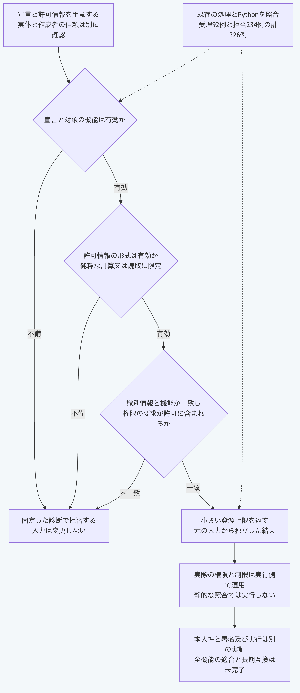

# Pythonだけで実行側の許可情報へ照合する

拡張機能の宣言と実行側が用意した許可情報を照合します。
一致した場合は、要求と許可のうち小さい資源上限を持つ機能の情報を返します。
実際の権限の付与、制限の強制と拡張機能の起動は行いません。

## 準備する

リポジトリのルートで、[対応するPython](README.md#実行環境を選ぶ)を使います。
Node.js、Git、追加部品、通信、認証情報と秘密値は実行に必要ありません。
[宣言の検査](python-plugin-manifest.md)を先に試すと、照合する機能の位置を確認できます。

同梱の例は架空の識別情報、配布物の検査値と権限名を使います。
例の文字列を本番の許可情報として採用しないでください。
以下の操作はファイルを書き換えません。

## 1. 許可情報の形式を検査する

同梱の[固定資料](../../packages/portable-core/fixtures/plugin-host-policy-vectors.json)から例を読み、許可情報だけを検査します。

```sh
python3 -B -c 'import json; from pathlib import Path; v=json.loads(Path("packages/portable-core/fixtures/plugin-host-policy-vectors.json").read_text()); print(json.dumps({"operation":"validate","policy":v["template"]["policy"]}))' | python3 -B packages/portable-core/plugin_host_policy.py
```

成功すると`{"valid":true}`を返します。
この値は許可情報の形式が正しいことを示し、特定の要求との一致を示しません。

## 2. 宣言された要求と照合する

同じ例で、実行側の時間上限を1000ミリ秒にして照合します。

```sh
python3 -B -c 'import json; from pathlib import Path; v=json.loads(Path("packages/portable-core/fixtures/plugin-host-policy-vectors.json").read_text()); r=v["template"]; r["operation"]="authorize"; r["policy"]["capability"]["resources"]["timeoutMs"]=1000; print(json.dumps(r))' | python3 -B packages/portable-core/plugin_host_policy.py
```

結果は`capability`に入り、`resources.timeoutMs`は1000になります。
要求が許可上限を超えても、この照合は小さい方へ制限した結果を返します。
上限を実際に守らせる処理は、結果を使う実行側で用意します。

識別情報は拡張機能のID、版と配布物の検査値の完全一致を求めます。
機能のIDと作用も一致させ、作用は`pure`又は`read-only`に限定します。
要求する五種類の権限名が、対応する許可一覧にすべて含まれることを求めます。
空の要求一覧は照合できますが、空の許可一覧で空でない要求を通すことはありません。
権限名は生の文字列として比較し、パスの解決、ワイルドカードの展開とUnicodeの表記の統一は行いません。

必須の上限は`timeoutMs`と`maxOutputBytes`、任意の上限は`maxMemoryBytes`と`maxCostUnits`です。
任意の上限が片側だけにあればその値を使い、両側になければ結果にも含めません。

## 3. 自分の処理へ組み込む

関数を使う場合は、`packages/portable-core`を探索先へ加えます。
同梱例を読む部分を、自分で用意した宣言と信頼する実行側の許可情報の読取へ置き換えます。

```sh
PYTHONPATH=packages/portable-core python3 -B - <<'PY'
import json
from pathlib import Path
from plugin_host_policy import authorize_plugin_host_policy, validate_plugin_host_policy

request = json.loads(Path("packages/portable-core/fixtures/plugin-host-policy-vectors.json").read_text())["template"]
policy = validate_plugin_host_policy(request["policy"])
capability = authorize_plugin_host_policy(request["manifest"], request["capabilityId"], policy)
print(json.dumps(capability, ensure_ascii=False))
PY
```

検証関数は入力の対応表そのものを返します。
照合関数は独立した結果を返し、結果の権限一覧と上限を変更しても元の入力は変わりません。
宣言の不備と機能の未宣言を先に確認し、その後に許可情報の形式、識別情報、機能と権限の順で照合します。
関数の失敗には既存APIと同じ診断コードと位置を返します。

CLIは、厳密なUTF-8、重複項目の拒否と8MiBの上限を使います。
失敗時は終了値1で、標準エラーへ`PLUGIN_HOST_POLICY_INPUT_INVALID`と固定した位置だけを返します。
入力の拒否時は標準出力を返しません。
出力先の書込失敗も固定した診断へ変換しますが、出力途中の失敗まで原子的な送信を保証するものではありません。

## 照合の範囲

既存Node.js APIから固定した326例で、受理92例の結果全体の検査値と拒否234例のコード及び位置を照合します。
参照コミットと対象ソースの検査値を固定資料に含め、生成器の再実行は必要ありません。
Python単独の単体検査と、公開中核だけを渡した照合も用意しています。
この手順の追加時点の公開中核は31モジュールで、現在の範囲は[中核の案内](../../packages/portable-core/README.md)を参照します。

この処理は、許可情報を誰が作ったかを認証しません。
配布物の検査値は宣言との文字列の一致であり、配布物の実体、署名と供給元の真正性は別に確認します。
全機能の独立適合、長期互換と実運用の安全性は、この照合の成功から判断しません。



[図の生成元](../diagrams/python-plugin-host-policy.mmd)
