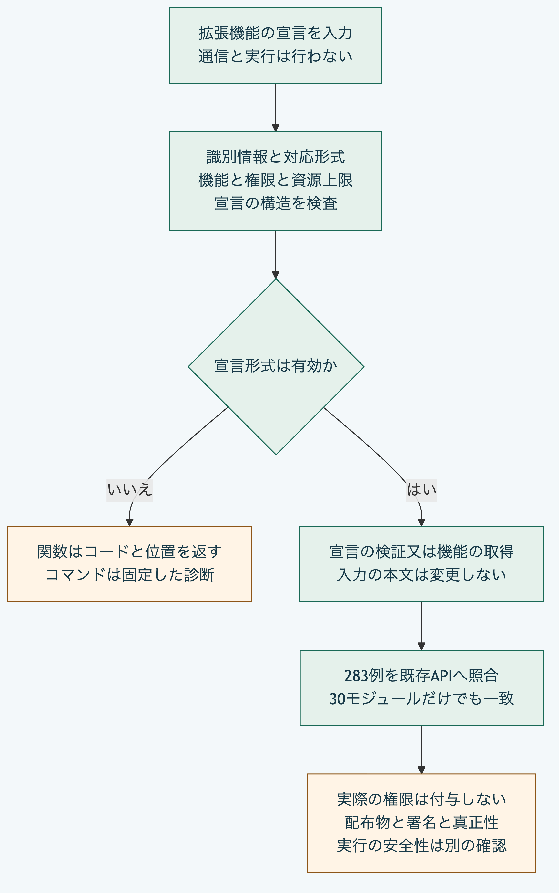

# Pythonだけで拡張機能の宣言を検査する

拡張機能の宣言を検査し、そこに記載された機能を取り出します。
Python 3.14又は3.15の標準機能だけを使い、取得済みのリポジトリ直下で実行します。
Node.js、Git、通信と追加の部品の導入は必要ありません。

この検査は宣言の形式と内部の条件を確認します。
権限を付与せず、拡張機能を起動しません。
宣言した検査値の文字列表記は確認しますが、配布物の実体、署名、本人性と実行の安全性は検証しません。

## 1. 同梱した宣言を検査する

```sh
python3 -B - <<'PY' | python3 -B packages/portable-core/plugin_manifest.py
import json
from pathlib import Path
manifest = json.loads(Path("packages/kernel/test/fixtures/plugin-manifest/repository-importer.json").read_text())
print(json.dumps({"operation": "validate", "manifest": manifest}, ensure_ascii=False))
PY
```

結果は`{"valid":true}`です。
サンプルに含まれる配布物の検査値は説明用の固定値で、実際の配布物との一致を示しません。

検査対象は次のとおりです。

| 対象 | 確認する条件 |
|---|---|
| 識別情報 | 識別子、版、配布者の非空文字列と配布物の検査値の形式 |
| 対応形式 | 現行の要求と結果の通信形式、Coreと分野別の定義の文字列集合 |
| 機能 | 識別子の重複、作用の種類、入出力形式と再試行の宣言 |
| 権限 | Graph読取、ファイル読取、通信、秘密情報と機器の文字列集合 |
| 資源 | 必須の時間と出力、任意のメモリと費用の上限が正の安全な整数であること |
| 供給情報と移行 | 供給元の文字列、任意の署名と部品表の検査値の形式及び移行の文字列集合 |

集合は順序を固定しませんが、同じ文字列の重複は拒否します。
既存契約に合わせ、生の文字列として異なるUnicodeの表記を、自動的に同じ識別子へまとめません。
検査時の正規化で項目名が衝突する値は拒否します。

## 2. 宣言された機能を取り出す

```sh
python3 -B - <<'PY' | python3 -B packages/portable-core/plugin_manifest.py
import json
from pathlib import Path
manifest = json.loads(Path("packages/kernel/test/fixtures/plugin-manifest/repository-importer.json").read_text())
print(json.dumps({"operation": "capability", "manifest": manifest,
                  "capabilityId": "repository.read-file"}, ensure_ascii=False))
PY
```

結果の`capability`には、`read-only`という作用の宣言、`repository-root`へのファイル読取の宣言と資源上限が含まれます。
未宣言の機能は取り出せません。
実際に許可する権限との照合、配布物の照合と起動は、ホスト側の別の処理です。

## 3. 自分のPython処理から使う

```python
from pathlib import Path
import sys
sys.path.insert(0, "packages/portable-core")
from canonical import load_json
from plugin_manifest import validate_plugin_manifest, get_declared_plugin_capability

manifest = load_json(Path("my-plugin.json").read_text(encoding="utf-8"))
validate_plugin_manifest(manifest)
capability = get_declared_plugin_capability(manifest, "my-capability")
```

両関数は入力を変更せず、元の対応表又は機能の対応表を返します。
戻り値は複製ではないため、呼出側で書き換える場合は必要に応じて複製します。
失敗時の`ValidationError`は既存Node.js APIに対応する`code`と`path`を持ちます。
位置には入力の項目名が含まれる場合があり、コマンドライン入口の固定した診断とは区別します。

## コマンドラインの失敗と上限

標準入力は、重複項目のない厳密なUTF-8のJSONで8MiBまでです。
`validate`は`operation`と`manifest`、`capability`はそれらに`capabilityId`を加えた項目だけを受け付けます。
引数は取りません。
失敗すると終了コード1、空の標準出力と、標準エラーへの次の固定したJSONを返します。

```json
{"error":{"code":"PLUGIN_MANIFEST_INPUT_INVALID","path":"/"}}
```

この入口は、任意の本文、項目名と引数を診断へ展開しません。
宣言の形式が正しくても、実際の利用許可、対応するSchemaの存在と移行の実行可能性まで確認した結果にはしません。

## 検査の範囲

[固定した283例](../../packages/portable-core/fixtures/plugin-manifest-vectors.json)では、受理38例の結果と拒否245例のコード及び位置をNode.jsへ照合します。
宣言の全項目、整数境界、Unicode、集合、未知の項目と複数違反時の診断順を含みます。
[照合検査](../../tools/python-plugin-manifest-conformance.test.mjs)では、公開中核だけを移し、Node.jsとGitを探索できない環境でも同じ283例が一致します。
署名、実行権限、供給元の真正性、全機能の独立適合と長期互換の証明ではありません。



[図の生成元](../diagrams/python-plugin-manifest.mmd)

[利用手順の入口](README.md)へ戻れます。
