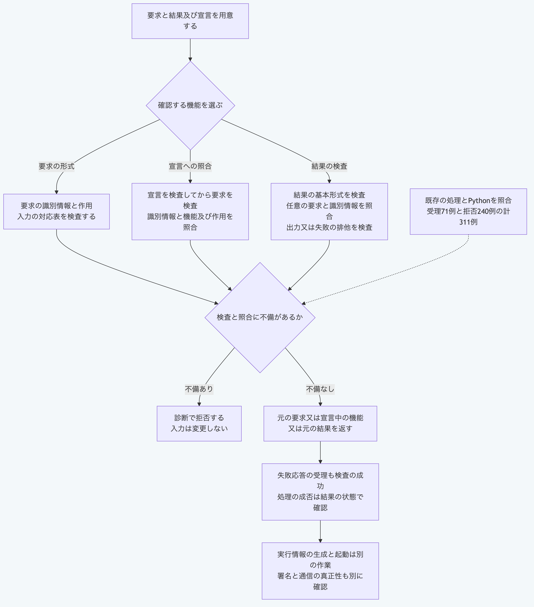

# Pythonだけで拡張機能の要求と結果を検査する

拡張機能へ渡す要求と、受け取った成功又は失敗の結果を検査します。
要求は宣言された機能へ、結果は任意の要求へ照合できます。
メッセージの検査だけでは、実行側の権限と実際の処理を確認したことにはなりません。

## 準備する

リポジトリのルートで、[対応するPython](README.md#実行環境を選ぶ)を使います。
Node.js、Git、追加部品、通信、認証情報と秘密値は不要です。
例は[固定した適合入力](../../packages/portable-core/fixtures/plugin-message-vectors.json)にある架空の要求と結果を読み、ファイルを書き換えません。

## 1. 要求の形式を検査する

```sh
python3 -B -c 'import json; from pathlib import Path; v=json.loads(Path("packages/portable-core/fixtures/plugin-message-vectors.json").read_text()); print(json.dumps({"operation":"validate-request","request":v["templates"]["base"]["request"]}))' | python3 -B packages/portable-core/plugin_messages.py
```

成功すると`{"valid":true}`を返します。
要求は処理ID、拡張機能のIDと版、機能のIDと作用及び`input`を持ちます。
作用は既存の五種類を受理しますが、ここでその作用を許可するわけではありません。
`input`は論理的な対応表として検査し、入力の形式ごとの意味までは検証しません。

## 2. 要求を宣言へ照合する

```sh
python3 -B -c 'import json; from pathlib import Path; v=json.loads(Path("packages/portable-core/fixtures/plugin-message-vectors.json").read_text())["templates"]["base"]; print(json.dumps({"operation":"authorize-request","manifest":v["manifest"],"request":v["request"]}))' | python3 -B packages/portable-core/plugin_messages.py
```

成功すると`capability`へ宣言された機能を返します。
拡張機能のIDと版及び機能のIDと作用を照合します。
この入口は宣言への一致を確認するもので、実行側の許可情報は照合しません。
必要な場合は、別の[許可情報への照合](python-plugin-host-policy.md)も使います。

## 3. 結果を要求へ照合する

```sh
python3 -B -c 'import json; from pathlib import Path; v=json.loads(Path("packages/portable-core/fixtures/plugin-message-vectors.json").read_text())["templates"]["base"]; print(json.dumps({"operation":"validate-result","result":v["result"],"request":v["request"]}))' | python3 -B packages/portable-core/plugin_messages.py
```

成功すると`{"valid":true}`を返します。
結果の処理ID、拡張機能のIDと版及び機能IDを要求へ照合します。
`request`を省略するか`null`にすると、結果の形式だけを検査します。
対応する要求を確認したい場合は、要求を明示して渡します。

成功応答は`status`が`success`で、対応表の`output`だけを持ちます。
失敗応答は`status`が`failure`で、空でない`code`と`message`を含む`failure`だけを持ちます。
`output`と`failure`の同時指定は拒否します。
形式が正しい失敗応答でも検査は成功するため、`valid`を処理そのものの成功として使わないでください。
処理の成否は、検査済みの元の結果の`status`で確認します。

## 4. 自分の処理へ組み込む

同梱例を読む部分を、自分で用意した宣言、要求と受け取った結果へ置き換えます。

```sh
PYTHONPATH=packages/portable-core python3 -B - <<'PY'
import json
from pathlib import Path
from plugin_messages import authorize_plugin_run_request, validate_plugin_run_request, validate_plugin_run_result

value = json.loads(Path("packages/portable-core/fixtures/plugin-message-vectors.json").read_text())["templates"]["failure"]
request = validate_plugin_run_request(value["request"])
capability = authorize_plugin_run_request(value["manifest"], request)
result = validate_plugin_run_result(value["result"], request)
print(json.dumps({"capabilityId": capability["id"], "status": result["status"]}))
PY
```

この例は形式が正しい失敗応答を検査し、`status`に`failure`を表示します。
三つの関数は入力を変更せず、元の要求、宣言中の機能又は元の結果を返します。
識別子は生の文字列で比較し、Unicodeの表記を統一して一致させることはしません。
宣言と要求の不備、識別情報と機能の不一致、要求と結果の不一致及び成功と失敗の排他は、既存APIと同じ診断順で確認します。

CLIは厳密なUTF-8、重複項目の拒否と8MiBの上限を使います。
失敗時は終了値1で、標準エラーへ`PLUGIN_MESSAGES_INPUT_INVALID`と固定した位置だけを返します。
入力の拒否時は標準出力を返しません。
出力先の書込失敗も固定した診断へ変換しますが、出力途中の失敗まで原子的な送信を保証するものではありません。
関数の診断には入力の項目名が含まれる場合があり、固定したCLI診断とは区別します。

## 照合の範囲

既存Node.js APIから固定した311例で、受理71例の結果全体の検査値と拒否240例のコード及び位置を照合します。
要求検証117例、宣言への照合38例と結果検証156例で、任意の要求への対応、未知の項目と診断順も含みます。
参照コミットと対象ソースの検査値を固定資料に含め、生成器の再実行は不要です。
この追加時点の公開中核は32モジュールで、その中核だけを渡した環境でも同じ311例を実行します。

実行情報の生成とプロセスの起動は、この入口では行いません。
メッセージの送信者、署名、供給元の真正性と実際の通信経路は認証しません。
全機能の独立適合、長期互換と安全な実行も別の検証が必要です。



[図の生成元](../diagrams/python-plugin-messages.mmd)
