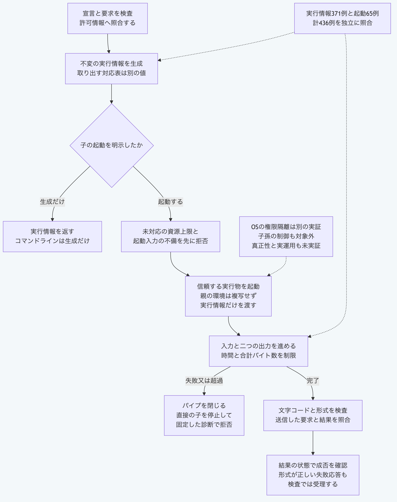

# Pythonだけで実行情報を生成して子を起動する

宣言、要求と実行側の許可情報を照合し、不変の実行情報を生成します。
信頼する実行物を明示すると、親の環境を複写せず、時間と出力の上限付きで子を起動できます。
この処理はOSの権限を隔離しないため、信頼する実行物を指定してください。

## 準備する

リポジトリのルートで、[対応するPython](README.md#実行環境を選ぶ)を使います。
以下の手順はmacOSのPython 3.14と3.15で確認しています。
LinuxとWindowsでは、この手順を実行していません。
中核と同梱の合成子は標準機能だけを使い、Node.js、Git、通信、追加部品と認証情報を必要としません。

[固定資料](../../packages/portable-core/fixtures/plugin-runtime-vectors.json)の架空の宣言と許可情報、[検査用の合成子](../../packages/portable-core/fixtures/plugin-runtime-child.py)を使います。
この合成子は通信経路の検査用であり、実際の取込機能ではありません。
以下の操作は正本と保存済みのファイルを書き換えません。

## 1. 実行情報だけを生成する

```sh
python3 -B -c 'import json; from pathlib import Path; v=json.loads(Path("packages/portable-core/fixtures/plugin-runtime-vectors.json").read_text())["templates"]["runtime"]; print(json.dumps({"operation":"grant",**v}))' | python3 -B packages/portable-core/plugin_runtime.py
```

結果の`grant`に、処理ID、拡張機能のIDと版、機能のIDと作用、要求する権限名と縮小した資源上限が入ります。
CLIは生成だけを行い、子を起動する操作は受け付けません。
入力には厳密なUTF-8、重複項目の拒否と8MiBの上限を使います。
失敗時は終了値1で、標準エラーへ`PLUGIN_RUNTIME_INPUT_INVALID`と固定した位置だけを返します。

## 2. 信頼する合成子を明示して起動する

```sh
PYTHONPATH=packages/portable-core python3 -B - <<'PY'
import json
from pathlib import Path
import sys
from plugin_runtime import run_plugin_process

value = json.loads(Path("packages/portable-core/fixtures/plugin-runtime-vectors.json").read_text())["templates"]["runtime"]
child = Path("packages/portable-core/fixtures/plugin-runtime-child.py").resolve()
result = run_plugin_process(**value, command=sys.executable, args=["-B", str(child)])
print(json.dumps({"status": result["status"], "value": result["output"]["value"]}, ensure_ascii=False))
PY
```

`status`が`success`で、要求の例にある日本語の値を返します。
実行物は絶対パスを使い、この例では手順を実行中のPythonを指定します。
自分の処理では、宣言と許可情報、要求、信頼する実行物と引数を明示して置き換えます。
作業先が必要なら`cwd`へ文字列のパスを指定します。
シェルは使わず、実行情報を`MORIVYX_PLUGIN_EXECUTION_GRANT`へ正規形のJSONとして明示して渡します。
親の`PATH`、`HOME`と秘密値などを環境の対応表へ複写しません。
実行物自身とOSが必要とする条件は別に確認してください。

## 3. 不変の実行情報と対応表を使い分ける

```sh
PYTHONPATH=packages/portable-core python3 -B - <<'PY'
import json
from pathlib import Path
from plugin_runtime import create_plugin_execution_grant

value = json.loads(Path("packages/portable-core/fixtures/plugin-runtime-vectors.json").read_text())["templates"]["runtime"]
grant = create_plugin_execution_grant(value["manifest"], value["request"], value["policy"])
copy = grant.to_dict()
copy["capability"]["permissions"]["fileRead"].append("example-copy-only")
print(json.dumps({"originalPermissions": grant.to_dict()["capability"]["permissions"]["fileRead"], "copyPermissions": copy["capability"]["permissions"]["fileRead"]}))
PY
```

元の権限一覧は空のまま、取り出した対応表だけに例の文字列が入ります。
関数の戻り値は不変の`PluginExecutionGrant`で、`to_dict()`は毎回独立した対応表を返します。
`json_text`は生の文字列を保つ保存値、`canonical_json`は既存契約と同じ正規形の送信値です。
Unicodeと日時の正規化は送信値に適用し、元の入力と取り出す生の値は変更しません。

## 4. 強制できない上限を起動前に拒否する

```sh
PYTHONPATH=packages/portable-core python3 -B - <<'PY'
import json
from pathlib import Path
import sys
from plugin_runtime import run_plugin_process
from schema_validation import ValidationError

value = json.loads(Path("packages/portable-core/fixtures/plugin-runtime-vectors.json").read_text())["templates"]["runtime"]
value["policy"]["capability"]["resources"]["maxMemoryBytes"] = 1024
try:
    run_plugin_process(**value, command=sys.executable, args=["-B", str(Path("packages/portable-core/fixtures/plugin-runtime-child.py").resolve())])
except ValidationError as error:
    print(json.dumps({"code": error.code, "path": error.path}))
PY
```

`PLUGIN_RUN_RESOURCE_UNSUPPORTED`を返し、子は起動しません。
この方式が強制するのは時間と、標準出力及び標準エラーの合計バイト数です。
メモリーと費用の上限は強制できないため、どちらかの指定があれば起動前に拒否します。

## 結果と診断の意味

要求と許可情報の照合、未対応の上限の拒否、起動入力の検査の順で処理します。
コマンド、引数と作業先の不正は`PLUGIN_RUN_INVALID`です。
起動と入出力の失敗、早期の入力閉鎖、終了失敗、時間と出力の超過は`PLUGIN_RUN_FAILED`で、任意の本文を含めません。
入力を送信するときに保存した要求を使い、受け取った結果との対応を確認します。
呼出し中の全変更を原子的に除外する保証ではありません。

結果には厳密なUTF-8と一つのJSONを求め、要求と識別情報を照合します。
結果の受理を処理の成功と取り違えず、`status`を確認します。
子の結果のJSONは、既存のNode.js経路と同じく、重複した同名項目の最後の値を使います。
これは重複項目を拒否する生成CLIとは異なり、正規化後の項目名の衝突と不正な論理値は後続の検証で拒否します。

既存APIから固定した実行情報371例と実際の子プロセス65例、計436例を照合します。
子が読む前の大量出力、合計バイト数の境界、厳密な文字コード、深さ1,200の入出力と生の送信表記も含みます。
この追加時点の公開中核は33モジュールで、その中核と合成子だけの環境でも同じ例を実行します。

失敗時はパイプを閉じ、直接の子を停止して回収を試みます。
検査した失敗では直接の子の終了とパイプの閉鎖を確認していますが、子孫の全面的な制御とOSの停止不能な処理は保証しません。
権限名と配布物の検査値の一致は、OSの隔離、実体の照合と署名の真正性を代替しません。
全機能の独立適合、長期互換と実運用の安全性は別の検証が必要です。



[図の生成元](../diagrams/python-plugin-runtime.mmd)
