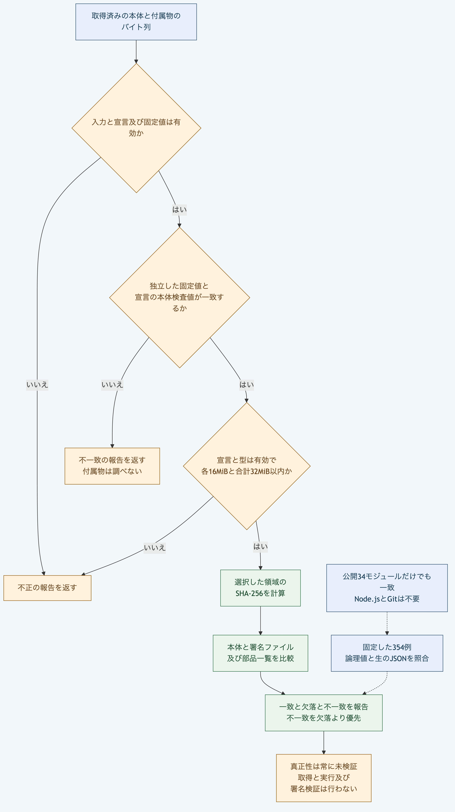

# Pythonだけで配布物のバイト列を照合する

取得済みの本体、署名ファイルと部品一覧を、宣言と独立して固定した本体の検査値へ照合します。
この処理は取得、実行、署名の有効性と配布元の真正性の検証を行いません。
報告の`authenticity`は常に`not-verified`です。

## 準備する

リポジトリのルートで、[対応するPython](README.md#実行環境を選ぶ)を使います。
以下はmacOSのPython 3.14と3.15で確認し、LinuxとWindowsでは実行していません。
標準機能だけを使い、Node.js、Git、通信と認証情報を必要としません。
固定した宣言を読みますが、ファイルと正本を書き換えません。

例の本体は実際の配布物ではなく、3バイトの`abc`です。
そのSHA-256を既知の固定値として使い、例の宣言に設定します。
実際の利用では、配布物自身から計算した値だけを信頼せず、許可した提供元と独立した固定値を別の経路で確認してください。

## 1. 本体のバイト列を照合する

```sh
PYTHONPATH=packages/portable-core python3 -B - <<'PY'
import json
from pathlib import Path
from plugin_supply_chain import verify_plugin_supply_chain

pin = "sha256:ba7816bf8f01cfea414140de5dae2223b00361a396177a9cb410ff61f20015ad"
manifest = json.loads(Path("packages/kernel/test/fixtures/plugin-manifest/repository-importer.json").read_text())
manifest["identity"]["packageDigest"] = pin
report = verify_plugin_supply_chain({"manifest": manifest, "expectedPackageDigest": pin, "artifacts": {"package": b"abc"}})
assert report["status"] == "matched"
assert report["package"]["byteLength"] == 3
print(json.dumps(report, ensure_ascii=False))
PY
```

`status`が`matched`で、本体の期待値と実際の値が一致します。
宣言に付属物の検査値がなければ、報告の`signature`と`sbom`は`null`です。
付属物を宣言した場合は、それぞれのバイト列も渡して照合します。

APIは`bytes`と`bytearray`、及びそれらを裏に持つ連続した符号なし1バイトの`memoryview`を受けます。
`memoryview`は選択した領域だけを照合します。
報告は入力の変更可能な対応表とバイト列を保持せず、個別16MiBと合計32MiBの上限を確認してから検査値を計算します。
別々の入力を同時に捕捉する保証はないため、呼出し中に別の処理から変更しないでください。

## 2. 欠落と不一致を区別する

```sh
PYTHONPATH=packages/portable-core python3 -B - <<'PY'
import json
from pathlib import Path
from plugin_supply_chain import verify_plugin_supply_chain

pin = "sha256:ba7816bf8f01cfea414140de5dae2223b00361a396177a9cb410ff61f20015ad"
manifest = json.loads(Path("packages/kernel/test/fixtures/plugin-manifest/repository-importer.json").read_text())
manifest["identity"]["packageDigest"] = pin
for artifacts, expected in [({}, "incomplete"), ({"package": b"changed"}, "mismatch")]:
    report = verify_plugin_supply_chain({"manifest": manifest, "expectedPackageDigest": pin, "artifacts": artifacts})
    assert report["status"] == expected
    print(json.dumps({"status": report["status"], "issues": report["issues"]}))
PY
```

本体がない場合は`incomplete`で、`PLUGIN_SUPPLY_CHAIN_ARTIFACT_MISSING`を返します。
異なる内容は`mismatch`で、`PLUGIN_SUPPLY_CHAIN_ARTIFACT_MISMATCH`です。
欠落と不一致が同時にある場合は不一致を優先します。
入力や宣言、バイト列の型又は上限が不正なら`invalid`です。
本体の固定値と宣言値が違う場合は、付属物を調べる前に`PLUGIN_SUPPLY_CHAIN_PIN_MISMATCH`を返します。

## 3. base64を使ってCLIへ渡す

```sh
python3 -B - <<'PY'
import base64
import json
from pathlib import Path
import subprocess
import sys

pin = "sha256:ba7816bf8f01cfea414140de5dae2223b00361a396177a9cb410ff61f20015ad"
manifest = json.loads(Path("packages/kernel/test/fixtures/plugin-manifest/repository-importer.json").read_text())
manifest["identity"]["packageDigest"] = pin
request = {"operation": "verify", "manifest": manifest, "expectedPackageDigest": pin,
           "artifacts": {"package": base64.b64encode(b"abc").decode("ascii")}}
result = subprocess.run([sys.executable, "-B", "packages/portable-core/plugin_supply_chain.py"],
                        input=json.dumps(request), text=True, capture_output=True, check=True)
report = json.loads(result.stdout)["report"]
assert report["status"] == "matched"
assert result.stderr == ""
print(json.dumps({"status": report["status"], "authenticity": report["authenticity"]}))
PY
```

CLIは厳密なUTF-8、重複のないJSON、標準的なbase64と48MiBの入力上限を使います。
形式に失敗すると終了値1で、標準エラーへ`PLUGIN_SUPPLY_CHAIN_INPUT_INVALID`と固定した位置だけを返します。
報告を生成した場合は`invalid`でも終了値0なので、終了値に加えて`report.status`を確認してください。

既存APIから固定した354例は、一致13例、不一致48例、欠落4例と不正289例です。
公開対象34モジュールだけの環境でも、報告の論理値と生のJSONが同じになります。
一致した署名ファイルが有効な署名であること、安全なコード、権限の隔離、全機能の独立適合と長期互換は、この結果では証明できません。
実行が必要な場合は、別の[明示的な起動手順](python-plugin-runtime.md)で信頼する実行物を指定します。



[図の生成元](../diagrams/python-plugin-supply-chain.mmd)
