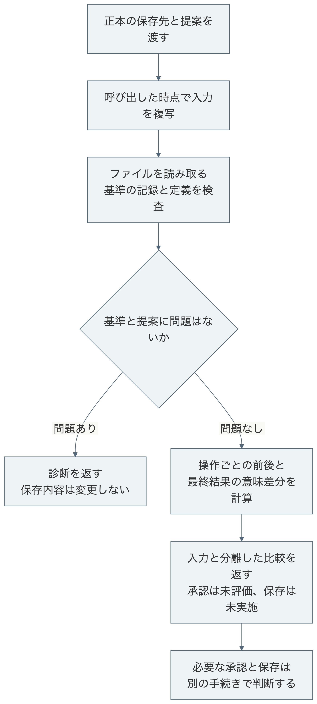

# Pythonで保存前の提案を比較する

`proposal_review_api.prepare_proposal_review`は、保存済みの正本と提案を比較する入口です。
基準の記録、SchemaとIDの競合を検査し、変更後のGraph、操作ごとの前後、意味差分と検査値を返します。
Python 3.14以降の標準機能と、同梱の公開Pythonモジュールで動作します。
製品処理にNode.js、Gitと外部通信は不要です。



[図の生成元](../diagrams/python-proposal-review-file-api.mmd)

## 同梱の資料で試す

リポジトリのルートで次を実行します。
例の準備処理は一時フォルダーへ同梱資料を複写します。
比較する入口自体はファイルを書きません。

```sh
PYTHONPATH=packages/portable-core python3.14 -B - <<'PY'
import asyncio
from pathlib import Path
import shutil
import tempfile

from decision_preparation import prepare_decision_creation
from package_records import read_package
from proposal_review_api import prepare_proposal_review

def stable_id(number):
    return f"urn:uuid:00000000-0000-4000-8000-{number:012d}"

async def main():
    with tempfile.TemporaryDirectory() as temporary:
        base = Path(temporary).resolve() / "base"
        shutil.copytree("docs/validation/fixtures/decision-maintenance-base", base)
        schemas = base / ".morivyx" / "schemas"
        schemas.mkdir()
        shutil.copyfile("docs/schema/morivyx.core@0.1.yaml", schemas / "morivyx.core@0.1.yaml")
        prepared = prepare_decision_creation(read_package(base / ".morivyx"), {
            "format": "morivyx.decision-creation-request/0.1",
            "decisionId": stable_id(1), "changeSetId": stable_id(2),
            "actor": stable_id(9), "recordedAt": "2026-09-09T12:00:00Z",
            "resultingRevision": "graph:proposal-created",
            "attributes": {
                "question": "保存前に比較するか",
                "rationale": "誤った提案を正本へ入れない",
                "consequences": ["承認は別途必要"],
            },
        })
        result = await prepare_proposal_review({
            "basePath": str(base), "changeSet": prepared["changeSet"],
            "candidateElements": [prepared["candidateElement"]],
            "resultingRevision": prepared["resultingRevision"],
            "evaluatedAt": "2026-09-09T12:00:00Z",
        })
        print(result["valid"], result["authorization"], result["persisted"])
        print(result["comparison"][0]["before"])
        print(result["semanticDiff"]["entries"][0]["kind"])

asyncio.run(main())
PY
```

出力は次のとおりです。

```text
True not-assessed False
None
entity_added
```

例の準備に使う`read_package`は、既存の容量を制限した読取です。
提案比較の入口は別のファイル読取を使うため、この準備例の容量制限を新しい入口へ追加したものではありません。

## 実際の提案を渡す

| 項目 | 渡す値 |
| --- | --- |
| `basePath` | 正本を含むフォルダー、又はその`.morivyx`への空でない文字列のパス |
| `changeSet` | 比較する変更記録 |
| `candidateElements` | 操作から参照する候補要素の一覧。省略又は`None`なら空一覧 |
| `resultingRevision` | 変更後の版、親、Schemaと根の検査値を含む記録 |
| `evaluatedAt` | 比較の評価時刻 |

未知の入力項目は拒否します。
候補には同じ要素の途中の版も渡せるため、改訂、置換と廃止を続けた場合も、各操作の時点の前後を確認できます。
戻り値の`comparison`は操作順で、`semanticDiff`は基準と最終結果の比較です。

入力は関数を呼び出した時点で複写します。
その後に呼出側が入力を変更しても、待機中の比較内容は変わりません。
返却値も入力から分離します。
不正入力は返された処理を`await`した時に例外になります。

```python
from schema_validation import PackageError

try:
    result = await prepare_proposal_review(request)
except PackageError as error:
    print(error.code, error.path, error.message)
```

ファイルの読取で発生したOSの例外は、提案の不正とは区別して伝えます。
利用側では、必要に応じて`OSError`と`TypeError`も処理します。

## 比較後に残る判断

`valid`が`True`でも、承認、本人性、署名と採用権限を証明しません。
`authorization`は`"not-assessed"`、`persisted`は`False`です。
この結果を保存許可として扱わず、必要な承認と保存は別の手続きで行います。
ファイルが並行して変更されないことや、実運用のOS隔離も保証しません。

## 開発時に比較を再実行する

比較用のNode.jsには26.13.0以上を使います。
製品のPython処理とは別に、元の実装との比較のために導入します。

```sh
python3.14 -B -m unittest discover -s packages/portable-core -p test_proposal_review_api.py
npm ci --prefix packages/kernel --ignore-scripts
MORIVYX_REFERENCE_PYTHON=python3.14 node --test tools/python-proposal-review-file-api-conformance.test.mjs
MORIVYX_REFERENCE_PYTHON=python3.15 node --test tools/python-proposal-review-file-api-conformance.test.mjs
```

実装前に固定した139件と、実装後に追加した191件の比較を区別します。
変更後の版に未知の項目がある場合と親参照について、さらに4例の診断を比較します。
戻り値、例外の公開属性、読取順序、入力所有、返却値の参照とファイルの保持を比較します。
Pythonの比較先へ渡すのは、既存47モジュール、新パッケージ、比較用入口と入力だけです。
固定した期待値はPythonへ渡さず、外部実行と通信も比較用の監査で拒否します。
有限の入力での一致を、全入力と全機能の証明へ広げません。
