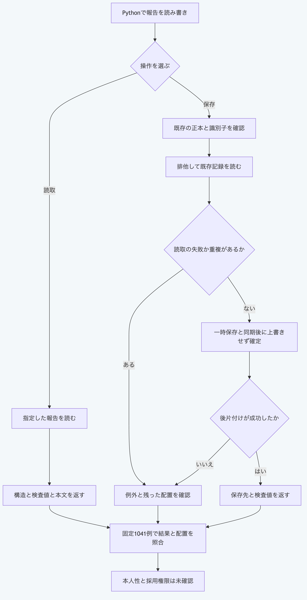

# Pythonで報告ファイルを読み書きする

`report_records.read_report`と`report_records.write_report`は、追跡、通常の意味差分、移行時の意味差分と外部資料の報告を扱います。
Python 3.14と3.15を検査対象とし、NodeとGitを呼び出しません。
読取には報告ファイル、保存には既存の`.morivyx`と識別子を持つ報告を渡します。
戻された処理は`await`で完了を待ちます。
構造と検査値の一致を返す入口で、内容の真正性、Graphの意味、本人性と採用権限は別に検証します。

## 一時領域で保存して読み直す

公開リポジトリの直下から実行します。
この例は既存の正本を変更せず、所有する一時領域の中だけに保存します。
報告の内容は手順用の値で、実際の追跡を実施した結果ではありません。

```sh
cd packages/portable-core
python3.15 -B - <<'PY'
import asyncio
from pathlib import Path
from tempfile import TemporaryDirectory
from report_records import read_report, write_report
from schema_validation import ValidationError

async def main():
    report = {
        "format": "morivyx.trace-report/0.1",
        "id": "urn:uuid:00000000-0000-4000-8000-0000000003e8",
        "queryId": "governing-decision",
        "graphRevision": "graph:stage-1-package-v1",
        "schemaLockDigest": "sha256:a1ff6841d890e7a0646941f052a8c1b698820a8af05d55f828baf4c7bb9ed842",
        "focusId": "urn:uuid:550e8400-e29b-41d4-a716-446655440000",
        "evaluatedAt": "2026-08-04T00:00:00Z",
        "status": "partial",
        "paths": [],
        "missing": ["governs"],
    }
    with TemporaryDirectory(prefix="morivyx-report-example-") as directory:
        Path(directory, ".morivyx").mkdir()
        saved = await write_report(directory, report)
        loaded = await read_report(saved["path"])
        assert saved["digest"] == loaded["digest"]
        assert loaded["report"] == report
        print(loaded["type"], loaded["report"]["status"])
        try:
            await write_report(directory, report)
        except ValidationError as error:
            assert error.code == "REPORT_ALREADY_EXISTS"
            print(error.code)

asyncio.run(main())
PY
```

出力は次のとおりです。

```text
trace-report partial
REPORT_ALREADY_EXISTS
```

実際の利用では、`write_report`へ自分の正本を含むフォルダーか、その`.morivyx`を文字列で渡します。
既存の`.morivyx`がない場合は`REPORT_PACKAGE_MISSING`となります。
同じ識別子の記録は種類をまたいで確認し、報告の重複は`REPORT_ALREADY_EXISTS`、別の種類との重複は`ID_DUPLICATE`として拒否します。
全記録の読取が重複の判定より先なので、後の記録の読取失敗が優先する場合があります。
この確認は正本全体の意味の検証ではありません。

## 失敗後の配置を確認する

保存は既存ファイルを上書きせず、一時ファイルへの書込と同期後に確定します。
ただし、確定後の一時ファイルの削除や排他の解放に失敗すると、例外が返っても保存先が存在する場合があります。
失敗後は`error.code`と`error.path`及び保存先を確認し、無条件に再試行しないでください。
処理中に入力を変更せず、例外を受けた場合も残った配置を確認してから次の操作を決めます。

```python
try:
    saved = await write_report(project_directory, report)
except Exception as error:
    print(getattr(error, "code", None), getattr(error, "path", None))
    raise
```

既存の`read_report_source`と`serialize_report_yaml`は同期する文字列の入口で、従来の容量と深さの制限を保持します。
新しいファイルの入口にはその容量制限を流用していないため、信頼できない大きさの入力を受けるアプリは呼出し側で容量と実行資源を管理します。

## 照合の範囲を確認する

リポジトリ直下で実行します。

```sh
python3.15 -B -m unittest discover -s packages/portable-core -p test_report_file_api.py
```

実装前に元の結果1041例を固定し、返り値、診断の種類と位置、入力保持、処理前後の本文と配置を照合します。
同時保存、リンク、8MiBを超える本文、呼出し後の変更と制御した故障を含み、公開47本番モジュールだけでも再現します。
並行する同じ入力の勝ち順、実際のOS障害、強制終了、任意の悪意あるリンク配置の隔離と全入力の適合は証明しません。



[図の生成元](../diagrams/python-report-file-api.mmd)
