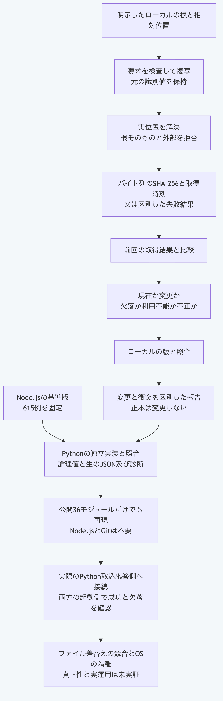

# Pythonだけでファイルを取り込み再取込の衝突を調べる

この手順は現在の`main`向けです。
リポジトリ直下でPython 3.14又は3.15を使い、`python3`を対応する実行物へ置き換えます。
Node.jsの導入と外部サービスへの通信は不要です。
例は同梱ファイルと自分で作る一時ファイルだけを読み、元の正本を変更しません。

## 1. 同梱ファイルを取得する

要求の組立と検査は別の操作です。
取込は要求の検証後に複写し、根と対象の実位置を解決して、根の外と根そのものへの参照を拒否します。
内容は文字へ変換せず、取得したバイト列のSHA-256を返します。

```sh
python3 - <<'PY'
from pathlib import Path
import sys
sys.path.insert(0, "packages/portable-core")
from repository_import import repository_import_request, validate_repository_import_request, import_repository_file
request = repository_import_request(run_id="run:local", external_id="repository:fixture", locator="source.txt",
    repository_root=str(Path("packages/kernel/test/fixtures/plugin-communication/repository").resolve()))
assert validate_repository_import_request(request) is request
result = import_repository_file(request, now=lambda: "2026-09-05T01:00:00Z")
assert result["status"] == "success"
assert result["output"]["digest"] == "sha256:41719047f9824d28ef29e87214bbeb2c25e31dcd2a8c9ff3a28fda3ca4cd1353"
print(result["status"], result["output"]["digest"])
PY
```

自分の資料には`repository_root`を明示した読取元の絶対パスへ、`locator`をその中の相対位置へ置き換えます。
`external_id`は同じ対象を継続して識別する値で、再取込でも維持します。
`run_id`と外部の識別値は元の文字列を保持し、表示用の正規化へ置き換えません。

## 2. 再取込とローカル変更の衝突を調べる

次は自分で作った一時ファイルを更新し、外部の内容とローカルの対象の両方が変わった例です。
比較と判定は報告を返すだけで、正本へ採用しません。

```sh
python3 - <<'PY'
from pathlib import Path
import sys, tempfile
sys.path.insert(0, "packages/portable-core")
from repository_import import repository_import_request, import_repository_file, compare_repository_import_snapshots, assess_repository_reimport
with tempfile.TemporaryDirectory() as directory:
    file = Path(directory) / "source.txt"
    file.write_bytes(b"before\n")
    request = repository_import_request(run_id="run:compare", repository_root=directory, external_id="owned:source", locator="source.txt")
    previous = import_repository_file(request)
    file.write_bytes(b"after\n")
    current = import_repository_file(request)
    comparison = compare_repository_import_snapshots({"previousResult": previous, "currentRequest": request, "currentResult": current})
    report = assess_repository_reimport({"comparison": comparison,
        "baselineTarget": {"id": "local:target", "revision": "before"},
        "currentTarget": {"id": "local:target", "revision": "after"}})
    assert comparison["status"] == "stale"
    assert report["status"] == "conflict"
    print(comparison["status"], report["status"])
PY
```

外部だけの変更は`external-changed`、ローカルだけの変更は`local-changed`、両方が同じなら`unchanged`です。
外部の欠落、取得元の利用不能と不正も区別します。
判定関数は比較報告の形式と状態を確認する最小条件を使うため、取得結果の検証を省く用途には使いません。
取得結果の比較関数を先に使います。

## 3. 実際の取込応答側を起動する

[実行側の許可情報と資源上限](python-plugin-runtime.md)を使い、信頼するPython実行物と同梱の応答側を明示します。
許可情報はOSの権限を隔離するものではありません。
実行物を選ぶ責任は起動側に残ります。

```sh
python3 - <<'PY'
from pathlib import Path
import json, sys
sys.path.insert(0, "packages/portable-core")
from plugin_runtime import run_plugin_process
from repository_import import repository_import_request, validate_repository_import_result
fixtures = Path("packages/kernel/test/fixtures")
manifest = json.loads((fixtures / "plugin-manifest/repository-importer.json").read_text())
policy = json.loads((fixtures / "plugin-manifest/host-policy.json").read_text())
request = repository_import_request(run_id="run:child", external_id="repository:fixture", locator="source.txt",
    repository_root=str((fixtures / "plugin-communication/repository").resolve()))
result = run_plugin_process(command=sys.executable, args=["-B", str(Path("packages/portable-core/repository_import.py").resolve()), "--stdio"],
    manifest=manifest, request=request, policy=policy)
validate_repository_import_result(result, request)
assert result["status"] == "success"
assert result["output"]["digest"] == "sha256:41719047f9824d28ef29e87214bbeb2c25e31dcd2a8c9ff3a28fda3ca4cd1353"
print(result["status"], result["output"]["digest"])
PY
```

`--stdio`は、一つの取込要求を受けて一つの結果を返す[応答側の入口](python-plugin-stdio.md)です。
この応答側は既存のNode.js起動APIからも呼べます。
時間と出力の上限は起動側へ接続します。
通信の失敗は終了値2と固定した診断、形式の正しい取込失敗は終了値0の失敗結果です。

## 4. 上限付きのJSON入口を使う

包みを付ける入口には`operation`と`input`だけを渡します。
次の例は取込を行い、`result`へ結果を返します。

```sh
python3 - <<'PY' | python3 packages/portable-core/repository_import.py
from pathlib import Path
import json, sys
sys.path.insert(0, "packages/portable-core")
from repository_import import repository_import_request
request = repository_import_request(run_id="run:json", external_id="repository:fixture", locator="source.txt",
    repository_root=str(Path("packages/kernel/test/fixtures/plugin-communication/repository").resolve()))
print(json.dumps({"operation": "import", "input": request}))
PY
```

操作は`validate-request`、`validate-result`、`import`、`compare`と`assess`です。
検証は`valid`、取込は`result`、比較と判定は`report`へ返します。
`validate-result`の`input`は`result`と任意の`request`を持ち、それ以外は各APIの入力を直接渡します。
入力と出力は各8MiB以下で、不正なUTF-8、重複項目、余分な引数と不正な入口は終了値1の固定した診断です。
不正という有効な判定と取込の失敗結果は終了値0でも返るため、`valid`、`status`と診断コードを確認します。
ファイル内容自体の大きさと時間を、このJSON入口の上限では制限しません。

## 確認した範囲

既存Node.jsから固定した615例は、要求148例、結果162例、比較42例、判定91例と取込172例です。
取込172例には不正要求と失敗も含みます。
正規形と生のJSONの検査値及び拒否した診断コードと位置を照合します。
公開36モジュールと外から与える検査の駆動部及び試験ファイルだけでも、Node.jsとGitなしで再現できます。

参照環境はmacOSのPOSIXのパスです。
ファイル差替えの競合、原子的な取得、OSの隔離、WindowsとLinuxの実機、取得元の真正性と実運用は未実証です。
このAPIはローカルのバイト列の取得と判定を行い、外部サービスへの通信、署名の検証と正本への採用は行いません。



[図の生成元](../diagrams/python-repository-import.mmd)

[手順一覧](README.md)へ戻れます。
