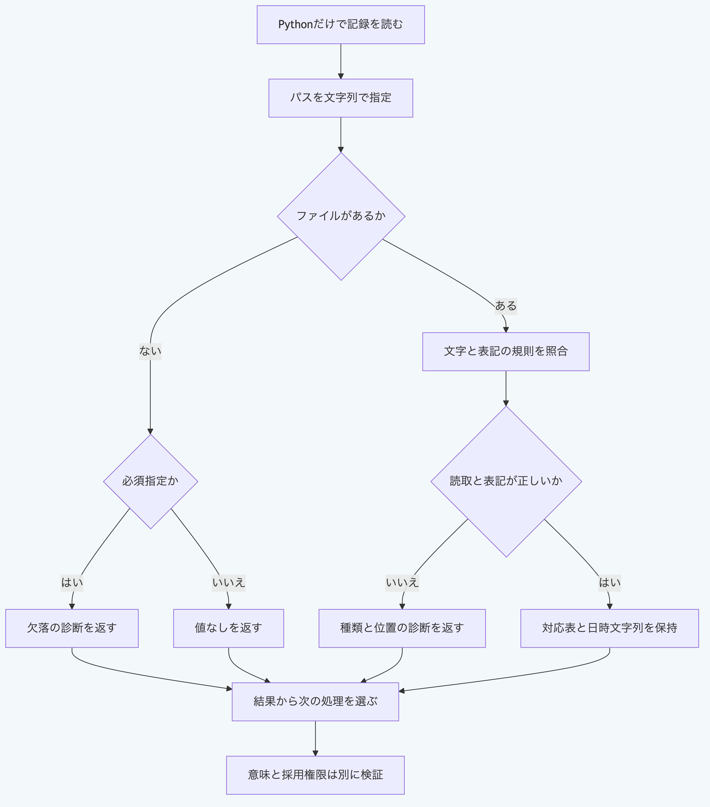

# Pythonで記録ファイルを読む

`yaml_authoring.read_yaml_record(path, required=True)`は、指定したファイルを読んで対応表を返します。
Python 3.14と3.15を検査対象とし、NodeとGit及び外部のYAML処理系を呼び出しません。
戻された処理は`await`で完了を待ちます。
ファイルのパスは文字列で渡し、`Path`を使う場合は`str(path)`へ変換します。
正本一式ではなく、一つのファイルを選ぶ入口です。

## 一時領域で読み、任意の欠落を区別する

公開リポジトリの直下から実行します。
この例は所有する一時領域だけを使い、既存の正本を変更しません。

```sh
cd packages/portable-core
python3.15 -B - <<'PY'
import asyncio
from pathlib import Path
from tempfile import TemporaryDirectory
from yaml_authoring import read_yaml_record
from schema_validation import ValidationError

async def main():
    with TemporaryDirectory(prefix="morivyx-yaml-example-") as directory:
        base = Path(directory)
        path = base / "record.yaml"
        timestamp = "2026-01-01T01:00:00.12000+01:00"
        path.write_text('title: "e\u0301"\nrecordedAt: "' + timestamp + '"\n', encoding="utf-8")
        value = await read_yaml_record(str(path))
        assert value["title"] == "é"
        assert value["recordedAt"] == timestamp
        print(value["title"])
        print(value["recordedAt"])

        missing = await read_yaml_record(str(base / "absent.yaml"), required=False)
        assert missing is None
        print(missing)

        invalid = base / "invalid.yaml"
        invalid.write_text("field: unquoted\n", encoding="utf-8")
        try:
            await read_yaml_record(str(invalid), required=False)
        except ValidationError as error:
            assert error.code == "PACKAGE_AUTHORING_PROFILE_INVALID"
            assert error.path.endswith("invalid.yaml#/field")
            print(error.code)

asyncio.run(main())
PY
```

出力は次のとおりです。

```text
é
2026-01-01T01:00:00.12000+01:00
None
PACKAGE_AUTHORING_PROFILE_INVALID
```

項目名と文字列をNFCへ正規化し、日時らしい文字列はUTCへ変換せずに保持します。
この入口は日時の意味を検証せず、引用符内の存在しない日付も文字列として扱います。
日時、報告の構造、SchemaとGraphの意味、内容の真正性、本人性と採用権限は、用途に対応する検証へ接続します。
対応表が得られたことを、これらの検証の完了には数えません。

## 必須の欠落と読取失敗を扱う

`required=True`が既定です。
必須のファイルがない場合は、`PACKAGE_FILE_MISSING`を返します。
`required=False`は欠落だけを`None`へ変え、壊れた表記、存在するディレクトリーと読取不能は拒否します。
呼出し側では、`error.code`と`error.path`で原因と位置を確認します。

```python
try:
    value = await read_yaml_record("/path/to/project/record.yaml")
except Exception as error:
    print(getattr(error, "code", None), getattr(error, "path", None))
    raise
```

UTF-8、BOMなし、LFと末尾の改行、文字列の引用及び既知の形式の項目順と空値の規則を確認します。
元のファイルを上書きせず、論理値だけを返します。
明示したファイルのシンボリックリンクとハードリンクを元の入口と同様に読みます。
任意のリンク配置に対するOS隔離を提供する入口ではありません。

## 既存の入口と検証範囲を確認する

既存の`read_authoring_yaml`は、同期する文字列の入口と従来の容量及び深さの制限を保持します。
報告の読取と保存には[報告ファイルの手順](python-report-file-api.md)を使います。
新しいファイル入口には既存の容量制限を流用していないため、受け入れる大きさと実行資源は呼出し側で管理します。

リポジトリ直下で実行します。

```sh
python3.15 -B -m unittest discover -s packages/portable-core -p test_yaml_file_api.py
```

実装前に元の結果5045例を固定し、論理値、診断の種類と位置及び順序、元の本文と配置、リンク数及び制御した故障を照合します。
深さ1024と8MiBを超える本文も含み、公開47本番モジュールだけを複写して、NodeとGitを探索できない条件でも再現します。
追加レビューの十例は最初の実装後に別途観測した比較で、事前固定5045例の期待値は変更しません。
比較はmacOSで確認し、数値のファイル記述子、全入力、任意のOS競合、実障害と長期耐障害性の証明は含みません。



[図の生成元](../diagrams/python-yaml-file-api.mmd)
