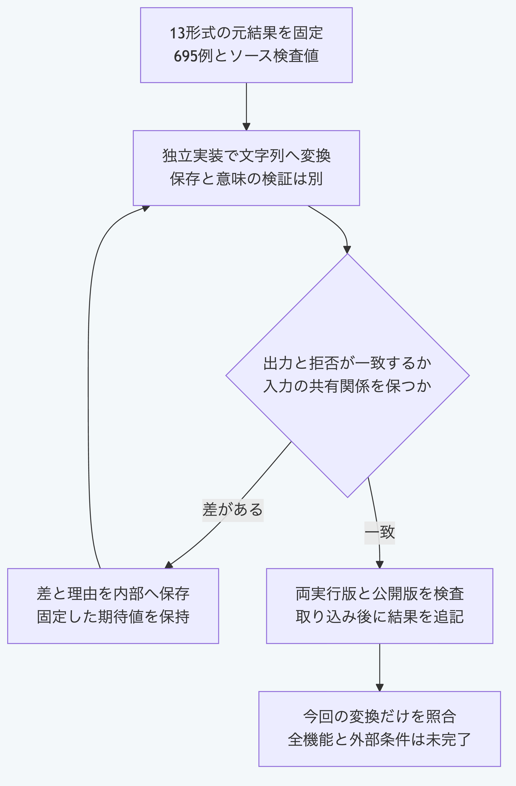

# Pythonで13形式の記録を文字列へ変換する

`serialize_yaml_record`は、判断の作成要求と改訂要求、Schema定義を含む13形式をYAML文字列へ変換します。
Pythonだけで実行でき、NodeとGitを呼び出しません。
ファイル保存と、記録の意味の検証は別に行います。
Python 3.14と3.15を検査対象とします。

## 最小の記録を変換する

公開リポジトリの直下から実行します。
この例は標準出力へ文字列を表示し、正本を書き換えません。

```sh
cd packages/portable-core
python3.15 -B - <<'PY'
from yaml_records import serialize_yaml_record

record = {"format": "morivyx.schema/0.1"}
source = serialize_yaml_record(record)
assert source == 'format: "morivyx.schema/0.1"\n'
print(source, end="")
PY
```

最小例の出力は次のとおりです。

```yaml
format: "morivyx.schema/0.1"
```

この入口は必須項目の意味を検証しないため、この最小例も変換できます。
採用可能な定義であることを示す結果ではありません。
実際の保存と採用では、その用途の検証入口へ接続します。

## 表現できない入力を確認する

```python
from schema_validation import ValidationError
from yaml_records import serialize_yaml_record

try:
    serialize_yaml_record({"format": "morivyx.schema/0.1", "probe": None})
except ValidationError as error:
    assert error.code == "YAML_SERIALIZATION_INVALID"
    assert error.path == "/probe"
```

項目名と文字列を正規化し、日時と安全な整数を既存の独立した規則で扱います。
循環参照、単独の代理文字、文字の正規化で重複する項目名と許可されない位置の`null`は拒否します。
共有した値は入力の共有関係を保持したまま、出力では値を展開します。
既存の`write_yaml`は10形式と既存のサイズ及び深さの制限を保持します。

## 照合の範囲を確認する

リポジトリ直下で次を実行します。

```sh
python3.15 -B -m unittest discover -s packages/portable-core -p test_yaml_serialization.py
```

実装前に元のNodeの結果695例を固定し、出力文字列、拒否の種類と位置及び入力の保持を照合します。
13形式、項目順、入れ子、配列、制御文字、共有と循環参照及び許可された空値の位置を含みます。
全入力の適合、ファイル保存、意味の検証、採用権限と本人性の証明は含みません。



[図の生成元](../diagrams/python-yaml-serialization.mmd)
