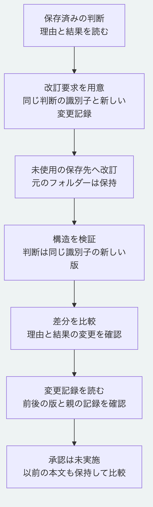

# 判断を改訂して履歴を比較する

この手順では、保存済みの判断の理由を「保存前に検証する」から「読み取り時にも検証する」へ改訂します。
元のフォルダーを保持し、同じ識別子の判断を新しい版として別のフォルダーへ保存します。
Node.js 26.13.0以上を使い、[最初の手順](getting-started.md)の第5節まで実行した状態から始めます。
以下はリポジトリ直下で実行します。

## 1. 改訂要求を読む

[改訂要求の実例](../../examples/getting-started/revise.yaml)を開きます。
主な項目は次のとおりです。

```yaml
format: "morivyx.decision-revision-request/0.1"
decisionId: "urn:uuid:00000000-0000-4000-8000-000000000002"
attributes:
  consequences:
    - "保存前と読み取り時に構造を検証する。"
  question: "設定の保存形式を何にするか？"
  rationale: "YAMLを維持し、読み取り時にも構造を検証する。"
changeSetId: "urn:uuid:00000000-0000-4000-8000-000000000004"
resultingRevision: "graph:tutorial-revised"
actor: "urn:uuid:00000000-0000-4000-8000-000000000009"
recordedAt: "2026-11-02T00:20:00Z"
```

`decisionId`は既存の判断と同じ値です。
`changeSetId`には未使用の識別子を指定し、`resultingRevision`も現在と異なる値にします。
`attributes`は差分の追記ではなく、改訂後の属性全体です。
残したい問いや結果も含めます。
この書式では文字列値を二重引用符で囲みます。
ルートの項目はこの例と同じ規定順、`attributes`内は文字の符号位置の昇順に並べます。
識別子と時刻は再現用のサンプル値です。
自分の記録に使う場合は、新しい識別子と実際の記録時刻に置き換えます。

## 2. 別の保存先へ改訂する

```sh
node packages/kernel/src/cli.js revise-decision .tutorial/after examples/getting-started/revise.yaml .tutorial/revised
node packages/kernel/src/cli.js validate .tutorial/revised
node examples/getting-started/read.mjs .tutorial/revised
```

改訂結果は`valid: true`、`graphRevision: "graph:tutorial-revised"`、`elementCount: 2`です。
判断を増やす操作ではないので、資料1件と判断1件のままです。
判断の識別子は末尾`000000000002`を維持し、内容の検査値である`decisionRevision`は変わります。
理由と結果に要求の内容が表示されます。
入力の`.tutorial/after`は変更しません。

改訂できる判断は`draft`または`active`です。
この例は`draft`を維持し、確認状態は`unreviewed`になります。
成功しても、承認や本人認証を済ませたことにはなりません。

## 3. 改訂前後を比較する

```sh
node packages/kernel/src/cli.js diff .tutorial/after .tutorial/revised --evaluated-at 2026-11-02T00:30:00Z
node examples/getting-started/read.mjs .tutorial/after
```

差分の`report.entries`は、同じ判断の理由と結果の変更を指します。
判断を追加する`entity_added`はありません。
2つ目のコマンドでは改訂前の理由が残っていることを確認できます。
版の検査値は、改訂前後の作成結果にある`decisionRevision`を比較します。

## 4. 変更記録を確認する

```sh
node examples/getting-started/history.mjs .tutorial/revised
```

この[読取例](../../examples/getting-started/history.mjs)は、保存された変更記録を表示します。
`parentRevision`は`graph:tutorial-decision`です。
`changeSets`は作成時と改訂時の計2件あります。
改訂時の記録では`baseRevision`が`graph:tutorial-decision`、`resultingRevision`が`graph:tutorial-revised`です。
その`operations`に、次の対応があります。

```text
op: revise
targetId: 同じ判断の識別子
beforeRevision: 改訂前のdecisionRevision
afterRevision: 改訂後のdecisionRevision
```

変更記録には前後の版を示す検査値を保存します。
この表示だけで、すべての祖先の本文を復元したり、履歴の真正性を認証したりするものではありません。
前の本文を比較できるよう、入力フォルダーも保持してください。

## うまく動かないとき

| 状況 | 対応 |
|---|---|
| 対象の判断がない | 最初の手順で`.tutorial/after`を作ったか確認する |
| 保存先が既にある | `.tutorial/revised-2`など未使用の名前を指定する |
| 変更記録の識別子が衝突する | 次の改訂では未使用の`changeSetId`と新しい`resultingRevision`を指定する |
| 残したい属性が消える | 要求の`attributes`に改訂後の属性全体を記載する |
| 元の正本を手で編集して検証が失敗する | 元を直接編集せず、要求と未使用の保存先で改訂する |

手順全体の実行確認は`node tools/check-getting-started.mjs`で行えます。
Pythonが必要です。
[利用手順の入口](README.md)へ戻れます。



[図の生成元](../diagrams/revise-decision-tutorial.mmd)
