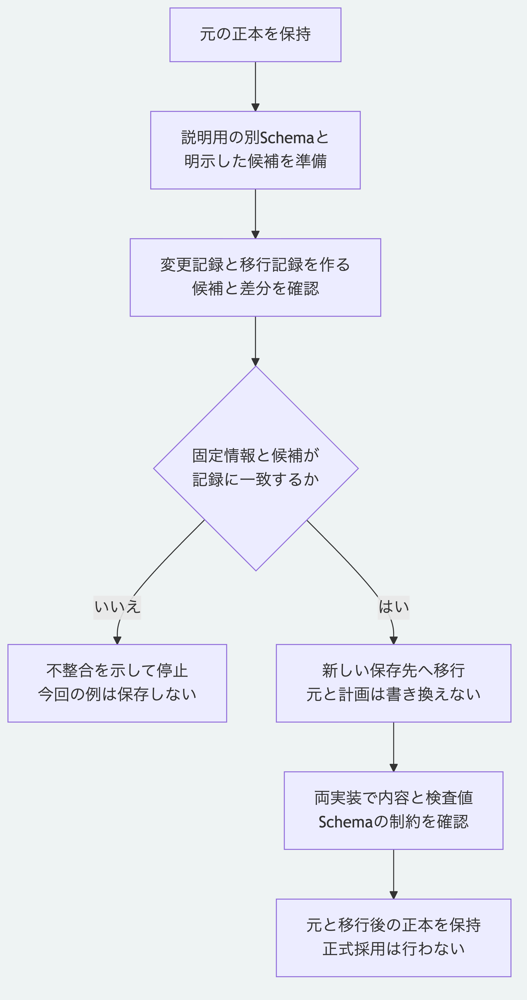

# Schemaを変えて新しい正本へ移行する

資料の記録に注記を1つ加え、その属性を許すSchemaへ移行します。
元の正本を保持し、別の保存先に移行後の正本を作ります。
この例のSchemaの版`0.2`は説明用で、Morivyxの正式な新しい版の公開を意味しません。

Node.js 26.13.0以上と、検証用のPython 3.14または3.15を使います。
ソース取得と依存の導入は[最初の手順の第1節](getting-started.md)で済ませ、以下をリポジトリ直下で実行します。
操作はローカルで完結します。

## 1. 元の正本と移行の入力を準備する

```sh
mkdir -p .tutorial
node examples/getting-started/prepare.mjs .tutorial/schema-source
node examples/schema-migration/prepare.mjs .tutorial/schema-source/base .tutorial/schema-plan
```

1つ目の例は資料が1件の正本を作り、2つ目の[準備例](../../examples/schema-migration/prepare.mjs)は移行の入力を作ります。
この手順では、同時に作られる`schema-source/decision.yaml`は使いません。
既存の保存先は再利用しないため、既に同名のフォルダーがある場合は別の名前を指定します。
計画の保存先も元の正本の外に置きます。

準備の結果は`prepared: true`で、まだ移行後の正本は保存していません。
元の版は`graph:tutorial-base`、移行後の予定の版は`graph:tutorial-migrated`です。
元と移行先の`schemaLockDigest`が異なります。

| 入力 | 役割 |
|---|---|
| `schema-source/base/.morivyx` | 変更しない元の正本 |
| `schema-plan/target/schemas/morivyx.core@0.2.yaml` | `core.artifact`に任意の属性`migrationNote`を許す説明用のSchema |
| `schema-plan/target/schema.lock.yaml` | 移行先のSchemaの名前、版と定義の検査値を固定する |
| `schema-plan/candidates/artifact.yaml` | 移行後の要素の完全な候補。注記と型の版を明示する |
| `schema-plan/changeset.yaml` | 元と移行後の要素の版を対応させる変更記録 |
| `schema-plan/diff.yaml` | 要素とSchemaの変更を示す差分の報告 |
| `schema-plan/migration.yaml` | 元と移行先の固定情報、変更記録、差分と結果の検査値を結ぶ移行記録 |
| `schema-plan/revision.yaml` | 元の版を親とする移行後の版 |

準備例は、この資料1件に限定したJavaScriptの実装例です。
任意のSchemaの差を解釈して変換を自動生成する道具ではありません。
`rules.json`と`mapping.json`には例の説明と明示した対応を保存し、そのファイル全体のSHA-256を`rulesDigest`と`mappingDigest`へ記録します。
移行コマンドがこれらのJSONを読み込んで規則として実行することや、外部の規則本文の検査値を自動照合することはありません。

## 2. 候補と差分を確認する

```sh
cat .tutorial/schema-plan/mapping.json
cat .tutorial/schema-plan/candidates/artifact.yaml
node packages/kernel/src/cli.js report .tutorial/schema-plan/diff.yaml
```

候補の`typeVersion`は`0.2`、追加した`attributes.migrationNote`は「説明用の移行で加えた注記。」です。
資料の識別子、元の属性、作成時の主体、下書きの状態と未確認の状態は保持します。
内容を変えたため、要素の`revision`と全体の`rootDigest`も変わります。

差分の`entries`には`entity_revised`と`schema_changed`が各1件あります。
`valid: true`は報告の形式が有効であるという意味で、移行の採用や内容の正しさの承認ではありません。
候補だけを手で変えた場合は、要素の版、変更記録、全体の検査値と差分を含めて一致させる必要があります。
この例では準備のコードで変更を明示し、新しい計画の保存先を使って再計算します。

## 3. 新しい保存先へ移行する

```sh
node packages/kernel/src/cli.js migrate .tutorial/schema-source/base .tutorial/schema-plan/migration.yaml .tutorial/schema-plan/changeset.yaml .tutorial/schema-plan/diff.yaml .tutorial/schema-plan/revision.yaml .tutorial/schema-result --target-schema .tutorial/schema-plan/target --candidates .tutorial/schema-plan/candidates
node packages/kernel/src/cli.js validate .tutorial/schema-result
node packages/kernel/src/cli.js inspect .tutorial/schema-source/base
node packages/kernel/src/cli.js inspect .tutorial/schema-result
```

移行と検証の結果は`valid: true`です。
元の正本は`graph:tutorial-base`、移行後は`graph:tutorial-migrated`で、どちらも資料が1件です。
移行後には、Schemaの本文と固定情報、候補の要素、変更記録、移行記録及び差分の報告を保存します。
元の正本と計画の入力は書き換えません。
同じ保存先を指定して移行をもう一度実行すると、`PACKAGE_OUTPUT_EXISTS`で拒否し、既存の正本を保持します。

移行は、明示した変更と検査値の一致及び移行先のSchemaの制約を確認する操作です。
暗黙の値変換、規則の実行、本人認証、署名の確認と正式採用は行いません。

## 4. Pythonでも内容と制約を確認する

```sh
python3 -B packages/portable-core/package_records.py .tutorial/schema-result/.morivyx
python3 -B packages/portable-core/package_validation.py .tutorial/schema-result/.morivyx --previous .tutorial/schema-source/base/.morivyx
```

読取結果の`graphRevision`は`graph:tutorial-migrated`です。
`calculatedRootDigest`と`calculatedSchemaLockDigest`を、移行結果の`rootDigest`と`schemaLockDigest`へそれぞれ照合します。
検証結果は`valid: true`、`validation.graphConstraintsValidated: true`です。
`signaturesValidated`と`historyAncestryValidated`は`false`で、署名とGitの祖先関係全体の検証には数えません。
Pythonの安全なファイル読取はPOSIXの操作を使い、この手順はmacOSで確認しています。

## 失敗した場合

| 結果の`issues`にあるコード | 確認する入力 |
|---|---|
| `MIGRATION_TARGET_SCHEMA_MISMATCH` | 移行先の定義、固定情報と移行記録の検査値が一致するか |
| `CHANGESET_CANDIDATE_REVISION_MISMATCH` | 候補の本文と`revision`、変更記録の移行後の版が一致するか |
| `CHANGESET_PRECONDITION_FAILED` | 変更記録が要求する候補を渡したか、元の要素の版が一致するか |
| `PACKAGE_OUTPUT_EXISTS` | 保存先を既に使っていないか。上書きせず新しい保存先を指定する |

失敗時は終了コードが0以外になり、`valid: false`と`issues`を確認できます。
準備例自体の失敗は標準エラーへ出力し、JSONを返しません。

## 手順の自動確認

```sh
node tools/check-schema-migration-tutorial.mjs python3
```

[実行確認](../../tools/check-schema-migration-tutorial.mjs)は、一時領域のサンプルだけに書き込みます。
元と計画の保持、明示した属性と型の版だけの変更、既存保存先の保持及び元の正本の中への計画の保存の拒否を確認します。
不一致な固定情報、本文を変えて版を更新しない候補及び不足した候補では、失敗して保存先を作らないことを確認します。
コピーしたPython実装と両方の正本を使い、Node.jsとGitを子プロセスのPATHから除いた状態で内容、記録、根とSchemaの検査値を照合します。
OSによる完全な隔離を実証する検査ではありません。



[図の生成元](../diagrams/schema-migration-tutorial.mmd)

[利用手順の入口](README.md)へ戻れます。
