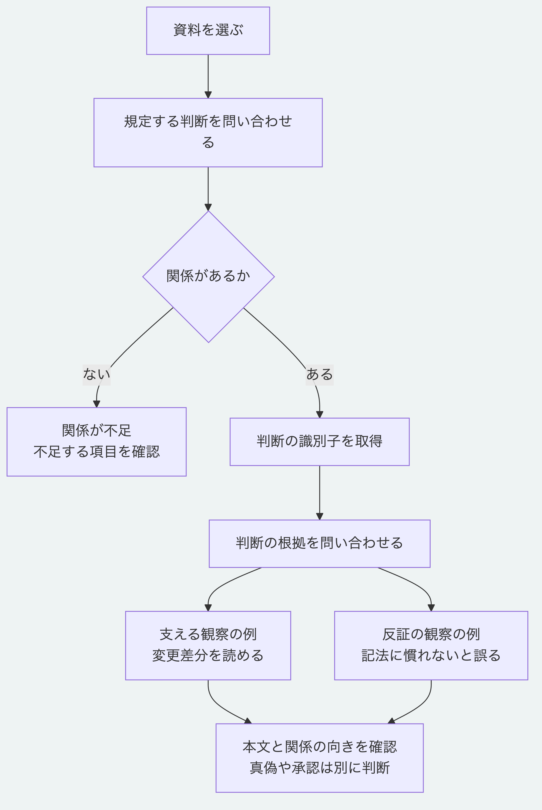

# 資料から判断と根拠をたどる

この手順では、資料と判断を結び、判断を支える情報と反証をたどります。
[最初の手順](getting-started.md)の第5節まで実行し、`.tutorial/after`を作った状態から始めます。
Node.js 26.13.0以上を使い、リポジトリ直下で実行します。
改訂のチュートリアルを先に実行する必要はありません。

## 1. 関係がない状態を確認する

```sh
node packages/kernel/src/cli.js trace .tutorial/after --query governing-decision --focus urn:uuid:00000000-0000-4000-8000-000000000001 --evaluated-at 2026-11-02T00:50:00Z
```

`report.status`は`partial`、`paths`は空、`missing`は`["governs"]`です。
資料と判断が保存されていても、両者の関係がなければ追跡できません。
`valid: true`は操作結果の形式が有効という意味で、関係が揃うことや判断の正しさを意味しません。

## 2. 関係のあるサンプルを保存する

```sh
node examples/getting-started/link.mjs .tutorial/after .tutorial/linked
node packages/kernel/src/cli.js validate .tutorial/linked
node examples/getting-started/read.mjs .tutorial/linked
```

[この生成例](../../examples/getting-started/link.mjs)は既存の`writeAppliedPackage`を使います。
一般用途の関係追加コマンドではなく、このチュートリアルの識別子とSchemaを使う実装例です。
入力を保持し、未使用の保存先へ観察の例2件と関係3件を加えます。
要素は計7件、保存先の版は`graph:tutorial-linked`、検証結果は`valid: true`です。
観察の本文は説明用に作った値で、実際の計測結果ではありません。
要素と関係は下書きかつ未確認です。

| 関係 | 始点 | 終点 | サンプルでの意味 |
|---|---|---|---|
| `governs` | 判断、末尾`000000000002` | 資料、末尾`000000000001` | 判断が資料を規定する |
| `supported_by` | 同じ判断 | 観察、末尾`000000000011` | 変更差分を読めるという例を根拠にする |
| `challenged_by` | 同じ判断 | 観察、末尾`000000000012` | 記法の難しさという例を反証にする |

各関係の`attributes`には`source`、`predicate`、`target`を記録します。
資料から判断を探すときも、保存する`governs`の向きは判断から資料です。
[Schema](../schema/morivyx.core@0.1.yaml)は、`governs`の始点を判断に制限します。
`challenged_by`は判断または知識から、知識または観察へ向かいます。
`supported_by`は判断、知識または学習から、資料、知識または観察へ向かいます。
相手の識別子が存在することに加え、型と向きも検証対象です。

## 3. 資料を規定する判断を探す

```sh
node packages/kernel/src/cli.js trace .tutorial/linked --query governing-decision --focus urn:uuid:00000000-0000-4000-8000-000000000001 --evaluated-at 2026-11-02T00:50:00Z
```

`report.status: "complete"`、`missing: []`になり、経路は1件です。
`paths[0].hops[0]`に次の対応があります。

```text
fromId: 末尾000000000002の判断
predicate: governs
toId: 末尾000000000001の資料
```

## 4. 判断の根拠と反証を読む

```sh
node packages/kernel/src/cli.js trace .tutorial/linked --query decision-evidence --focus urn:uuid:00000000-0000-4000-8000-000000000002 --evaluated-at 2026-11-02T00:50:00Z
```

焦点を資料から判断に変えます。
結果は`complete`で、`paths`に`supported_by`と`challenged_by`の経路が各1件あります。
それぞれの`toId`を第2節の読取結果と照合すると、根拠と反証の本文が読めます。
関係の追跡は、根拠の真偽の判定、反証への対応や判断の承認を行いません。

## 5. 別の問いで不足を読む

```sh
node packages/kernel/src/cli.js trace .tutorial/linked --query why-artifact-exists --focus urn:uuid:00000000-0000-4000-8000-000000000001 --evaluated-at 2026-11-02T00:50:00Z
```

結果は`partial`、`missing: ["produces"]`です。
この問い合わせは、資料を生んだ実行、その計画と目標の経路を探します。
今回追加した判断の関係とは別の経路で、このサンプルには含めていません。
`complete`は、指定した問い合わせに必要な経路が揃ったことだけを示します。

| 結果 | 読み方 |
|---|---|
| `complete` | 指定した問い合わせに必要な経路が揃っている |
| `partial` | 焦点はあるが必要な関係が不足している。`missing`を確認する |
| `broken` | 焦点がない、型が違う、参照先が壊れている等。`missing`と入力を確認する |

例えば`decision-evidence`の焦点へ資料の識別子を渡すと、`broken`と`focus-type`になります。
操作の終了値や最上位の`valid`だけで、経路の状態を判定しないでください。

実行確認は`node tools/check-trace-tutorial.mjs`で行えます。
入力の保持、保存先の上書き拒否、経路の識別子と状態も確認します。
[利用手順の入口](README.md)へ戻れます。



[図の生成元](../diagrams/trace-relations-tutorial.mmd)
